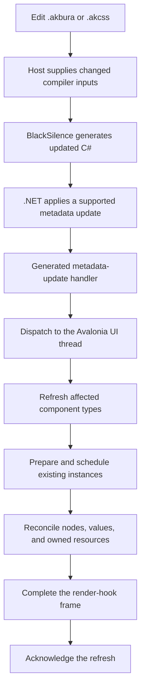
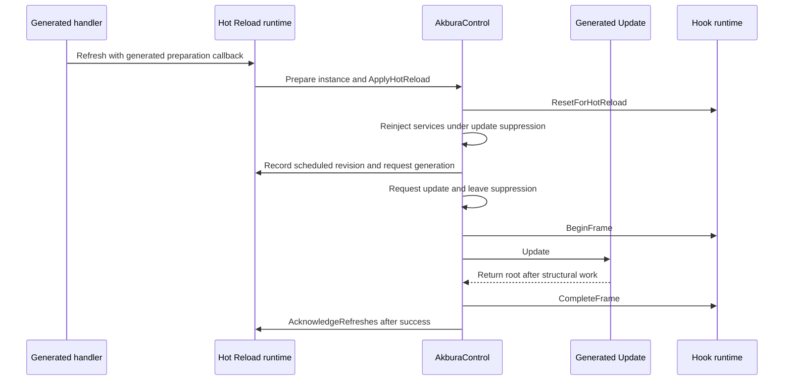
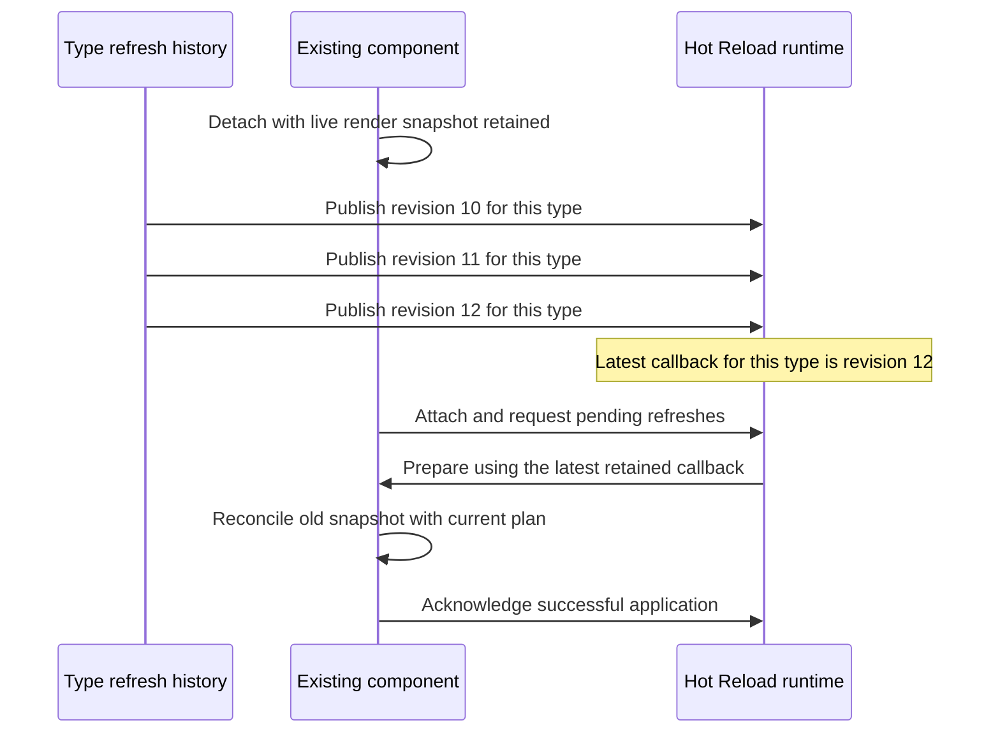
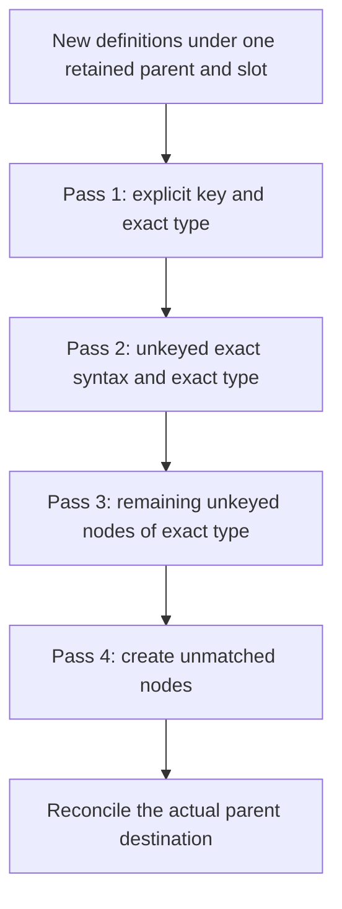
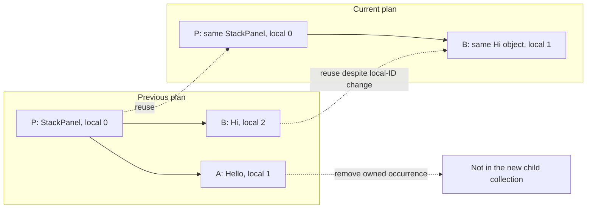
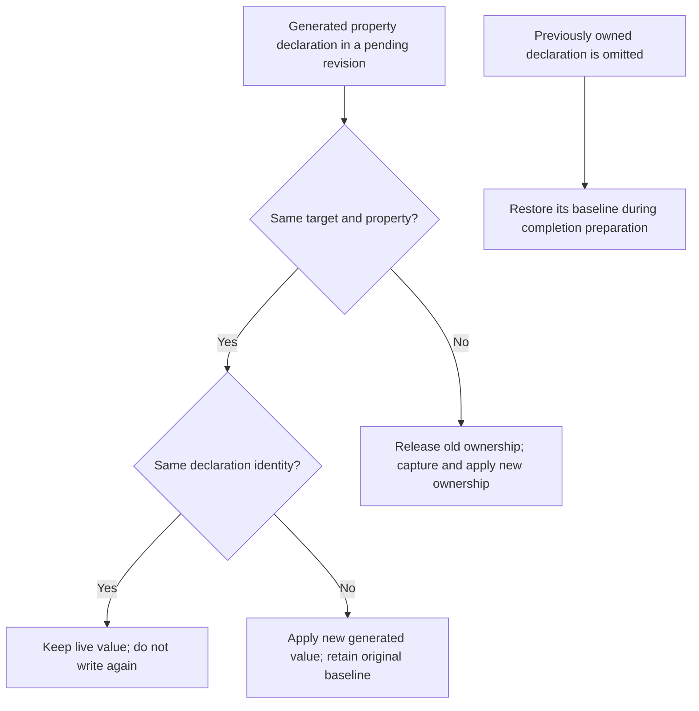
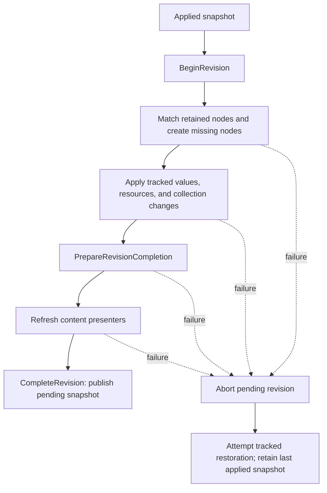
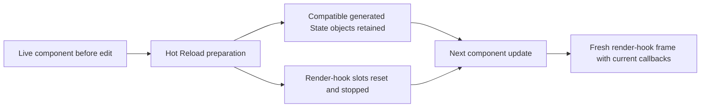

# How Hot Reload Works

Akbura Hot Reload updates a running component without unconditionally replacing its control tree. The generator produces an update-friendly C# contract, .NET applies the supported code changes, and Akbura reconciles the new declarations with the objects already in memory.

The central idea is:

> Update the generated instructions, preserve compatible live objects, and explicitly reconcile the resources and values owned by those instructions.

This guide explains the implementation for contributors working on the generator, runtime, or tests. In particular, it includes the render-hook reset and lifecycle changes in that revision. The examples are explanations of the implementation, not a promise that every illustrated source edit is accepted by every .NET Hot Reload host.

Diagrams use Mermaid and are embedded directly in this Markdown file. GitHub can render these fenced blocks without separate image assets. See [GitHub's diagram documentation][mermaid-docs] for renderer details.

## Contents

- [1. The two layers of Hot Reload](#1-the-two-layers-of-hot-reload)
- [2. Why Debug generates a different control representation](#2-why-debug-generates-a-different-control-representation)
- [3. From a metadata update to a component refresh](#3-from-a-metadata-update-to-a-component-refresh)
- [4. Descriptor and state preparation](#4-descriptor-and-state-preparation)
- [5. Refresh revisions, scheduling, and acknowledgment](#5-refresh-revisions-scheduling-and-acknowledgment)
- [6. The structural render plan](#6-the-structural-render-plan)
- [7. How old and new nodes are matched](#7-how-old-and-new-nodes-are-matched)
- [8. Worked example: inserting and removing children](#8-worked-example-inserting-and-removing-children)
- [9. Property values and declaration ownership](#9-property-values-and-declaration-ownership)
- [10. Collection reconciliation](#10-collection-reconciliation)
- [11. Bindings, events, and AKCSS](#11-bindings-events-and-akcss)
- [12. Structural completion and rollback](#12-structural-completion-and-rollback)
- [13. Render hooks during Hot Reload](#13-render-hooks-during-hot-reload)
- [14. An end-to-end edit](#14-an-end-to-end-edit)
- [15. Supported scope and important boundaries](#15-supported-scope-and-important-boundaries)
- [16. Debugging a failed refresh](#16-debugging-a-failed-refresh)
- [17. Tests contributors should add](#17-tests-contributors-should-add)
- [18. Source map and contributor checklist](#18-source-map-and-contributor-checklist)
- [19. AKCSS baseline implementation and verification](#19-akcss-baseline-implementation-and-verification)
- [20. AKCSS incremental reconciliation](#20-akcss-incremental-reconciliation)
- [21. AKCSS property ownership and transactions](#21-akcss-property-ownership-and-transactions)
- [22. AKCSS update batching and indexed conflict resolution](#22-akcss-update-batching-and-indexed-conflict-resolution)
- [23. BlackSilence document dependencies and reload latency](#23-blacksilence-document-dependencies-and-reload-latency)
- [24. C# semantic probes and compilation latency](#24-c-semantic-probes-and-compilation-latency)
- [25. Immutable element names](#25-immutable-element-names)

## 1. The two layers of Hot Reload

There are two separate mechanisms involved.

**.NET Hot Reload changes executable code and metadata.** The development host detects changes, obtains updated compilation output, and applies the edits supported by its runtime and debugger. Akbura's generated code participates in that process.

**Akbura Hot Reload updates existing component instances.** After the metadata update, Akbura refreshes generated descriptors, schedules affected components, reconciles their render trees, and rebuilds their render-hook frames.

Akbura's runtime is not a second parser that reads a modified `.akbura` file. The new instructions arrive as updated generated C# methods and data. The source generator reads `.akbura` and `.akcss` through Roslyn's additional-text pipeline; the runtime consumes the resulting contract.



A source edit can therefore fail at different layers. A compilation error or unsupported metadata edit prevents the new code from reaching Akbura's runtime. A reconciliation or effect failure happens later, after updated code has arrived. Diagnosing one as the other leads to fixes in the wrong subsystem.

**Read:** [the incremental generator][generator], [the generated update handler writer][handler], and [the .NET metadata-update handler contract][metadata-docs].

## 2. Why Debug generates a different control representation

The generator selects `ComponentGenerationMode.DebugStructural` when the consuming C# parse options contain the `DEBUG` preprocessor symbol. Otherwise, it selects `ReleaseDirect`. The selection is based on the symbol, not merely on a configuration's display name.

In the direct representation, generated code can use ordinary fields and direct element references. That is convenient for normal execution, but tying each element to a separate CLR field makes structural source edits change the component's metadata shape.

The structural representation instead places eagerly created component-scope elements in an `AkburaRenderState`. The component contains a stable runtime-store field, and generated expressions retrieve the current objects through local identifiers.

The important generated members are:

| Member | Responsibility |
| --- | --- |
| `__akburaRenderState` | Retains live objects and the last applied structural snapshot. |
| `__AkburaCurrentRenderRevision()` | Returns the current render-plan fingerprint. |
| `__AkburaDescribeRenderTree(...)` | Describes the current nodes and their structural relationships. |
| `__AkburaCreateRenderNode(int)` | Constructs a missing node for a current-plan identifier. |
| `__AkburaEnsureRenderTree()` | Starts reconciliation when the plan is different or was invalidated. |

For example, this is a simplified generated-code excerpt, with qualification and attributes omitted:

```csharp
private readonly AkburaRenderState __akburaRenderState = new();

private static object __AkburaCreateRenderNode(int localId)
{
    return localId switch
    {
        0 => new StackPanel(),
        1 => new TextBlock(),
        2 => new Button(),
        _ => throw new ArgumentOutOfRangeException(nameof(localId)),
    };
}

private bool __AkburaEnsureRenderTree()
{
    return __akburaRenderState.BeginRevision(
        __AkburaCurrentRenderRevision(),
        __AkburaDescribeRenderTree,
        __AkburaCreateRenderNode);
}
```

The factory describes how to create an object **when no old object can be reused**. It does not recreate every object on every update. Generated access to an existing element uses expressions such as:

```csharp
var button = __akburaRenderState.GetRequired<Button>(2);
```

Adding an unnamed eager child can now change the description and factory method bodies without requiring another per-element field. Existing `x.Name` elements receive typed accessors backed by the runtime store.

This is a targeted metadata-stability strategy, not a guarantee that arbitrary source edits preserve CLR shape. Adding named members, changing state declarations, or changing compiler-generated closure shapes can still involve metadata changes outside that strategy. The emitted-metadata tests are important precisely because stable-looking generated source alone is not enough.

**Read:** [mode selection][generator], [structural code generation][structural-writer], and [metadata-contract tests][metadata-tests].

## 3. From a metadata update to a component refresh

`HotReloadServiceWriter` generates `Akbura.HotReloadService.g.cs`. Under `#if DEBUG`, that file registers an assembly-specific handler through `MetadataUpdateHandlerAttribute`.

The handler has the two .NET callbacks:

```csharp
internal static void ClearCache(Type[]? updatedTypes)
internal static void UpdateApplication(Type[]? updatedTypes)
```

Akbura's generated `ClearCache` clears affected AKCSS observed-property metadata before refresh. The actual component refresh work begins in `UpdateApplication`. The .NET contract calls cache-clearing callbacks before application-update callbacks; Akbura performs its generated descriptor reconciliation in the application-update path.

### UI-thread handoff

`UpdateApplication` checks `Dispatcher.UIThread.CheckAccess()`. On the UI thread, it runs `UpdateApplicationCore` immediately. Otherwise, it posts that work to the UI dispatcher.

Posting the callback is not the same as completing a refresh. The component's successful-update acknowledgment happens substantially later.

### Selecting affected types

`UpdateApplicationCore` has two paths:

| Input | Selection |
| --- | --- |
| `updatedTypes` is `null` | Refresh every generated component known to this handler. |
| The generated handler itself is included | Refresh every known component, using the current generated list. |
| A concrete type list is supplied | Select affected component types and consumers of affected generated AKCSS modules. |

The generated `Affects` helper checks the updated type and walks its `DeclaringType` chain. It also checks whether that type is assignable from a candidate component type. This accounts for updates reported against nested types and for affected base types.

The resulting component types are ordered with base types first. The handler then calls each selected component's generated `__AkburaHotReloadApply()` method. Failures are collected so that one component type does not prevent attempts to refresh the others.

This is not a general dependency graph for arbitrary helper methods. A change in an unrelated service or utility type should not automatically be assumed to invalidate every component that calls it.

**Read:** [handler generation and filtering][handler].

## 4. Descriptor and state preparation

`__AkburaHotReloadApply()` separates three concerns: generated descriptor shape, generated state shape, and instance render preparation.

A *shape* is a fingerprint computed by the generator. It describes the relevant declaration contract; it is not a snapshot of the live values currently held by a component.

### Descriptor shape

Descriptors include parameters, injected services, and commands. Their stable keys incorporate semantic identity rather than source position. For example, a parameter key includes its name, type, and property kind; a service key includes its name and type; a command key includes its signature.

The descriptor fingerprint contains additional details that can affect a descriptor's behavior, including parameter flags and default-value syntax.

The last applied descriptor and state fingerprints and property manifest are held
by `AkburaHotReloadMetadata` in a runtime `ConditionalWeakTable` keyed by the
component type. Generated Debug components do not have `s_akburaApplied*Shape` or
`s_akburaHotReloadProperties` fields. The existing service-array initializer
registers the initial snapshot after the generated descriptor fields initialize,
including when a static descriptor is accessed before any instance is created.
Reading the runtime metadata explicitly ensures that static initialization has run.

When the descriptor shape changes, generated code:

1. Saves the previous property manifest and computes the current descriptor keys.
2. Removes obsolete generated Avalonia property registrations.
3. Reuses compatible property objects through `FindProperty<TProperty>()`, creates replacements where needed, and rebuilds descriptor arrays.
4. Publishes the current manifest and applied descriptor-shape fingerprint.

Preserving a compatible Avalonia property object's identity matters because existing instances may already hold values associated with that property. Descriptor changes should not unnecessarily create a second property identity for the same compatible declaration.

`AvaloniaPropertyRegistryHotReload` isolates the compatibility-sensitive part. It accesses Avalonia's registry maps and caches through reflection, removes obsolete registrations for the specific owner, and clears the relevant caches. A private-field layout mismatch produces a `NotSupportedException`, not an attempted silent fallback.

> **Contributor rule:** An Avalonia dependency upgrade must be checked against this registry adapter. Do not replace targeted unregistering with a blanket removal of all properties belonging to a component.

### State shape

State identity is based on the state name, value type, and factory kind: a value initializer and a state-producing hook are different contracts. The state fingerprint is built from the ordered state keys. It does **not** include the initializer expression.

This distinction is deliberate. Changing:

```akbura
state int count = 0;
```

into:

```akbura
state int count = 100;
```

does not overwrite an already-created compatible `State<int>` object with `100`.

Generated Debug state access is lazy, conceptually:

```csharp
private State<int> CountState =>
    RuntimeStates.GetOrCreate(
        "state:count:System.Int32:value:None:",
        () => CreateState(__AkburaCreateStateInfo_count()));
```

The real member names include generated identity information. `GetOrCreate`
retains an existing compatible state and its current value. Its factory creates
the `StateInfo` only when a new state is needed, so new instances use the updated
initializer without a static metadata field. Release retains direct state fields
and static readonly `StateInfo` fields.

When the state shape changes, the instance preparation callback invalidates the
runtime collection's snapshot. Hook aliases are staged in a runtime transaction;
commit installs the new aliases and reconciles removed state resources, while
abort restores the previous cached snapshot. The old Hot Reload snapshot remains
available until a frame commits successfully.

> **Important:** Despite its name, `__AkburaHotReloadResetStates()` does not clear ordinary runtime states. It invalidates the cached snapshot. Compatible state objects can survive; new or incompatible identities do not receive automatic value migration.

Renaming a state or changing its type is therefore different from editing its initializer. Such changes also remain subject to the host's ability to apply the resulting CLR metadata edits.

### Instance preparation

In structural mode, the ordinary preparation callback calls:

```csharp
__component.__akburaRenderState.Invalidate();
```

Invalidation clears the applied render fingerprint but retains the live-node snapshot. The next update must reconsider the current plan even if its local fingerprint has not changed, which is useful for changes outside the element's own markup.

The generator also contains a direct-mode preparation path that reapplies generated initial values. Do not confuse that path with the structural mode selected for a normal `DEBUG` compilation.

**Read:** [component Hot Reload generation][component-hot-reload], [identity generation][identity], [state generation][state-writer], and [the registry adapter][registry-adapter].

## 5. Refresh revisions, scheduling, and acknowledgment

`AkburaHotReloadRuntime` coordinates instance refreshes. It does not use one boolean saying that a component is up to date.

### Different identifiers answer different questions

| Identifier | Question it answers |
| --- | --- |
| Descriptor/state fingerprint | Did this generated declaration contract change? |
| Render fingerprint | Is this the same generated structural plan? |
| Global refresh revision | Which published type refresh is newer? |
| Component creation revision | Which refreshes predate this instance? |
| Per-component request generation | Which scheduled update completed successfully? |
| Plan `LocalId` | Where is a node in the current description? |
| Runtime `NodeId` | Which retained live node is this across descriptions? |

These identities must not be substituted for one another. A render fingerprint does not prove that effects completed, and a local identifier is not a stable cross-edit node identity.

### Tracking instances without retaining them forever

`AkburaComponentRegistry` tracks participating attached components through weak references. Excluded top-level windows do not participate; the diagnostics window uses this mechanism.

The Hot Reload runtime keeps per-instance applied and scheduled revisions in a `ConditionalWeakTable`. Separately, it retains the **latest preparation callback per component type** so an older detached instance can catch up later.

The type-level callback should not capture a particular component instance. Otherwise, a callback intended to describe how to refresh a type could accidentally keep an instance alive.

### The attached-instance path

For a matching participating component, the runtime invokes any required preparation callbacks and calls `AkburaControl.ApplyHotReload`.

That method suppresses component updates while it resets render hooks, reinjects services, records a new request generation, and requests an update. Suppression prevents an intermediate state change from running the update before preparation has finished.



Acknowledgment happens only after `Update()` returns, `Child` is assigned, and the hook frame completes. The runtime moves eligible scheduled revisions into the applied-revision map at that point.

If an update fails, the request generation is retained as pending. Later update processing or another refresh attempt can retry it. A scheduled refresh is not falsely recorded as applied merely because its preparation callback ran.

Reentrant refresh requests are handled through `IsApplying` and `NeedsDrain`; they request another drain rather than recursively running the same refresh application. This is separate from `AkburaControl`'s nonrecursive update loop and its `MaxUpdatesPerBatch` guard.

### Detached-instance catch-up

A component records the currently published revision when it is created. An older instance that is detached when a refresh occurs is not refreshed through the attached-component registry. On its next participating attach, it is checked against newer applicable revisions.

Only the newest callback for a given component type is retained. Missed structural revisions are coalesced, not replayed one by one.



An instance created after a refresh's publication starts with that creation baseline; it does not need to replay the preceding history. Multiple applicable type refreshes, such as base and derived component refreshes, still have their own revision bookkeeping.

**Read:** [refresh coordination][hot-reload-runtime], [the component registry][component-registry], and [component update integration][control].

## 6. The structural render plan

`AkburaRenderNodeDefinition` describes a node using six pieces of information:

| Field | Meaning |
| --- | --- |
| `LocalId` | Dense identifier in the current plan, starting at zero. |
| `ParentId` | Current-plan parent; the root uses `-1`. |
| `Slot` | Semantic destination under the parent, such as a collection or scalar property. |
| `Type` | Exact runtime type expected from the factory. |
| `ExplicitKey` | Optional source identity; currently derived from `x.Name`. |
| `SyntaxIdentity` | Hash of the node's own normalized declaration. |

The plan builder requires one root, dense identifiers, and parents appearing before their children. Duplicate explicit keys within the same parent and slot are rejected.

The slot is not just an arbitrary child index. For example, a parent's content property and its children collection are different destinations. Matching must not transfer an object between unrelated properties merely because the object's type happens to match.

### What the syntax identity includes

`ComponentHotReloadIdentity.CreateRenderSyntaxIdentity()` hashes the start tag and non-element body content. Nested element declarations are excluded from their parent's own identity.

Consequently, inserting a child does not automatically make the parent's own declaration appear changed. This helps preserve a parent's live values when only its descendants are edited.

Normalization uses token kinds and token values, excluding trivia. This is not a rule that every whitespace change is irrelevant: meaningful markup text remains part of the token content.

On an ordinary update, `BeginRevision()` returns `false` when the current fingerprint already matches. The generated component can still evaluate dynamic expressions and register render hooks without reconstructing the structural description on every state change.

**Read:** [the plan builder][plan-builder], [the structural writer][structural-writer], and [syntax and slot identities][identity].

## 7. How old and new nodes are matched

Matching runs within a group identified by a **retained parent node identity and a semantic slot**. The runtime processes parents before children so it can determine the correct old sibling group for each new parent.

For each group, `MatchGroup()` performs four passes in order:



### Pass 1: explicit identity

An explicitly keyed node matches an old node with the same key and exact type. At this revision, the generator derives the key from `x.Name`:

```akbura
<TextBox x.Name="query" Text="Search" />
```

Keyed nodes do not fall back to unkeyed matching when their key changes. A renamed key is therefore an identity change, not merely a cosmetic rename from the reconciler's perspective.

Keys are scoped to the parent and slot. `x.Name` is not a global command to move a live control between arbitrary parents. Replacing a parent can prevent its old descendants from being candidates for reuse under the new parent.

### Pass 2: exact declaration matching

For unkeyed nodes, the runtime first looks for the same exact type and syntax identity. When several old candidates have identical declarations, it chooses the closest sibling position, using the earlier old position to break a tie.

This pass is what lets an unchanged later sibling survive the removal of an earlier sibling of the same type.

### Pass 3: type fallback

Remaining unkeyed nodes match remaining old nodes of the same exact type in old sibling order. This lets an edited declaration reuse an object even though its syntax hash changed.

Despite the method name `MatchCompatibleTypes`, the implementation requires type equality, not general assignability. A different derived type is not interchangeable with the original runtime type.

### Pass 4: construction

Unmatched nodes are created by the current factory and receive new runtime `NodeId` values. The runtime rejects a null result, an unexpected concrete type, or one object reused for multiple nodes. New objects implementing `ISupportInitialize` are tracked through their initialization lifecycle.

Reused nodes retain both their CLR object reference and their runtime `NodeId`. Their current `LocalId` can be different.

> **Identity limit:** Two identical unkeyed siblings do not contain enough information to recover an author's intended business identity after arbitrary edits. The implementation makes a deterministic choice; it does not infer invisible identities. Use an existing explicit name where identity matters, and test ambiguous cases rather than assuming perfect preservation.

**Read:** `MatchGroup`, `MatchExplicitKeys`, `MatchExactSyntax`, `MatchCompatibleTypes`, and `CreateUnmatchedNodes` in [the render state][render-state], plus [planner key selection][planner].

## 8. Worked example: inserting and removing children

Start with:

```akbura
using Avalonia.Controls;

<StackPanel>
    <TextBlock Text="Hello" />
    <TextBlock Text="Hi" />
</StackPanel>
```

For illustration, assign the live objects the runtime identities `P`, `A`, and `B`. These letters stand for actual `NodeId` values; they are not keys supplied by the source.

Now remove the first `TextBlock`:

```akbura
using Avalonia.Controls;

<StackPanel>
    <TextBlock Text="Hi" />
</StackPanel>
```

| Object | Old local ID | New local ID | Result |
| --- | ---: | ---: | --- |
| StackPanel `P` | 0 | 0 | Reused. |
| TextBlock `A`, `Text="Hello"` | 1 | — | No longer owned by the new child collection. |
| TextBlock `B`, `Text="Hi"` | 2 | 1 | Reused through exact syntax matching. |



The runtime does not decide that “local ID 1 survived, so it must be the first old text block.” The exact syntax match for `Hi` is considered before type-only fallback.

The inverse case is similar. Adding a previously absent `TextBlock Text="Hi"` after `Hello` preserves the old `Hello` object and constructs only the missing child. The collection reconciler inserts the new object without clearing the whole collection.

A changed literal is a different case. Changing the only unkeyed child from `Text="Hello"` to `Text="Welcome"` can reuse it through the exact-type fallback, then update the changed property declaration.

**Read:** [node matching][render-state] and [generated integration tests][integration-tests].

## 9. Property values and declaration ownership

Preserving an object reference is not enough. Reapplying every generated assignment to that same object would still destroy user-entered values.

The runtime therefore tracks declaration ownership at the property level. A retained node can have a changed start tag while only one of its property declarations actually needs to be reapplied.

Consider:

```akbura
<TextBox Text="Generated" Width="100" />
```

The user types `User value`. The source is then changed to:

```akbura
<TextBox Text="Generated" Width="200" />
```

The expected result is the **same TextBox**, with `Width` updated to `200` and live `Text` still equal to `User value`. The integration suite contains this scenario.

`ReconcileClrValue` and `ReconcileAvaloniaValue` record the generated declaration, its target, and its baseline. When the target and property still match, an unchanged declaration retains the previous property state without writing the generated value again.



### Baseline versus current value

The baseline is the value or property state associated with the ownership mechanism before the generated declaration took control. It is not necessarily the latest value written by application code.

Removing an owned declaration releases that ownership and restores the recorded baseline. It should not simply leave the last generated value in place forever. Changing the declaration repeatedly should not make each intermediate generated value the new original baseline.

This preservation rule applies to declarations routed through the reconciliation API. It is not a blanket promise that an arbitrary dynamic expression or user callback will stop assigning a property during normal updates.

Scalar child properties, such as a `Border`'s child, are tracked too. Their omission can remove a child while preserving the parent instance.

**Read:** property reconciliation in [the render state][render-state] and the value-preservation cases in [integration tests][integration-tests].

## 10. Collection reconciliation

`AkburaRenderCollectionReconciler` synchronizes the generated portion of a collection. It does not assume that Akbura owns every item in that collection.

The reconciler receives the live collection, the previous generated items, the desired generated items, and an insertion anchor. It locates the previous **owned occurrences**, then moves or inserts desired items and removes obsolete owned occurrences.

For example, where `External` is not generated:

```text
Live before:        [External, A, B]
Previously owned:   [A, B]
Desired generated:  [B, C]
Live after:         [External, B, C]
```

The external item survives. Retained reference-type items are identified by reference, not by an overridden `Equals` method. Value-type collections use value equality.

For movable Avalonia collections, the implementation uses a native move when available. Otherwise, a move can fall back to removal followed by insertion. Do not equate a fallback move with constructing a new item, or assume it has identical notification behavior to a native move.

The insertion anchor also matters when the generated segment becomes empty and later receives new children. Without retained placement information, subsequent insertion could drift to an unrelated position in a mixed-ownership collection.

There are explicit failure conditions. A read-only collection cannot be reconciled. If a previously owned occurrence was removed outside the reconciler and cannot be found, the runtime reports an ownership violation instead of silently claiming the resulting collection is consistent.

`ReconcileComponentCollection` adds logical-child synchronization for collection content owned by an Akbura component. Updating the backing list alone is insufficient if the component's logical tree still describes the old children. The structural runtime tracks the corresponding collection mutations for rollback.

**Read:** [collection reconciliation][collections] and collection ownership in [the render state][render-state].

## 11. Bindings, events, and AKCSS

Some generated operations own active resources rather than simple values. An event handler, for example, must be detached when its declaration disappears; merely ceasing to generate another `+=` does not remove the old subscription.

The structural runtime distinguishes ordinary operation registration from owned operations:

```text
ShouldApplyOperation
    Register and compare a declaration.

ShouldApplyOwnedOperation
    Register and compare a resource-owning declaration.

Apply...Operation
    Install the corresponding resource with replacement and rollback tracking.
```

The operation slot identifies the semantic destination on a retained node. The declaration identity describes the current source operation at that destination. These two identities have different purposes.

| Resource | Runtime handling |
| --- | --- |
| Avalonia binding | Applied through `ApplyBindingOperation`, with previous ownership released or restored as required. |
| Observable binding | Applied through `ApplyObservableBindingOperation`. |
| CLR event | Applied through `ApplyClrEventOperation`. |
| Routed event | Applied through `ApplyRoutedEventOperation`. |
| Generated AKCSS cascade | Applied through `ApplyAkcssStylesOperation`. |

An unchanged operation can retain its resource. A replacement releases the previous resource and installs the new one. An omitted operation is released during completion preparation. The pending revision tracks mutations so a failed structural application can attempt to restore the old resource state.

A property value and an owned operation cannot both claim the same node slot in one pending revision. Transitions such as “literal value becomes a binding” must explicitly release the previous kind of ownership.

### AKCSS revisions and module-only updates

In Debug, the generated cascade has a semantic revision independent of the element's overall markup identity. Its identity combines normalized generated activator code with the current revisions of the referenced styles and utilities. Style revision methods include expanded transitive `@apply` operations and return their current literals after CLR Hot Reload; they do not rely on rerunning static field initializers.

`ShouldApplyOwnedOperation` registers an unchanged cascade as retained in the pending revision. Descriptors, factories, and activators are created only when the cascade changes. For supported generated utility-only cascades, `ReconcileAkcssStylesOperation` retains compatible activators and subscriptions, constructs only added or changed candidates, and updates affected conflict keys. A new target has no previous candidates to retain. Classes, mixed cascades, unknown revisions, intercepted styles, and uncertain scoped/template ownership conservatively use full replacement on change. ReleaseDirect and ReleaseConditional generation are unchanged.

The existing handler's AKCSS dependency filtering still schedules affected live components when only a referenced module changes. Debug style creation continues through `__AkburaGetStyle(index)`, so changed utility operation arrays and changed style indexes use current constructors rather than the old static `Styles` collection.

The generated `ClearCache` phase invalidates observed-property name caches for reported styles, containing modules, and affected derived styles. Unknown update scope (`null`) clears this metadata cache; unrelated type entries remain cached for a concrete update list. `UpdateApplication` continues to dispatch refreshes on the Avalonia UI thread.

Debug frame refresh reevaluates dynamic arguments and frame conditions through existing utility conflict-key queues, without resetting/executing an unchanged static cascade. Disposed observable argument subscriptions ignore late callbacks before invoking their converter and drop their reference to the old source, including after the same activator reattaches.

For the real CLR scenarios, validation commands, and limitations, see [baseline verification](#19-akcss-baseline-implementation-and-verification) and [incremental reconciliation](#20-akcss-incremental-reconciliation) below.

The implicit root DataContext binding is also tracked as an owned operation. Infrastructure-generated bindings need the same lifecycle discipline as bindings written explicitly in markup.

**Read:** owned operations in [the render state][render-state], [handler AKCSS filtering][handler], and [generated root binding logic][lifecycle-writer].

## 12. Structural completion and rollback

A structural update has an applied snapshot and a separate pending revision. `Invalidate()` does not discard the live snapshot; `BeginRevision()` uses it as the basis for the next reconciliation.

The generated lifecycle follows this outline:

```text
Ensure the current render tree
    If the applied revision is current, no structural revision is opened.

Inside the generated update:
    Register render statements.
    Apply structural initial-value work when a revision is pending.
    Evaluate ordinary update work.
    Prepare structural completion when a revision is pending.
    Refresh component content presenters.
    Complete the structural revision when one is pending.
    Return the root.

On failure while a revision is pending:
    Abort the pending structural revision.
    Preserve the original exception, including rollback failures if any.
```



### Preparation is not publication

`PrepareRevisionCompletion()` validates owned operations, removes omitted properties, collections, and operations, and finishes initialization of newly created nodes. It marks the pending revision as prepared but does not publish it as the applied snapshot.

This ordering allows content-presenter refreshes to happen after completion-time changes while still being inside the structural rollback boundary.

`CompleteRevision()` publishes the pending nodes, collections, properties, and fingerprint. Only then is the pending revision cleared as successfully applied.

### What rollback means here

Tracked mutations give the runtime a way to restore collections, owned properties, and resource state after failure. Rollback can itself fail; the implementation combines those failures with the original exception rather than pretending restoration succeeded.

This is not a transaction over the entire application. It does not undo arbitrary user side effects, already-executed callbacks, or every ordinary dynamic assignment. Static descriptor preparation is also outside this per-instance structural transaction.

Most importantly, structural publication happens **inside generated `Update()`**. Hook completion and Hot Reload acknowledgment happen afterward in `AkburaControl`:

```text
Generated Update:
    Structural revision is completed.
    Root is returned.

AkburaControl:
    Child is assigned.
    Render-hook frame is completed.
    Scheduled refresh is acknowledged.
```

A hook failure can therefore leave an already-committed structural tree with an unacknowledged Hot Reload request. Do not describe these three boundaries as one all-or-nothing commit.

**Read:** [generated lifecycle ordering][lifecycle-writer], [render-state completion and abort][render-state], and [component acknowledgment][control].

## 13. Render hooks during Hot Reload

Render hooks normally use a positional frame. `UseHookRuntime` verifies the count, contract key, and runtime state type of registrations against the previous frame.

Hot Reload intentionally does not try to migrate that positional frame across source edits. `AkburaControl.ApplyHotReload()` calls `ResetForHotReload()` before service reinjection and the requested update.

The reset removes the old slot list from the active runtime state, attempts to stop every old slot, and lets the next completed frame create a new list. If reset is requested while a frame is being collected or completed, it is deferred until that operation reaches a safe boundary.



As a consequence, an effect with an empty dependency list runs again in the fresh Hot Reload frame. The new callback is not blocked merely because its old dependency list was empty. Adding or removing render hooks no longer requires matching the old slot count across a successful reset, although normal compilation and metadata-update restrictions still apply.

This policy does not make conditional hook calls valid during ordinary rendering. Between ordinary frames, the positional contract is still enforced.

### Detach is not Hot Reload

Detaching suspends render-hook application and stops active resources. Reattaching resumes the hook runtime and requests the appropriate restart or pending Hot Reload work. Unlike Hot Reload reset, detach can retain the slot state for later reuse.

The current implementation attempts cleanup across all slots and aggregates failures. `AkburaControl` also attempts component-parent cleanup and registry detachment even if hook cleanup fails.

### State hooks are a different lifetime

A state-producing hook used in a state initializer is not a render-hook slot merely because it has a `use...` name:

```akbura
state double width = useAvaloniaProperty(Width);
```

That state is accessed through the generated state-storage mechanism. Resetting render-hook slots is not equivalent to reconstructing every state initializer or disposing every object ever associated with a component.

**Read:** [the current hook runtime][hook-runtime], [Hot Reload integration][control], and [state generation][state-writer].

## 14. An end-to-end edit

Suppose this component is already running:

```akbura
using Avalonia.Controls;

state int count = 0;

<StackPanel>
    <TextBox x.Name="query" Text="Search" Width="180" />
    <Button Content="Run" />
</StackPanel>
```

The user has typed `Avalonia` into the TextBox. Existing application behavior has also changed `count` to `7`.

Now edit the component to:

```akbura
using Avalonia.Controls;

state int count = 100;

<StackPanel>
    <TextBlock Text="Find items" />
    <TextBox x.Name="query" Text="Search" Width="260" />
    <Button Content="Run" />
</StackPanel>
```

Assuming the host accepts the generated update, the intended path through the implementation is:

1. BlackSilence emits the updated factory, description, identities, and initializer method body; .NET applies the update and calls the generated handler.
2. The handler selects the component type. Its unchanged state key means the initializer edit does not reset the existing counter state.
3. Instance preparation invalidates the structural revision. `ApplyHotReload` resets render hooks, reinjects services, and requests an update under suppression.
4. The reconciler retains the StackPanel, finds `query` by explicit key and exact type, retains the unchanged Button, and creates the new TextBlock.
5. Property reconciliation applies the changed `Width` declaration. The unchanged `Text="Search"` declaration does not overwrite the user's live `Avalonia` value.
6. The collection receives the new first child. Generated lifecycle code prepares and completes the structural revision; the component then completes hooks and acknowledges the refresh.

The resulting state is:

| Item | Result |
| --- | --- |
| StackPanel | Same object. |
| Named TextBox | Same object. |
| TextBox text | `Avalonia`, because its generated text declaration did not change. |
| TextBox width | `260`, because that declaration changed. |
| Button | Same object. |
| New TextBlock | Newly constructed object. |
| Existing `count` state | Still `7`; changing the initializer does not replace an existing compatible state. |
| Render hooks, if present | Recreated for the new Hot Reload frame. |

Changing `Text="Search"` itself would be a different edit: the generated text declaration would then be new and could replace the live text. Preservation is based on unchanged declarations, not on a universal rule that user input always wins.

**Implementation basis:** [state identity][identity], [lazy state storage][state-writer], [matching and property ownership][render-state], and [hook reset][control].

## 15. Supported scope and important boundaries

The most useful guarantee is narrow and testable: compatible eager component-scope objects and unchanged owned declarations can survive a supported update.

| Boundary | Contributor implication |
| --- | --- |
| .NET metadata acceptance | A correct runtime reconciler cannot make a rejected CLR edit apply. Check the host before debugging node matching. |
| `DEBUG` selection | The structural representation depends on consuming parse options. Do not infer it solely from a folder or configuration label. |
| One structural root | Changing an existing single-root component to zero or multiple roots reaches an explicit restart guard. Keep a stable root container for structural-edit scenarios. |
| Deferred and template-local content | These are separate local scopes, not entries in the same eager component render store. Do not promise identity-preserving migration of all previously realized template instances. |
| Parent and slot boundaries | Reuse is local to a matched parent and semantic destination, not global reparenting by name. |
| Identical unkeyed siblings | Matching is deterministic but cannot recover an identity absent from the source. |
| State contract changes | Compatible fields can survive; renames, type changes, and factory-kind changes are not automatic value migrations. |
| Resource ownership | Only operations routed through ownership tracking receive its replacement and rollback behavior. Arbitrary subscriptions need their own lifecycle. |
| Multiple commit boundaries | Structural completion, hook completion, and scheduler acknowledgment are distinct. |
| Avalonia registry internals | Descriptor removal uses an isolated, version-sensitive reflection adapter. |
| Affected-type filtering | Arbitrary helper-code edits are not a universal component invalidation signal. |

The structural runtime contains deliberate validation rather than a universal “rebuild everything on any error” fallback. An ownership error should lead to understanding the invalid mutation, not to removing the check until the symptom disappears.

**Read:** [scope planning][planner], [root handling][lifecycle-writer], [matching validation][render-state], and [registry compatibility checks][registry-adapter].

## 16. Debugging a failed refresh

Debug in execution order. Establish where the update stopped before changing the next layer.

| Checkpoint | What to inspect |
| --- | --- |
| Compiler inputs and output | Did the changed additional text reach BlackSilence? Does the generated source reflect the edit? |
| Generation mode | Does the consuming compilation define `DEBUG`? Is the component using runtime storage? |
| Generated service | Is `Akbura.HotReloadService.g.cs` present with the metadata-update handler attribute? |
| Host update | Did .NET accept the update, or did the host report an unsupported edit or compilation failure? |
| Handler dispatch | Did `UpdateApplicationCore` run on the UI thread? Which `updatedTypes` were supplied? |
| Affected-type selection | Did the component or one of its known AKCSS modules satisfy the generated filter? |
| Participation | Is the instance attached and participating, or is its top-level excluded? |
| Preparation and scheduling | Was the render state invalidated? Is the latest revision prepared, merely scheduled, or acknowledged? |
| Structural reconciliation | Which parent/slot group was matched? What were the old and new keys, types, and syntax identities? |
| Property/resource ownership | Did the declaration change? Was an old owned collection occurrence removed externally? |
| Completion and hooks | Did structural preparation, content refresh, hook cleanup, or hook application throw? |

Useful breakpoint targets are `__AkburaHotReloadApply`, `ApplyPendingRefreshes`, `AkburaControl.ApplyHotReload`, `BeginRevision`, `MatchGroup`, `PrepareRevisionCompletion`, `CompleteRevision`, `UseHookRuntime.CompleteFrame`, and `AcknowledgeRefreshes`.

For an unexpectedly recreated control, inspect `ExplicitKey`, exact `Type`, retained parent `NodeId`, and `Slot` before looking at its local ID. For an unexpectedly overwritten value, inspect the specific property declaration identity, not just the node's identity.

For a refresh that appears stuck, compare scheduled revisions with acknowledged revisions and inspect the retained request generation. Do not mark a failed refresh as applied to suppress retries; that hides the failure and corrupts the scheduler's meaning.

A refresh failure does not imply that no other component was updated. Both the generated type loop and the attached-instance refresh loop attempt other entries and report collected failures afterward.

## 17. Tests contributors should add

Test observable behavior, generated representation, and failure recovery separately. A successful before/after string comparison does not prove that a real control kept its identity or that .NET can apply the emitted change.

### Runtime and integration scenarios

For a structural or ownership feature, cover the following cases where relevant:

| Area | Required observations |
| --- | --- |
| Insert/remove/reorder children | Reference identity of survivors, correct order, and absence of obsolete generated occurrences. |
| Change one constant | Changed property updates while another unchanged declaration preserves its live value. |
| Omit a property | Original baseline is restored through the appropriate ownership mechanism. |
| Replace/remove an event or binding | Old resource is released; repeated refreshes do not accumulate handlers or subscriptions. |
| Change AKCSS only | A consumer refreshes even when the element's own syntax is unchanged. |
| Mixed collection ownership | Unrelated items survive; insertion-anchor and empty-segment behavior remain correct. |
| Replace a scalar child | Parent identity and child relationships are correct. |
| Fail during a pending revision | Tracked state is restored where possible; the failure is not acknowledged as success. |
| Detach across several revisions | Latest applicable callback is used without replaying every intermediate revision. |
| Edit render hooks | Old slots stop, the next frame is rebuilt, and unchanged component state is not confused with hook state. |

Assertions should use object identity where identity is the guarantee. Equal text in a newly constructed TextBox does not prove preservation of the original TextBox.

### Emitted metadata contracts

`ComponentStructuralHotReloadMetadataContractTests` runs the generator, emits assemblies, and compares metadata contracts across edits. It covers representative eager-child, AKCSS-value, event, and binding edits.

Extend these tests when changing generated storage, helper methods, cached delegates, or closure construction. Compiler-generated fields and nested types can change the metadata contract even when the handwritten writer appears to emit only a small source change.

### What the integration tests do not establish

The inspected structural integration tests compile original and updated revisions separately and transfer the retained `AkburaRenderState` into an owner compiled from the updated revision. This is useful for testing the generated/runtime contract against live Avalonia objects.

It is not the same as applying a debugger metadata delta to the original running process. Keep a manual smoke test in the supported development host for the final source-edit workflow, especially when changing generated CLR shape.

### Running the focused tests

The test project targets .NET 10. Run commands from the repository root with the SDK and normal repository restore requirements available:

```sh
dotnet test src/Akbura.UnitTests/Akbura.UnitTests.csproj -c Debug --filter "FullyQualifiedName~HotReload|FullyQualifiedName~AkburaRender|FullyQualifiedName~UseHookRuntimeTests"
```

Also check the direct-generation path and broader regressions:

```sh
dotnet test src/Akbura.UnitTests/Akbura.UnitTests.csproj -c Release
```

These are contributor verification commands, not a record that the test suite was executed while this document was prepared.

**Read:** [structural integration tests][integration-tests], [metadata-contract tests][metadata-tests], [runtime refresh tests][refresh-tests], [render-state tests][render-tests], [hook tests][hook-tests], and [the test project][test-project].

## 18. Source map and contributor checklist

Use this map to decide where a change belongs. Links are pinned to the inspected revision so the explanations remain reproducible.

| Source | Start here when changing... |
| --- | --- |
| [`AkburaBlackSilenceGenerator.cs`][generator] | Additional-text input, generation pipeline, or mode selection. |
| [`HotReloadServiceWriter.cs`][handler] | Assembly handler registration, affected-type selection, UI dispatch, or type ordering. |
| [`ComponentHotReloadWriter.cs`][component-hot-reload] | Descriptor/state shape handling or per-instance preparation callbacks. |
| [`ComponentHotReloadIdentity.cs`][identity] | Stable declaration keys, syntax hashes, or semantic slot identities. |
| [`ComponentPlanner.cs`][planner] | Scope boundaries, `x.Name` identity, or runtime-storage eligibility. |
| [`ComponentStructuralHotReloadWriter.cs`][structural-writer] | The fixed generated structural contract. |
| [`ComponentLifecycleWriter.cs`][lifecycle-writer] | Initial rendering, revision application, content refresh, or commit ordering. |
| [`StateWriter.cs`][state-writer] | Lazy state fields and identity-preserving state generation. |
| [`AkburaHotReloadRuntime.cs`][hot-reload-runtime] | Type revisions, detached catch-up, scheduling, retries, and acknowledgment. |
| [`AkburaComponentRegistry.cs`][component-registry] | Attached-instance discovery, exclusions, or weak tracking. |
| [`AkburaControl.cs`][control] | Runtime lifecycle integration, update suppression, hook frames, and refresh completion. |
| [`AkburaRenderPlanBuilder.cs`][plan-builder] | Structural-plan invariants and duplicate-key validation. |
| [`AkburaRenderState.cs`][render-state] | Matching, owned properties/resources, pending revisions, and rollback. |
| [`AkburaRenderCollectionReconciler.cs`][collections] | Ordered collection mutation and generated-occurrence ownership. |
| [`AvaloniaPropertyRegistryHotReload.cs`][registry-adapter] | Compatibility with Avalonia's internal property registry. |
| [`UseHookRuntime.cs`][hook-runtime] | Render-hook reset, suspension, slot ownership, and cleanup. |

Before submitting a Hot Reload change, verify these invariants:

- [ ] Current-plan local IDs are not treated as stable identities across edits.
- [ ] Matching remains scoped to the retained parent and semantic slot, with exact-type checks.
- [ ] Unchanged owned declarations do not unnecessarily overwrite live values.
- [ ] Removed or replaced generated resources have an explicit release path.
- [ ] New mutations either participate in the pending revision's recovery model or have a clearly documented boundary.
- [ ] A scheduled refresh is acknowledged only after the component update and hook frame succeed.
- [ ] Deferred catch-up and render-hook reset are tested separately from ordinary updates.
- [ ] Representative edits preserve the intended emitted metadata contract, and Release generation still works.

The design is easiest to maintain when its guarantees remain explicit: **identity is not position, ownership is not the entire control, preparation is not completion, and completion of one layer is not completion of every layer.**

## 19. AKCSS baseline implementation and verification

This section describes complete-cascade replacement and its validation results.
Selective updates extend this mechanism as documented in section 20.

### Implementation

The complete-cascade implementation was validated against baseline `559208b`.

Debug structural generation compares a cascade revision through the existing
`AkburaRenderState.ShouldApplyOwnedOperation` contract. An unchanged operation is
registered as retained, not omitted. Its activator array is constructed only when
the guard requires replacement. Changed definitions and changed target nodes
still replace the complete cascade. The original three-argument
`ApplyAkcssStylesOperation` API remains available with unconditional replacement.

`AkcssHotReloadIdentity` hashes emitted C# tokens with SHA-256. The input encodes
token kind and length-prefixed token value, excluding whitespace, comments, and
source-mapping trivia. It includes ordered activator definitions, references,
arguments, variants, conflict metadata, and binding priorities, but not live
reactive values. Each referenced source-module style/utility contributes a
separate revision returned by `__AkburaStyleRevision(index)`. That method hashes
the emitted style/utility implementation, including metadata attributes and
expanded transitive `@apply` operations. These are method literals, not mutable
values hidden behind static readonly initializers.

The existing module dependency graph and generated handler select affected
components for module-only changes. Current style instances still come from
`__AkburaGetStyle(index)`, including current utility operation arrays. The CLR
tests cover both transitive imports and insertion/removal that changes indexes.
Unreferenced style changes and formatting-only edits retain installed cascades.

Debug frame refresh reuses the runtime's conflict-key queues to refresh dynamic
arguments, variants, and frame conditions. It does not unconditionally reset and
execute static cascades. Normal refresh and ReleaseDirect/ReleaseConditional
generation retain their previous paths.
Detached targets are not refreshed or resubscribed; visual reattachment installs
their sources through the existing attachment lifecycle.

`ClearCache` forwards the CLR's updated types to targeted observed-property name
invalidation. Nested styles, updated module scopes, and inherited attributes on
derived styles are covered; unrelated cache entries survive. A null update list
clears the metadata cache. Reflection lookup and invalidation are synchronized
so a concurrent lookup cannot reinsert stale metadata after invalidation.
Application refresh remains dispatched through Avalonia's UI thread.

Each observable argument attachment now has an observer that is deactivated
before subscription disposal. A retired observer ignores late values/errors
without calling an old converter and releases its reference to the value source.
This also protects detach/reattach of the same activator. Unchanged cascades do
not allocate new observers because they do not attach again.

### Important files

- Generator: `AkcssHotReloadIdentity.cs`, `AkcssModuleWriter.cs`,
  `AkcssDocumentWriter.cs`, `AkcssActivatorWriter.cs`, `ComponentScopeWriter.cs`.
- Runtime: `AkburaRenderState.cs`, `AkburaControl.cs`, `AkcssRuntime.cs`,
  `AkcssUtilityCandidateActivator.cs`, `AkcssUtilityValueSource.cs`.
- Cache lifecycle: `AkcssObservedPropertySignal.cs`,
  `AkburaHotReloadRuntime.cs`, `HotReloadServiceWriter.cs`.
- Tests: `AkcssHotReloadTests.cs`, `AkburaCompilationSession.cs`,
  `ClrHotReloadSession.cs`, revision/cache/ownership/runtime/writer unit tests.

### Real CLR scenarios

All integration cases use the production incremental generator, real
`EmitDifference` and `MetadataUpdater.ApplyUpdate`, the original assembly,
existing live controls, and generated handlers on Avalonia's UI thread.
Unavailable CLR Hot Reload fails the isolated child process; it is not skipped.

| Scenario | Verified behavior |
| --- | --- |
| A: unrelated component markup | Same controls and activators, same subscriptions, no extra reset/execute marker writes; reactive values still update. |
| B: utility definition | Same control reflects changed utility code and subsequent observable values. |
| C: module-only delta | Component is absent from the actual changed-type list; updated module/nested types refresh the existing component. |
| D: declaration removal | Removed utility releases its subscription and Width; unrelated class styling remains; removing the remaining class clears Height and the owned cascade. Late callbacks are inert. |
| E: 20 consecutive module deltas | Stable controls, one active subscription, one replacement/disposal per delta, no stale callback effects or growth of the installed activator array. |
| F: observed-property metadata | Real attribute delta changes Width to Height; reflection reports Height, Width stops causing updates, Height remains active. |
| G: failed refresh and retry | One-shot source attachment failure restores the previous owned activator array and active subscription; a later valid delta updates successfully. |
| Unreferenced style and reattachment | Unchanged cascade survives module edits and detach/reattach; a changed module while detached is applied on reattachment, and retired subscriptions stay inert. |
| Transitive import | Changing a base `@apply` declaration refreshes the dependent cascade. |
| Style indexes | Insert/remove declarations before the used style; current factories select the right definition. |
| Formatting only | Real source-mapping delta retains the cascade and its subscriptions. |

The harness updates source types and nested types and supplies types resolved
from `EmitDifferenceResult.ChangedTypes`, including compiler-generated types,
rather than assuming every delta updates the component.

### Validation

Environment: Windows, .NET SDK 10.0.401, CLR 10.0.12, repository Roslyn 4.11.0.

```powershell
dotnet test src/Akbura.UnitTests/Akbura.UnitTests.csproj --no-restore --filter "FullyQualifiedName~Akcss|FullyQualifiedName~AkburaRenderState|FullyQualifiedName~AkburaHotReload|FullyQualifiedName~ComponentDocumentWriter|FullyQualifiedName~HotReloadServiceWriter" --logger "console;verbosity=minimal" -m:1 /nodeReuse:false
dotnet test src/Akbura.HotReloadIntegrationTests/Akbura.HotReloadIntegrationTests.csproj --no-restore --logger "console;verbosity=minimal" -m:1 /nodeReuse:false
dotnet test src/Akbura.HotReloadIntegrationTests/Akbura.HotReloadIntegrationTests.csproj -c Release --no-restore --logger "console;verbosity=minimal" -m:1 /nodeReuse:false
```

The integration assembly's configuration selects the runtime build. Its dynamic
owner compilation deliberately remains Debug so CLR deltas are supported.
Separate generation tests exercise DebugStructural, ReleaseDirect, and
ReleaseConditional; this is not a claim that Release-optimized owners support
structural CLR edits.

Final results (all passed, none skipped):

| Run | Passed | Duration |
| --- | --- | --- |
| Selected Debug unit tests | 332 / 332 | 2 m 43 s |
| Complete CLR suite, Debug runtime | 24 / 24 | 1 m 55 s |
| Complete CLR suite, Release runtime | 24 / 24 | 2 m 31 s |

The CLR suite includes 11 new AKCSS scenarios and 13 existing scenarios. There
are 19 new unit-test cases covering hashing, cache scope, operation ownership,
generation modes, refresh behavior, and detached subscription lifetime. All 25
modified/new files passed CRLF and final-newline checks; modified/new C# files
passed Roslyn AST checks for braced if/for/foreach bodies and multiline XML
summaries. Embedded C# fixtures were checked as well. `git diff --check` passed.

Development runs additionally filtered on `AkcssHotReloadTests`,
`DeclarationRemoval`, and `AkcssDetachedRefreshTests`. The detached refresh test
was run before the runtime guard and failed with Expected 0 / Actual 1 active
subscriptions; it passed in the final selected suite after the fix. Intermediate
failed runs are described below rather than represented as successful checks.

During development, the tests exposed and resolved:

- Duplicate method-token emission when repeated generated lambdas were not
  matched. The harness now matches repeated occurrences, not only unique names.
- Duplicate `DeletedPEMethodDefinition` rows when removing the same cascade
  factories from multiple methods in one delta. This reproduced with Roslyn
  4.11.0, 5.0.0, and 5.9.0. The test harness emits those destructive method edits
  as separate real CLR deltas, unions their actual changed types, and invokes
  handlers only after the complete logical source update. No edits are omitted,
  and the repository's package versions were not changed.
- A late callback invoking a deleted converter after utility removal. Fixed by
  deactivating per-attachment observers before disposal.
- A dynamic source resubscribing while its target was detached. A new headless
  test first reproduced one subscription instead of zero, then verified the
  Debug-only refresh guard and normal reattachment.
- Standalone handler fixtures missing their newly required runtime reference.
- Incorrect fixture assumptions about initial attachment counts, reusing the
  once-only Set API, and resetting arbitrary CLR setter effects.
- One development build hit an MSBuild DLL lock. Shutting down build servers and
  using single-node, non-reused builds resolved the infrastructure failure.

Existing nullable/analyzer warnings in `Akbura.Furioso` and
`QuotedResourceRegressionTests` are outside these changes.

### Complete-replacement boundaries

- Metadata-only style references, intercepted declarations, and scoped/template
  ownership use conservative full replacement rather than an uncertain identity.
- The dependency graph is for AKCSS declarations, not arbitrary external C#
  helper/service implementation changes. Such changes are not promised to
  automatically invalidate dependent components.
- CLR-supported edits vary by host. The tested observed-property attribute edit
  works on this runtime; arbitrary base-type/layout/attribute edits are not
  promised. The harness explicitly rejects changed base types and CLR retains
  metadata for deleted types/fields.
- An IDE's one-delta deletion behavior remains dependent on its compiler/host;
  the harness's split-delta workaround is not installed into the production host.
- Rollback restores the existing owned-resource contract, not old method IL or
  arbitrary user-defined style effects. For example, an unregistered CLR setter
  such as the test's Marker has no reversible Avalonia property contribution;
  deletion assertions cover actual Avalonia Width/Height reset instead.
- Subscription callbacks already executing on another thread are not an added
  thread-quiescence guarantee. The live UI scenarios run on Avalonia's UI thread.
- No per-activator diff, reversible contribution infrastructure, transactional
  cascade engine, or new global module registry was introduced.

Per-activator reconciliation extends this mechanism as described in section 20.
Independent property contributions, compiler/IDE deletion interoperability, and
broader scoped ownership retention are not guarantees of complete replacement.

## 20. AKCSS incremental reconciliation

This section documents the incremental implementation, its compatibility boundaries,
and the validation results recorded after the baseline in section 19.

### 1. Architecture and baseline

Incremental reconciliation extends the complete-cascade implementation at
`18e3be27e5b46bb822f4f305a1deed0e8120f9a2`. The complete-cascade semantic
guard remains the first gate: an unchanged cascade registers the existing owned
resource and does not create descriptors, factories, activators or subscriptions.

For changed Debug utility-only cascades, the generator now supplies descriptors
and a lazy indexed factory to `AkburaRenderState.ReconcileAkcssStylesOperation`.
The existing target runtime stages a new ordered snapshot containing retained
instances and newly constructed replacements. It uses the existing utility
conflict resolver, operation reset/execute methods and reactive queues; this is
not another cascade engine or an independent property-contribution system.

ReleaseDirect and ReleaseConditional retain their existing generated paths.
Generated Debug components also work against a Release-built runtime.

### 2. Important files

- `src/Akbura/Akcss/AkcssActivatorDescriptor.cs`: hidden generated-code descriptor contract.
- `src/Akbura/Akcss/AkcssRuntime.Reconciliation.cs`: matching, staged transitions,
  affected-key invalidation, publication, commit and rollback.
- `src/Akbura/Akcss/AkcssRuntime.cs`: existing resolver with snapshot-local
  precedence, candidate membership checks and selective Debug condition refresh.
- `src/Akbura/HotReload/AkburaRenderState.AkcssReconciliation.cs` and
  `AkburaRenderState.cs`: owned resource integration and revision commit hook.
- `src/Akbura/AkburaControl.cs`: reconciliation-aware property-changed forwarding.
- `src/Akbura/Akcss/AkcssUtilityCandidateActivator.cs`, `AkcssUtilityOperation.cs`
  and `AkcssUtilityValueSource.cs`: eligibility, stable converters and lifecycle guards.
- Generator `AkcssActivatorPlan.cs`, `AkcssActivatorPlanner.cs` and
  `AkcssActivatorWriter.cs`: declaration anchors, individual revisions and lazy factories.
- Generator `AkcssDocumentWriter.cs`, `AkcssModuleWriter.cs`,
  `AkcssUtilityWriter.cs` and `AkcssUtilityOperationWriter.cs`: Debug safety metadata.
- `AkcssReconciliationTests.cs`, `AkcssReconciliationPerformanceTests.cs` and
  `AkcssIncrementalHotReloadTests.cs`: algorithm, ownership, measurements and real CLR tests.
- `AkburaBlackSilenceGeneratorTests.cs`: align the empty-project fixture's references
  with the generated runtime cache dependency.
- CLR harness `AkburaCompilationSession.cs` and `ClrHotReloadSession.cs`: optional
  generated-code counters and syntax maps for named local factories.

These generated-code entry points and the descriptor are public only because
generated components live in consumers' assemblies; the runtime reconciliation
engine is internal. They are not intended as user-facing styling APIs.

### 3. Declaration identity versus semantic revision

The descriptor contains `Identity`, `Family`, `SyntaxIdentity` and `Revision`.
Family is the existing utility-name key. The syntax anchor uses
`ComponentHotReloadIdentity.CreateOperationSyntaxIdentity`, not a positional
index or `GetHashCode()`. It ignores trivia and source mappings.

Within each family, uniquely matching old/new syntax anchors are paired first.
If exactly one declaration remains unmatched on each side, that pair represents
a modified declaration. The runtime carries the previous installed identity
forward for either retained or modified pairs. A value edit such as `w-12` to
`w-13` can therefore keep the declaration slot while changing its revision.
New slots use deterministic family/occurrence identities; collision suffixes
are deterministic and never steal a matched installed identity.

Repeated identical anchors are ambiguous. Their affected subset is replaced,
not guessed by position. Unique neighbors are still eligible for retention.
Multiple simultaneous unanchored edits in one family are also replaced.

The semantic revision hashes normalized emitted candidate tokens with SHA-256,
using zero in place of source order and module accessor indexes. It includes
arguments, activation, priorities, conflict metadata and value-source context,
plus the current `__AkburaStyleRevision(index)` of every referenced definition.
Live observable values are not revision inputs. A null referenced revision
preserves the unknown-definition full-replacement fallback.

Module implementation hashes currently include generated style names/indexes.
Inserting earlier definitions can therefore conservatively replace additional
utilities even if their behavior is unchanged. Correct current factories and
values are verified; maximal retention across module index shifts is not promised.

### 4. Reconciliation algorithm

Matching groups declarations by family and syntax anchor in O(n) expected time
and O(n) storage. A matched, supported candidate with an equal semantic revision
is retained by exact reference. Factories run for added, modified and ambiguous
declarations only. If any installed or desired operation is incompatible, the
whole transition uses complete replacement; already created replacements are
not constructed a second time.

Retained instances keep immutable `SourceOrder`. Effective precedence is the
desired snapshot's array index, stored in the runtime's snapshot sidecar rather
than mutating candidates. Old indexes are restored by rollback. The existing
resolver still handles operation priority/order, application order, prefixed
variants, conflict groups and unprefixed precedence.

### 5. Lazy generated factories and CLR shape

Named local factories are generated per declaration, with names based on the
existing syntax anchor and duplicate occurrence, not the structural local ID.
Each cascade's lexical block supplies the element-level namespace. A neighboring
element insertion must not rename and retire a retained factory's lambdas; a real
CLR regression shifts the styled element's local ID and then detaches/reattaches
the same controls. Value-source context changes may still replace affected
candidates conservatively, while compatible candidates retain callable factories.
An indexed switch dispatches
only requested declarations. No new component instance fields or mutable static
factory arrays are emitted. Fresh utilities use `__AkburaGetStyle(index)` and
their current operation arrays; static initializers are not replayed.

Debug object and same-type observable converters use runtime method groups,
so retiring an unrelated generated factory cannot retire a retained converter.
Observable conversions between different element/value types retain the older
complete-replacement generation path. This avoids promising compatibility for
converter lambdas whose identities could be changed by CLR edits.

The test harness maps named local functions and their scoped lambdas. With the
repository's Roslyn 4.11, removal of generated lambdas/local functions from
multiple methods can emit duplicate deleted-method rows. Such destructive
method edits are emitted as separate actual CLR deltas; handlers run only after
the complete logical source update. This extends the existing harness workaround,
not a production runtime workaround or simulated assembly replacement.

### 6. Subscriptions and activation state

Retained candidates are not attached or detached during supported reconciliation.
Their current arguments, observable variants, watchers and reversible binding
contributions remain installed. Changed candidates attach before publication;
obsolete subscriptions are retired only when the enclosing revision commits.
An in-flight callback from a staged/obsolete candidate cannot enqueue work unless
that candidate belongs to the currently installed snapshot.

Each utility Watch attachment has a deactivatable observer, as observable
arguments do. Deactivation precedes disposal and drops the
owner reference. Retired values/errors are ignored even after the same candidate
reattaches. Cleanup attempts all owned sources if one disposal throws, and clears
internal references before retry. User code that fails to actually unsubscribe
cannot be made transactional by reconciliation, but its retired observer is inert.

Detached targets do not attach added sources or execute the new cascade.
Reattachment uses the existing lifecycle and activates the latest snapshot.
`RefreshForHotReload` remains selective: inputs follow their existing refresh
contracts, and frame conditions invalidate keys only when their evaluated
activation changes. Sources explicitly requiring recreation on each frame still
follow that existing contract; retention does not override it.

### 7. Affected conflict groups

Changed, added and removed candidates contribute the union of their old/new
operation conflict keys. This includes every operation of multi-property
utilities. A relative-order inversion among retained candidates sharing a key
also marks that key. For each affected key, old operations are reset and the
existing resolver executes the current winner. A removed winner therefore exposes
the original retained shadowed candidate.

Unrelated keys are neither reset nor executed, and their contributions are not
disposed. Dependency-driven reactive notifications can legitimately invalidate
additional keys through the existing queue. Eligibility requires generated,
granular Avalonia-property operations with known revisions and reversible reset
metadata. Each candidate operation captures the original AvaloniaProperty and
receiver Type at construction. Its reset passes that captured property to a
stable runtime-backed overload instead of using the current generated Reset body.
The Debug overload remains emitted even if a later revision uses a CLR setter,
so a retired generated override is not deleted while it is still needed.
This matters because a CLR delta also replaces methods on retired instances:
changing Width to MinWidth must still clear the original Width. The captured
receiver guard preserves the original reset's target compatibility. A real CLR
regression additionally changes both keys of a multi-property utility and verifies
the old/new union without resubscribing its unaffected neighbor.

Arbitrary CLR setters do not opt in. Non-priority `ClearValue()` still
has its existing ownership limitations within an affected property; this work
does not introduce independent ownership of arbitrary external local values.

### 8. Avalonia property synchronization

The target runtime publishes the exact reconciled ordered array to
`AkburaControl.AkcssStylesProperty`. A flag scoped to that single target and
publication suppresses only the matching self-notification. There is no global
notification suppression. A different reentrant property replacement during
publication or reset/execute/retirement is rejected and causes rollback; both runtime and property snapshots
are checked against the expected array.

Normal `SetAkcssStyles`, its already-set validation, normal replacement and
`GetAkcssStyles` keep their existing behavior. Non-Control targets bypass the
Avalonia property and use the same runtime transition directly.

### 9. Ownership, staging, rollback and fallback

The reconciled resource occupies the existing `$akcss` owned-operation slot and
uses `ShouldApplyOwnedOperation` registration. Its baseline is inherited from the
previous resource, not from a chain of previous resources. Omission releases the
current cascade and restores the original public/runtime baseline. Aborting
omission reapplies the owned snapshot and restores its descriptor metadata.

Partial transitions retain the old ordered array, descriptors and working sources
until revision completion. Abort detaches staged replacements, resets affected
new operations, restores old snapshots/order, reapplies old affected winners and
restores the previous property-set state. Commit detaches only obsolete sources.
If cleanup fails during commit, rollback reattaches only candidates whose
retirement was attempted; unaffected sources are not attached twice.

The installed operation drops the transition snapshot and factory after success.
Pending mutations own rollback data only until completion, avoiding unbounded
previous-resource chains across repeated updates. Constructor/attachment failures,
explicit abort, omission abort, commit disposal failure and reentrant publication
are covered separately.

Fallback uses the established full `SetStyles` reset/replacement and previous
render-revision recovery path. It does not promise rollback of old IL after a CLR
delta or transactional compensation for arbitrary user style effects.

### 10. Support matrix

| Scenario | Behavior |
| --- | --- |
| Unchanged complete cascade, including classes | The semantic revision guard retains the complete resource. |
| Changed generated utility-only cascade with known revisions and Avalonia operations | Incremental matching, construction and affected-key update. |
| Observable arguments/variants with compatible contexts | Retained instances and subscriptions; existing refresh contracts remain in force. |
| Binding priorities and reversible contributions | Retained unrelated contributions remain installed. |
| Multi-operation utility or conflicting/reordered candidates | Old/new key union and snapshot-local precedence. |
| One external utility definition changes | Selective replacement of its applications on existing controls. |
| Earlier module definitions inserted/removed | Current indexes/factories; conservative extra replacements may occur. |
| Repeated identical declarations | Ambiguous subset replaced, unique neighbors retained. |
| Classes, mixed cascades, interceptors, legacy/custom operations, unknown revisions | Complete replacement on change. |
| Source-dependent local scope rejected by the existing retention guard | Existing forced/full replacement path. |
| Typed observable conversion requiring a generated converter lambda | Existing full-replacement generation path. |
| Arbitrary setters/effects or external-value contribution ownership | No new transactional/property-ownership guarantees. |

### 11. Tests and execution

Algorithm/ownership tests cover selective change, insertion, removal, reorder,
ambiguous duplicates, attachment failure, explicit abort, priority contributions,
omission/baseline restoration, unchanged frame conditions, retired Watch callbacks,
non-Control targets, commit cleanup failure, reentrant property publication/reset and
preservation/collision handling of installed declaration identities.

`AkcssIncrementalHotReloadTests` implements all requested A-M cases plus
module-only multi-property conflict-key migration and structural local-ID movement
regressions using the
production generator, the original loaded assembly, real `EmitDifference` and
`MetadataUpdater.ApplyUpdate`, live retained controls and generated handlers.
The fixtures optionally insert counters directly into generated utility
constructors and operation methods; counters measure actual construction,
Reset/Update/Apply calls and conflict keys. No production instrumentation is added.
Tests also assert reference identities, actual Avalonia values, active/cumulative
subscriptions and delayed retired callbacks. Supported cases fail if the runtime
unnecessarily uses full replacement. The isolated child fails, rather than skips,
if CLR updates are unavailable. J applies 20 successive logical CLR updates.

Validation commands (from the repository root):

```powershell
dotnet test src/Akbura.UnitTests/Akbura.UnitTests.csproj --no-restore --filter "FullyQualifiedName~Akcss|FullyQualifiedName~AkburaRenderState|FullyQualifiedName~AkburaHotReload|FullyQualifiedName~ComponentDocumentWriter|FullyQualifiedName~HotReloadServiceWriter|FullyQualifiedName~ComponentStructuralHotReload|FullyQualifiedName~GenerateSources_DebugCompilationRegistersHotReloadService" --logger "console;verbosity=minimal" -m:1 /nodeReuse:false
dotnet test src/Akbura.UnitTests/Akbura.UnitTests.csproj -c Release --no-restore --filter "FullyQualifiedName~Akcss|FullyQualifiedName~AkburaRenderState|FullyQualifiedName~AkburaHotReload|FullyQualifiedName~ComponentDocumentWriter|FullyQualifiedName~HotReloadServiceWriter|FullyQualifiedName~ComponentStructuralHotReload|FullyQualifiedName~GenerateSources_DebugCompilationRegistersHotReloadService" --logger "console;verbosity=minimal" -m:1 /nodeReuse:false
dotnet test src/Akbura.HotReloadIntegrationTests/Akbura.HotReloadIntegrationTests.csproj --no-restore --logger "console;verbosity=minimal" -m:1 /nodeReuse:false
dotnet test src/Akbura.HotReloadIntegrationTests/Akbura.HotReloadIntegrationTests.csproj -c Release --no-restore --logger "console;verbosity=minimal" -m:1 /nodeReuse:false
dotnet test src/Akbura.UnitTests/Akbura.UnitTests.csproj --no-restore --filter "FullyQualifiedName~OneOfTenUtilities" --logger "console;verbosity=detailed" -m:1 /nodeReuse:false
```

On Windows, .NET SDK 10.0.401, CLR 10.0.12 and repository Roslyn 4.11.0:

- The regression unit filter includes 17 new unit/measurement cases and the
  corrected empty-project fixture: 381 tests in both Debug and Release, zero skips.
- The complete real CLR project contains 15 new cases (A-M, conflict-key migration
  and structural local-ID movement) and 24 existing cases: all 39 passed in both
  Debug and Release, zero skips.

Final reruns on 2026-10-15 also saved machine-readable TRX results under the ignored
unit-test and integration-project `TestResults` (Debug) and `bin` (Release)
directories. All four result summaries report zero failures,
errors, timeouts, aborted cases and unexecuted cases. The latest complete unit
reruns include the stable-factory-name fix.

An optional unfiltered Debug run was stopped after 21 minutes because it had
started before the final reset-metadata fix: 2,570 cases had passed and the
empty-project fixture below had failed. This interrupted run is not reported as
a successful whole-repository suite. Validation uses the current focused unit
filter and the complete real CLR project in both runtime configurations.

The full Debug run exposed an existing fixture that deliberately removed all
Akbura references. Its generated ClearCache has called
`AkburaHotReloadRuntime.ClearAkcssMetadataCache` since the complete-cascade
implementation; incremental reconciliation does not change that writer.
Keeping the normal runtime reference fixes that test;
its assertions were not weakened. Existing unrelated analyzer warnings
(Furioso CS8602 and QuotedResourceRegressionTests xUnit2031/xUnit2013) remain.

### 12. Performance methodology

`AkcssReconciliationPerformanceTests` compares the old owned-operation
full-replacement API against the incremental API on the same current runtime.
Each path retains one Border across updates of ten independent real Avalonia
properties, including Padding and CornerRadius. Nine unchanged arguments are
observable; one scalar Width changes. Both paths include render ownership,
matching, arrays, reactive sources, property synchronization and conflict execution.
After 100 warm-up updates, 1,000 updates are measured with Stopwatch and
`GC.GetAllocatedBytesForCurrentThread`. Counters verify 10 versus 1 constructions,
9 versus 0 replacement subscriptions, 20 versus 1 resets and 10 versus 1 executions
per update. The old ownership path resets during release and again during install.

This is a runtime microbenchmark, not an end-to-end compiler/debugger latency
benchmark or BenchmarkDotNet statistical result. Tests do not assert timings;
results depend on JIT, machine load and cascade size. Descriptor matching has
nontrivial allocation overhead; small cascades may not benefit in elapsed time.

Recorded Debug sample after lifecycle/rollback hardening:

| Per update | Full-replacement path | Incremental path |
| --- | ---: | ---: |
| Constructed activators | 10 | 1 |
| Replaced observable subscriptions | 9 | 0 |
| Reset operations | 20 | 1 |
| Executed operations | 10 | 1 |
| Allocated bytes | 40,013 | 27,740 |
| Elapsed microseconds | 241.41 | 99.30 |

That sample uses about 30% fewer allocated bytes. A preceding sample measured
133.00/53.62 microseconds, illustrating timing variability; no universal latency
or allocation ratio is asserted. The exact operation/subscription counts are
test assertions. The benchmark excludes compiler generation and CLR delta
emission/application costs.

### 13. Remaining limitations

Remaining work includes independent property-contribution ownership for all
non-priority setters, better compensation for arbitrary custom/intercepted style
effects, granular metadata for class activators, stronger failure isolation for
misbehaving disposal code, and reducing conservative replacements across module
index changes. Pooling/matching allocation optimization needs further measurement.
Incremental reconciliation does not implement those mechanisms or change AKCSS syntax.


## 21. AKCSS property ownership and transactions

### Property API audit and compatibility contract

The runtime targets Avalonia 12.0.4. Generated utility operations have two
application paths: ordinary `Update` assignments and explicit-priority `Apply`
contributions. Generated class styles and interceptors have their own effect
and subscription lifecycle. Property ownership does not replace the existing
per-operation conflict resolver.

| Operation | Existing write/reset | Ownership contract |
| --- | --- | --- |
| Styled or attached property, ordinary utility | LocalValue assignment or local resource binding; ClearValue reset | Compatibility fallback; no independent local-source ownership or transactional guarantee. |
| Styled or attached property, explicit Animation/StyleTrigger/Template/Style | Reversible SetValue or Bind handle | Eligible for owned contributions and captured-resource rollback. |
| Direct property | Direct setter/local binding | Compatibility fallback; no reversible value stack. |
| Arbitrary CLR setter, class, interceptor, legacy/custom operation | User/generated effect and custom reset | Compatibility fallback; arbitrary side effects cannot be reversed. |
| ReleaseDirect/ReleaseConditional generation | Existing direct/conditional application | Unchanged generation; no Debug transaction metadata. |

Avalonia's LocalValue `SetValue` does not return a reversible handle; local
`Bind` replaces the previous binding. The compatibility path deliberately keeps
its existing priority and behavior. It does not restore external bindings using
an effective-value snapshot and does not use private value-store APIs. Preserving
an external local binding while temporarily overriding it at LocalValue is not
a supported transactional scenario. Explicit non-local layers preserve external
local values and bindings according to their original Avalonia precedence.
LocalValue utilities still retain semantic revision guards and incremental
activator matching; the compatibility boundary concerns property cleanup and
rollback, not an unconditional loss of incremental reconciliation.

API audit sources: [AvaloniaObject](https://github.com/AvaloniaUI/Avalonia/blob/12.0.4/src/Avalonia.Base/AvaloniaObject.cs)
and [ValueStore](https://github.com/AvaloniaUI/Avalonia/blob/12.0.4/src/Avalonia.Base/PropertyStore/ValueStore.cs).

### Owned sources and generated code

Debug generated `AkcssUtilityOperation.Apply` returns an
`AkcssPropertyContribution` for styled/attached properties at the four supported
non-local priorities. `SupportsOwnedContributions` distinguishes this capability
from incremental matching alone. The runtime checks the actual returned resource;
custom disposable handles retain the older compensation contract. Ordinary
generated `Update` and `Reset` remain the LocalValue compatibility path.

Each contribution captures the exact target, property, priority, current value,
and its own Avalonia binding handle. Its observable initially supplies UnsetValue,
so the handle is owned before a real value can invoke a throwing notification.
The public property API validates values before publication. Suspending sends
UnsetValue through this binding, never ClearValue on the target. Resuming
republishes the captured value without invoking generated Apply/Update/Reset.
Resource contributions retain their subscription and latest value while suspended.
Disposal deactivates the observer, attempts both source and binding cleanup, and
is idempotent. Retired values/errors cannot mutate the property.
A suspended UnsetValue binding still exists until commit; IsSet alone is not a
test that its effective contribution is active. After committed removal, the
binding itself is gone and an originally unset ordinary property is unset again.

The existing ConflictKey resolver remains authoritative. Only a winning operation
owns an active property contribution; shadowed candidates retain argument/variant
state. External local values still outrank Style/Template/StyleTrigger and remain
below Animation. Removal reveals the underlying live binding/value naturally.
Originally unset properties receive no fabricated local value.

### Transaction and structural ownership protocol

1. Preparation validates descriptors, distinct activator instances and matches,
   and constructs only necessary replacements. It does not attach subscriptions
   or execute operations for validation.
2. Application transfers affected owned handles from candidate slots to the
   transition snapshot, suspends them, attaches replacements, resolves affected
   keys, and publishes the staged ordered array. Unaffected handles and sources
   are neither transferred nor recreated.
3. `PrepareCommit` retires obsolete candidate watchers and argument subscriptions.
   Attempted retirements are recorded before invoking user disposal code. A failure
   reattaches only those candidates, without duplicating unaffected subscriptions.
4. Every render mutation commits before `CompleteCommit` releases old suspended
   contributions. A standalone runtime `Commit` combines these two steps.
5. Rollback releases provisional resources, restores arrays/descriptors and the
   original handles, then resumes owned winners without rerunning generated
   application code. Compatibility operations use the older reset/reapply path.

A handle belongs to one candidate slot or one transition snapshot, never both.
The render operation owns the cascade, not individual property handles. Rollback
is idempotent; installed operations retain no previous-resource chains. Cascade
baseline restoration distinguishes unset and explicitly installed arrays.
Omission to an empty cascade baseline is staged through the same transition:
abort resumes the old contributions, while structural commit releases them.
Restoring a non-empty preexisting public cascade retains the established
full-replacement compatibility path and its compensation limitations.

Candidate invalidations and resource publications are queued per target until
structural completion. Commit drains them against the new cascade; rollback
drains them against the restored cascade. No global scheduler or background
property mutation is introduced. Detachment releases current and suspended
snapshot sources; rollback while detached does not reactivate them. Reattachment
activates the latest applicable cascade.

### Failure boundaries

Independent cleanup continues after a failure. Application and rollback failures
are preserved in AggregateException; a second rollback does not repeat a failed
release. A subsequent valid revision can retry. If finalization released an old
source before a later mutation failed, compensation reinstalls its captured
property source. Re-subscribing a custom source may itself fail and is reported.

Transactions cannot undo CLR IL changes, arbitrary constructor/class/interceptor
effects, or direct/CLR setters. A source that throws before returning a handle
or fails to unsubscribe cannot be made transactional. Re-subscribing retired user
observables can execute updated/deleted code: that recovery remains best-effort.
LocalValue assignments and ClearValue resets explicitly have no independent
ownership guarantee. External bindings are never recreated using effective-value
snapshots, and private Avalonia APIs are not used.

### Verification and measurements

`AkcssOwnedContributionTests` covers external values and a real live binding,
all reversible priorities, unset restoration, competing/reordered entries,
variant/priority changes, preparation/application/commit/rollback failures,
structural aborts, queued notifications, resources, pending detachment, retry,
and LocalValue/direct-property boundaries. Generator tests cover owned Debug
scalar/attached/resource operations and unchanged non-Debug generation.

Real CLR cases retain original controls while testing property migration with an
external binding, multi-property failure/retry, twenty updates, resource
rollback/removal, detached updates, and isolated padding changes with retained
background/corner-radius sources. The ordinary compatibility cases remain covered.

The microbenchmark compares disposable priority handles with suspendable sources
on the same current runtime, not an old runtime binary. One of ten independent
properties changes while nine argument subscriptions remain retained. Allocations
and timing are measured after warm-up, without timing assertions. The existing
compatibility full-replacement/incremental measurement is retained separately.
Additional paired workloads measure conflicts, multi-property utilities, reactive
updates, and failed application with rollback. Extra observable entries and relay
objects are the cost of owning the handle before publishing a value and keeping
old resource sources suspended. Retained subscriptions and unrelated contributions
are not replaced. Timing samples under concurrent compiler/test load are not
treated as statistical performance results.

Important implementation files are `AkcssPropertyContribution.cs`,
`AkcssRuntime.Reconciliation.cs`, `AkcssUtilityCandidateActivator.cs`,
`AkcssUtilityOperationWriter.cs`, `AkburaRenderState.AkcssReconciliation.cs`, and
the render-state commit/release hooks. `AkcssStyle.cs` and `AkcssRuntime.cs` also
attempt remaining independent cleanup after disposal failures. Tests live in
`AkcssOwnedContributionTests.cs`, `AkcssReconciliationPerformanceTests.cs`,
`AkcssUtilityWriterTests.cs`, and `AkcssIncrementalHotReloadTests.cs`.

Validation uses the regression unit filter and CLR commands from section 20 in
both Debug and Release. Debug generated owners are deliberately tested against
both runtime configurations; ReleaseDirect/ReleaseConditional generation retains
the original paths and does not emit the new Debug ownership metadata.
The three initial regression tests failed before implementation. Intermediate
runs exposed an incorrect IsSet expectation for the coerced cascade property and
an accidental single-exception wrapper; both were corrected. Superseded runs
compiled before subsequent fixes were stopped/replaced, not counted as successful
validation. No claim is made about an unfiltered whole-repository test run.
An isolated Debug run also exposed fixture dependence on Avalonia dispatcher
initialization order. Owned-property and measurement tests now dispatch every
property mutation through the headless UI session, matching production and CLR
integration threading requirements.

### Recorded validation results

Final validation on 2026-10-15, Windows, SDK 10.0.401 / CLR 10.0.12,
Avalonia 12.0.4 and repository Roslyn 4.11:

| Run | Passed | Failed / skipped |
| --- | ---: | ---: |
| Regression unit filter, Debug | 411 | 0 / 0 |
| Regression unit filter, Release | 411 | 0 / 0 |
| Complete real CLR project, Debug runtime | 45 | 0 / 0 |
| Complete real CLR project, Release runtime | 45 | 0 / 0 |
| Isolated owned/generator/measurement filter, Debug and Release | 36 each | 0 / 0 |

The unit filter adds 25 functional cases and five measurement cases to the
previous 381 cases. The CLR project adds six cases to the previous 39. All four
final TRX summaries also report zero errors, timeouts, aborted and unexecuted
cases. Unit and CLR projects were checked to use byte-identical runtime binaries
for each configuration. Existing unrelated Furioso/QuotedResourceRegressionTests
warnings remain; no package or target-framework changes were required.

Machine-readable results are under ignored `bin/OwnedAkcss/FinalDebugUnit`,
`FinalReleaseUnit`, `VerifiedDebugClr`, and `VerifiedReleaseClr` directories.
Three separate, sequential Debug measurement runs were then executed without
the parallel validation runs, six cases per run, all passing. Their TRX files
are under `bin/OwnedAkcss/Measurements`. Medians of these three samples follow;
times are descriptive microbenchmarks, not statistically established speedups.

| Workload | Handle path B/update | Owned path B/update | Handle path us/update | Owned path us/update |
| --- | ---: | ---: | ---: | ---: |
| One changed utility of ten | 29,307 | 29,892 | 110.52 | 94.42 |
| Competing candidates | 11,122 | 11,512 | 58.89 | 63.43 |
| Multi-property utility | 9,040 | 9,544 | 38.63 | 47.60 |
| Reactive update | 848 | 1,128 | 3.90 | 5.25 |
| Failed update and rollback | 11,216 | 11,376 | 61.25 | 70.10 |

The one-of-ten instrumented source benchmark still constructs one candidate,
replaces zero argument subscriptions, and installs/releases one contribution per
update on either path. Its approximately 2% allocation overhead buys suspendable
rollback resources. Reactive scalar updates add 280 bytes (about 33%) and extra
binding relay work: this is a real cost, not an allocation improvement. The
multi-property samples also show extra publication work. Smaller/fewer relay
allocations and affected-key bookkeeping are candidates for future profiling;
no new pooling or scheduler was added. The instrumented source benchmark is not
an end-to-end generated-code/compiler/CLR latency measurement.

The unchanged compatibility workload measures full replacement at 40,093
B/update versus incremental matching at 29,140 B/update; their median times are
172.17 and 89.96 microseconds. The earlier recorded incremental sample in section
20 was 27,740 B/update: the additional validation and rollback bookkeeping cost
about 5% in this fixture, while preserving the exact one-versus-ten construction,
zero-versus-nine replacement subscription, and one-versus-ten execution counts.
All 15 changed/new files passed CRLF/final-newline checks; C# files passed braced
if/for/foreach and multiline XML-summary checks. `git diff --check` passed.

## 22. AKCSS update batching and indexed conflict resolution

The implementation baseline for these optimizations is commit
`6d905239d41feb5471c17fbb6ee989899019281e`. The checkout HEAD was verified before
changes; the historical ownership measurements above are not universal targets.

### Synchronous update boundaries

`AkburaControl.BeginAkcssUpdate(target)` opens a target-local, nestable synchronous
scope. Dispose the outermost scope to resolve pending conflict keys using their
latest inputs. A key occurs only once in the pending set; background and padding
still represent independent work. Disposing a scope twice is harmless. An ordinary
unbatched notification continues to take effect before its publisher returns.
Scopes must be used on the target's Avalonia thread and must not span asynchronous
work. There is no Dispatcher-posted flush and no global reactive scheduler.

```csharp
using (AkburaControl.BeginAkcssUpdate(target))
{
    backgroundSource.Publish(first);
    backgroundSource.Publish(latest);
    paddingSource.Publish(padding);
}
```

Structural render revisions hold existing styled targets from `BeginRevision`
through commit or abort, including retained targets whose styling operation does
not change. New reconciled targets join that boundary when styling is installed.
Candidate refresh already provides an internal boundary. Pending reconciliation
continues to isolate both candidate invalidations and resource publications.
Commit drains against the new snapshot; rollback restores the old snapshot first.
Removed source observers are deactivated before disposal and cannot enqueue work
after retirement. Detached targets remain inactive until attachment.

One iterative drain now handles full-cascade requests, individual keys and queued
resource publications. A key is removed immediately before execution, so a real
reentrant invalidation can enqueue it again without recursion or lost work.
Invalidations for another still-pending key are naturally coalesced. There is no
silent iteration cap: genuinely non-converging user feedback remains an application
error, not work the scheduler discards. Explicit full refresh still resets/reapplies
the cascade and preserves arbitrary class/interceptor execution semantics.

### Snapshot-local candidate indexes

Each target lazily indexes a conflict key to its candidate operation references,
captured effective source order and static conflict-group slots. After the first
lookup, reset and resolution visit only that key's operations, not unrelated
background, typography or layout operations. Scratch group winners and insertion
order arrays are reused and cleared after resolution, including exceptional exits.
There is no cached dynamic winner: readiness, variants, operation eligibility and
priority are evaluated on every invalidation.

Resolution preserves operation priority, effective source order, application order,
operation order, conflict-group order, prefix precedence and binding-layer behavior.
In particular, group insertion order and the final ungrouped-prefixed tie break are
preserved even when public callers supply equal source-order values.

An incremental snapshot shallow-copies the key map and invalidates affected keys
for additions, removals, revised metadata and conflicting declaration reorders.
Unaffected indexes are shared only while their membership and relative order remain
valid. A rebuilt key performs one snapshot scan; subsequent notifications do not.
Rollback restores the original map with the original styles/descriptors. Full
replacement or descriptor restoration invalidates the entire map. Runtime value,
variant, frame-condition and binding-priority changes do not require rebuilding
static membership: their dynamic eligibility is never assumed cached. Empty keys
are not retained, preventing removed declaration names from accumulating.

### Matching and allocation ownership

Declaration matching now counts unique `(Family, SyntaxIdentity)` anchors directly,
then matches only a single remaining old/new declaration per family. Ambiguous
duplicates remain unmatched. This preserves the previous matching rules without
per-family LINQ lookups, group arrays, filtered iterators and temporary integer
hash sets. Known-size validation sets are pre-sized, and affected-operation cleanup
uses direct exception handling instead of allocating closures for retained styles.

Fresh private style/descriptor arrays transfer to immutable snapshots without a
second copy. They are not subsequently mutated or shared with factory callers.
The empty style array remains canonical for Avalonia's coerced attached property.
Rollback storage remains owned by its transition until completion; no subscription,
contribution, array or target is pooled. Map copying, initial key construction,
factories, subscriptions and rollback snapshots still allocate. The optimization
does not promise constant-memory reconciliation independent of cascade size.

### Scalar contributions and equality contracts

Generated Debug operations expose stable virtual publication hooks, including a
false-returning hook for resource-backed/conditional/unsupported operations. This
avoids deleting a virtual override when a real CLR edit changes operation shape.
An eligible scalar operation can update an existing `AkcssPropertyContribution`
only when the target, property and priority match exactly and the scalar handle is
active, not suspended or disposed. Validation precedes publication. A changed
winner, priority, missing handle or unsupported operation takes the existing
replacement path. Target-dependent frame/operation eligibility and mixed conflict
groups conservatively retain reset-before-resolution behavior.

The optimization retains the independently owned Avalonia binding and publishes
through its relay; it does not substitute direct SetValue/ClearValue calls.
Transactions still suspend/capture old handles rather than updating rollback state
in place. Dynamic resources retain live subscriptions and publish their latest
queued values; they are not converted into scalar caches. Stale resource observers
are deactivated. Ordinary LocalValue compatibility limitations are unchanged.

`AkcssUtilityValueSource.WithEqualityPolicy(...)` is opt-in, before attachment:

- `AlwaysNotify` is the existing default, including generated sources.
- `ImmutableScalar` suppresses equal primitive, enum, string, decimal, date/time,
  duration and Guid values, including boxed nullable scalars. It never invokes a
  user-defined Equals implementation; unrecognized structs, brushes, collections
  and other mutable/custom values continue notifying.
- `ReferenceEquality` is an explicit caller-owned reference-identity contract. Do
  not select it when in-place mutation must be observed.

Converters still execute for every emission before the source compares its output.
`RecreateOnRefresh` clears readiness before reattachment, so an equal refreshed
value still notifies. Priority/activation changes and explicit full refresh are
not bypassed. Automatically selecting equality from an argument's scalar type
alone was rejected: arbitrary utility code can rely on each emission. Existing
callers do not silently acquire value-suppression semantics.

ReleaseDirect/ReleaseConditional output is unchanged; only Debug-generated scalar
operations opt into relay reuse. Runtime indexing and explicit batches also work
with compatible hand-written operations. Debug-generated components are validated
against both Debug and Release runtime assemblies, without generated instance
fields or mutable module caches that require rerunning a type initializer.

### Measurement and lifetime methodology

`AkcssOptimizationPerformanceTests` uses identical warmed inputs for unchanged
refresh, one-of-ten/one-of-fifty reconciliation, observable emissions, same/different
key bursts, fifty competing candidates, multi-property writes and failed updates.
There are 100 warm-up iterations, 1000 allocation iterations and a separate 1000
timing iterations. GC generation counts and deterministic construction, installation,
release, source subscription/disposal, eligibility and effective property-change
counts (including attached cascade publication) are reported outside timed loops. These single-key fixtures have one resolver
call per eligible group pass; the fifty-contender fixture evaluates fifty operations
per resolution. No elapsed-time assertions are used.

A separate GCAllocationTick sampler profiles allocation types, not exact allocation
stacks or retained memory. Before optimization, large samples came from integer
arrays, LINQ Grouping/Lookup/GroupBy/Where structures and matching dictionaries.
Afterward, remaining samples are principally snapshot/validation dictionaries and
arrays. Sampling includes instrumentation overhead and is not part of timing runs.
Pooling and persistent winner caching were not introduced: the measured reductions
did not require either lifecycle complexity. Source observer epochs and binding
ownership handles remain separate because stale callbacks and rollback can outlive
an individual attachment.

Runtime benchmarks exclude Roslyn compilation and CLR delta emission. A separate
real-CLR fixture applies fifty consecutive deltas to the original owner/control,
reorders conflicts, retains its reactive neighbor and checks retired activator
lifetime. It measures handler allocation/time after five warm-up deltas. Its GC
counts explicitly include compilation and must not be interpreted as handler-only
GC cost. Additional CLR cases exercise synchronous scalar reuse/batching and real
scalar/resource/conditional shape edits without replacing the loaded assembly.

Lifetime tests use no-inline creation helpers, repeated collections and a later
dispatcher turn. They cover removed controls/activators, committed/aborted
transitions, discarded detached controls, disposed contributions and retired
observable sources. Another test keeps the current target alive while collecting
100 old activators and completed transitions, detecting snapshot chains rather
than merely confirming the whole target cycle can be collected. Stress coverage
uses 200 controls, 2000 utility applications and 20 reactive/structural cycles;
failure stress checks 100 failed transactions, retry, stale observers and bounded
index/queue storage. These tests check reachability and deterministic live-resource
counts, not a fixed process working-set or a single GC result.

### Recorded comparison

Measurements were collected on 2026-10-15, Windows 11 build 26200, Intel i5-11400H
(6 cores / 12 logical processors), win-x64, SDK 10.0.401, CLR 10.0.12, Avalonia
12.0.4 and Roslyn 4.11. Defaults for GC/tiered compilation were retained. After
validation and builds finished, baseline/final samples were alternated sequentially,
three per configuration. Values below are medians of those three runs, not a claim
of statistically established latency improvements. No compiler/test suites ran
concurrently with these samples.

The baseline was also extracted from Git into ignored
`bin/AkcssOptimization/BaselineSource`. Runtime/generator source hashes, normalized
with the repository's CRLF attributes, matched the baseline Git objects. Only
measurement fixtures and output capture were added there. The common workloads
use the same fixture inputs and instrumentation on both actual implementation
versions; batching and publication-reuse cases require the new APIs and are
reported separately. Initial pre-change measurements/profile were captured before
runtime implementation began.

| Runtime workload | Baseline B/update | Final B/update | Debug us/update, baseline -> final | Release us/update, baseline -> final |
| --- | ---: | ---: | ---: | ---: |
| Unchanged refresh, ten candidates | 0 | 0 | 0.30 -> 0.30 | 0.44 -> 0.45 |
| One changed utility of ten | 26,420 | 9,202 | 58.26 -> 44.36 | 60.87 -> 47.48 |
| One changed utility of fifty | 106,411 | 21,867 | 123.55 -> 84.33 | 167.96 -> 93.15 |
| Reactive source notification | 952 | 656 | 5.09 -> 4.88 | 4.88 -> 4.28 |
| Three unbatched notifications, same key | 2,856 | 1,968 | 14.87 -> 10.94 | 17.57 -> 13.14 |
| Three unbatched notifications, distinct keys | 2,856 | 1,968 | 15.56 -> 9.95 | 16.18 -> 19.49 |
| Fifty competing candidates | 108,724 | 20,315 | 135.58 -> 85.50 | 141.17 -> 93.09 |
| Multi-property utility, ten candidates | 27,988 | 10,514 | 61.11 -> 44.64 | 65.29 -> 51.22 |
| Failed reconciliation and rollback | 28,107 | 10,282 | 64.21 -> 48.58 | 67.86 -> 52.69 |

The existing render-owned one-of-ten source benchmark changes from 29,892 to
12,826 B/update (Debug 68.62 -> 53.27 us; Release 68.26 -> 54.69 us). It still
constructs one candidate, replaces zero retained argument subscriptions and
installs/releases one source contribution per update. Existing owned-reactive
measurements change from 1,128 to 832 B/update (Debug 4.15 -> 3.27 us; Release
4.55 -> 4.39 us). The source-based ownership gap remains 280 B relative to the
disposable path; preserving independently suspendable source ownership still has
a cost. Scalar reuse addresses repeated creation instead of deleting that handle.

| Final-runtime comparison | B/update | Debug us/update | Release us/update | Deterministic work |
| --- | ---: | ---: | ---: | --- |
| Three same-key notifications without a batch | 1,968 | 10.94 | 13.14 | Three resolutions/installations |
| Same burst in an explicit batch | 728 | 3.90 | 5.05 | One resolution/installation |
| Three distinct keys in an explicit batch | 1,992 | 10.27 | 12.73 | Three resolutions/installations |
| Scalar handle replacement | 512 | 3.29 | 4.12 | One installation, two effective changes |
| Scalar publication through the retained handle | 104 | 1.88 | 1.69 | Zero installations, one effective change |

These publication rows use the same final runtime and scalar fixture with opt-in
reuse enabled/disabled, not different historical binaries or the older 1,128-byte
fixture. Source-disposal counters instrument observable contributions; they are
not an independent scalar-binding release counter. Scalar ownership is additionally
checked through unchanged Apply/subscription counts, external-value restoration,
explicit disposal and lifetime tests.

In a representative 1000-update Debug allocation pass, one-of-fifty reconciliation
went from 17 to 3 Gen0 collections, one-of-ten from 4 to 1, and the multi-property
case from 5 to 2. Short reactive passes typically collected zero times. Detailed
per-run GC and operation counters remain in TRX, not just elapsed-time summaries.
The competing case performs fifty fresh eligibility checks per resolution;
one-of-fifty invalidation evaluates only its one affected operation. The rollback
fixture performs two group resolutions (provisional and restored) per failure.

The first index implementation increased full-replacement allocations by about
6%; it was refined rather than retained with that cost. The single-operation fast
path avoids temporary lists/group dictionaries and empty scratch arrays. The
final full-replacement compatibility benchmark measures 39,653 versus 40,093
B/update (Debug 108.95 versus 115.09 us; Release 109.93 versus 119.28 us).

Not every timing sample improved. In particular, Release distinct-key notifications
were slower in the recorded medians, and older owned multi-property/rollback
fixtures changed from 38.57 to 40.87 us and 53.44 to 55.86 us. Debug owned-conflict
timing also changed from 40.95 to 41.53 us. These short samples are sensitive to
JIT/GC/load and do not establish a universal speedup. The index is retained for
its measured allocation/scanning reductions and unchanged semantics, not on a
claim that every workload became faster. ReleaseDirect generation itself is
unchanged; normal compatibility full replacement did not regress in these samples.

Real CLR handler measurements are separate single 50-delta runs, averaged over
the last 45 deltas after warm-up:

| Runtime | Baseline handler B/update | Final handler B/update | Baseline handler us/update | Final handler us/update |
| --- | ---: | ---: | ---: | ---: |
| Debug | 29,140 | 26,087 | 2,614.37 | 2,680.47 |
| Release | 29,152 | 26,091 | 2,734.10 | 2,744.29 |

Handler allocation is lower, but handler latency did not improve in these samples.
Reflection/metadata dispatch dominates this small component; no end-to-end edit
latency gain is claimed. Whole-loop Gen0 counts were 258 -> 266 (Debug) and
259 -> 265 (Release), including Roslyn compilation/delta creation; those figures
must not be attributed to runtime reconciliation alone. All four isolated cases
passed their 50-delta, original-control and retired-activator checks.

### Validation commands and results

The expanded regression filter passed 449 cases in both Debug and Release, zero
failed/skipped. Two further index edge cases were then added and the complete
25-case scheduling/lifetime/stress class passed in each configuration (23 overlap
the broad run, two are additional). This validates 451 distinct unit cases, not
474. Relative to the baseline filter, there are 25 scheduling/lifetime/stress,
14 measurement/profile and one generator cases. The entire real CLR project
passed all 48 cases against each runtime configuration (45 existing, three new).
The repeated CLR and scalar/resource/conditional shape cases use actual
EmitDifference/MetadataUpdater updates, not assembly replacement.

All final TRX summaries report zero errors, timeouts, aborted and unexecuted cases.
Unit/CLR runtime binaries were byte-identical within each configuration. The
25-case targeted run includes 200 controls / 2000 utility applications over 20
cycles, 100 repeated failures/retry, stale callbacks, and weak-reference lifetime
checks, including 100 retired activators/transitions with a still-live target.
No fixed working-set bound, whole-process object census or whole-repository
passing claim is made.
CLR and the test harness retain edit metadata while their assemblies are loaded;
these lifetime checks bound AKCSS runtime snapshots, not CLR metadata storage.
All 18 changed/new files passed CRLF/final-newline checks; C# files passed braced
if/for/foreach and multiline XML-summary checks. `git diff --check` passed.

Exact validation commands (run from repository root):

```powershell
$regression = 'FullyQualifiedName~Akcss|FullyQualifiedName~AkburaRenderState|FullyQualifiedName~AkburaHotReload|FullyQualifiedName~ComponentDocumentWriter|FullyQualifiedName~HotReloadServiceWriter|FullyQualifiedName~ComponentStructuralHotReload|FullyQualifiedName~GenerateSources_DebugCompilationRegistersHotReloadService'
dotnet test src/Akbura.UnitTests/Akbura.UnitTests.csproj -c Debug --no-restore --filter $regression --logger 'trx;LogFileName=regression-debug.trx' --results-directory bin/AkcssOptimization/VerifiedDebug -m:1 /nodeReuse:false
dotnet test src/Akbura.UnitTests/Akbura.UnitTests.csproj -c Release --no-restore --filter $regression --logger 'trx;LogFileName=regression-release.trx' --results-directory bin/AkcssOptimization/VerifiedRelease -m:1 /nodeReuse:false
dotnet test src/Akbura.UnitTests/Akbura.UnitTests.csproj -c Debug --no-restore --filter 'FullyQualifiedName~AkcssReactiveSchedulingTests' --logger 'trx;LogFileName=scheduling-final-debug.trx' --results-directory bin/AkcssOptimization/VerifiedSchedulingDebug -m:1 /nodeReuse:false -p:BuildProjectReferences=false
dotnet test src/Akbura.UnitTests/Akbura.UnitTests.csproj -c Release --no-restore --filter 'FullyQualifiedName~AkcssReactiveSchedulingTests' --logger 'trx;LogFileName=scheduling-final-release.trx' --results-directory bin/AkcssOptimization/VerifiedSchedulingRelease -m:1 /nodeReuse:false -p:BuildProjectReferences=false
dotnet test src/Akbura.HotReloadIntegrationTests/Akbura.HotReloadIntegrationTests.csproj -c Debug --no-restore --logger 'trx;LogFileName=clr-debug.trx' --results-directory bin/AkcssOptimization/VerifiedClrDebug -m:1 /nodeReuse:false -p:BuildProjectReferences=false
dotnet test src/Akbura.HotReloadIntegrationTests/Akbura.HotReloadIntegrationTests.csproj -c Release --no-restore --logger 'trx;LogFileName=clr-release.trx' --results-directory bin/AkcssOptimization/VerifiedClrRelease -m:1 /nodeReuse:false -p:BuildProjectReferences=false
```

`BuildProjectReferences=false` was used only after both configurations' dependencies
had been rebuilt. Running the broad filter now also includes the two added edge
cases. The initial baseline AKCSS filter passed 293 cases before implementation.
Intermediate red tests included an empty-array coercion issue introduced by copy
elision and test-registration mistakes; they were corrected before the verified
runs. The first 50-delta fixture counted duplicate references to a retained
candidate; its corrected version tracks each replaced slot and passes on both
baseline and final versions. Existing unrelated Furioso/QuotedResourceRegressionTests
warnings remain. No package/target-framework changes were made.

For each Debug/Release configuration and samples 1..3, measurement runs used:

```powershell
$measurementFilter = 'FullyQualifiedName~AkcssOptimizationPerformanceTests.Workloads|FullyQualifiedName~AkcssReconciliationPerformanceTests|FullyQualifiedName~OwnedWorkloads'
dotnet test src/Akbura.UnitTests/Akbura.UnitTests.csproj -c $configuration --no-build --no-restore --filter $measurementFilter --logger "trx;LogFileName=final-$configuration-$sample.trx" --results-directory "bin/AkcssOptimization/Measurements/Final$configuration"
dotnet test bin/AkcssOptimization/BaselineSource/src/Akbura.UnitTests/Akbura.UnitTests.csproj -c $configuration --no-build --no-restore --filter $measurementFilter --logger "trx;LogFileName=baseline-$configuration-$sample.trx" --results-directory "bin/AkcssOptimization/Measurements/Baseline$configuration"
```

Each final sample passed 19 cases and each baseline sample 15. The baseline-only
fixture omits the four cases requiring batching/publication APIs; runtime and
generator sources remain unchanged. CLR measurement commands replace the project
path with each version's CLR project, select `FullyQualifiedName~FiftyDeltas`, and
write `baseline-clr-$configuration.trx` / `final-clr-$configuration.trx` under
`bin/AkcssOptimization/Measurements/Clr`. Detailed child output is captured for
this measurement instead of being lost after a successful subprocess.

Changed implementation files are `AkcssRuntime.cs`, its new `ConflictIndex` and
`Updates` partials, `AkcssRuntime.Reconciliation.cs`, `AkcssPropertyContribution.cs`,
`AkcssUtilityCandidateActivator.cs`, `AkcssUtilityOperation.cs`,
`AkcssUtilityValueSource.cs`, `AkcssValueEqualityPolicy.cs`, `AkburaControl.cs`,
`AkburaRenderState.cs` and `AkcssUtilityOperationWriter.cs`. Tests are in the new
`AkcssReactiveSchedulingTests.cs` / `AkcssOptimizationPerformanceTests.cs`, plus
`AkcssUtilityWriterTests.cs`, `AkcssIncrementalHotReloadTests.cs` and the child-output
harness. This guide remains the canonical mechanism/measurement document.

## 23. BlackSilence document dependencies and reload latency

The generator's dependency graph determines which documents need semantic binding
and generation **before** Roslyn constructs a CLR update. This is separate from
the runtime reconciliation and scheduling described above.

### Supported syntax versus conservative fallback

The implementation baseline for this change is
`c3b954fd4c72473c8afc16119a8fda9824d76e2d`. The syntax hierarchy was inspected rather
than treating every `MarkupContentSyntax` as safe. Its concrete content leaves are
`MarkupElementContentSyntax`, `MarkupInlineExpressionSyntax`,
`MarkupTextLiteralSyntax`, `IncompleteTagSyntax`, and the four concrete
`MarkupStatementSyntax` subclasses below.

| Syntax category | Classification |
| --- | --- |
| `MarkupForeachStatementSyntax` | Supported implementation body; header, key, nested tags and C# remain dependencies. |
| `MarkupIfStatementSyntax` | Supported implementation body, including conditions, `$else if` and `$else`. |
| `MarkupCodeStatementSyntax` | Supported local C# statements inside markup code blocks; raw C# validation and identifier scanning remain enabled. |
| `MarkupCodeIfStatementSyntax` | Supported C# control flow in markup code blocks; nested expressions and content are still visited. |
| Elements, inline expressions and text literals | Already supported before this change. |
| Property-element and collection content, templates, deferred content, content parameters and name scopes | Represented by the existing element/attribute/content nodes, not separate unclassified template syntax types. Their existing handling is preserved. |
| `IncompleteTagSyntax`, `IncompleteAttributeSyntax`, `IncompletePrefixedAttributeSyntax` | Recovery/unsupported syntax; still conservative. |
| Future, unclassified content, attribute or declaration subclasses | Still conservative through the explicit leaf allowlists. |

The other inspected families retain their existing classification. All nine
current `AkTopLevelMemberSyntax` leaves are explicitly recognized: using,
namespace, param, state, command, inject, top-level C#, markup root and inline
AKCSS. Top-level C# remains part of the declaration surface because it can
introduce class members and inferred contracts. The five `AkcssBodyMemberSyntax`
leaves (assignment, apply, intercept, if and pseudo block), the three AKCSS
top-level leaves, and the four complete markup-attribute leaves retain their
existing behavior. The two incomplete attribute leaves are not made safe.

Previously, the four supported markup statement types entered the unknown-content
fallback, and their entire bodies were also added to `SurfaceShape`. In the Purity
fixture the exact triggers were `MarkupForeachStatementSyntax` in `NeedHelp` and
`CreditCard`, and `MarkupIfStatementSyntax` plus `MarkupForeachStatementSyntax` in
`Invoices`. All three documents were syntactically reusable; parser recovery was
not the cause.

`DocumentSyntaxVersion` now recognizes these four concrete implementation-only
types. It does not suppress traversal: nested component tags, raw C# identifiers
(including escaped identifiers), aliases, binding paths and potential identifiers
from the meaningful source text are still collected. Param/state/command/inject
declarations, namespace/imports and top-level C# keep their existing surface
versions. `GenerationShape`, `BodyShape`, `SourceMapShape`, meaningful whitespace
and `#line` source positions are unchanged.

### How the graph propagates changes

No dependency traversal or candidate-selection algorithm needed changing.
`AkburaDependencyGraph` already distinguishes component-surface edges from
whole-body AKCSS/global/fallback edges; removing the incorrect fallback restores
that distinction for supported control flow.

- In `AppShell -> Sidebar -> NeedHelp`, an internal property or line-mapping edit
  in `NeedHelp` changes its generation version, not its exported surface. Only
  `NeedHelp` needs generation.
- A parameter type or other exported-contract change still invalidates consumers
  and conservatively relevant transitive consumers. Expression-only references
  inside a foreach remain component dependencies even without a matching tag.
- Imported AKCSS bodies, transitive `@apply`, inline module ownership and source
  mappings remain whole-body inputs. These edges can still propagate through
  component dependencies where the existing module contract requires them.
- Global using documents still have broad body dependencies. Additions, removals,
  namespace/metadata-name changes and reordered/ambiguous declarations keep the
  existing declaration-environment invalidation and deterministic candidate set.
- Genuinely unknown syntax, missing meaningful tokens, incomplete elements,
  malformed embedded C# and parser recovery still use conservative fallback.

In particular, the graph does not pick the first matching short name or forget
unresolved names. Its existing cycle handling, ordering, cancellation checks and
snapshot publication rules are unchanged.

### Inspecting conservative reasons

`DebugStats` / `ReleaseStats` extend the existing `GenerationStatistics` session.
After a generator call, `measurement.GetSnapshot().ConservativeDependencies`
contains immutable rows with `SourcePath`, the parser's actual `SyntaxKind`,
`Span` and `Cause`. A document can contribute several rows, for example a malformed
raw C# token and an incomplete prefixed attribute. Causes distinguish recovery,
missing tokens, malformed C#, incomplete elements, unknown syntax and empty
dependency names.

No compiler warning or normal application log is emitted. Recording calls are
conditional on `STATS`; ordinary Debug/Release builds do not collect rows or
allocate a per-document reason list. The optional measurement owns its rows,
copies them under a lock for snapshots, and retains no syntax nodes. Supported
control flow produces no conservative-reason rows.

### Measured Purity workload

Measurements were repeated on 15 October 2026 using a separate copy of
`D:/Repos/ForVidos/PurityUIDashborad`, never editing the original. The copy uses
the current local Akbura binaries/analyzers rather than its published beta.4
packages. Environment: Windows 11, Intel i5-11400H / 12 logical processors,
.NET SDK 10.0.401, CLR 10.0.12, Avalonia 12.0.4 and SDK Roslyn 5.9.0.0.

There are 18 markup/style documents and 16 components. Only the Ellipse
`StrokeThickness` inside `NeedHelp`'s foreach changes. GeneratorDriver measurements
use DebugStats, ten successive edits, two warm-up edits and eight measured edits.
The before/after rows below are repeated measurements from this implementation
session, not a subtraction from the earlier investigation's independent results.

| Metric | Before | After |
| --- | ---: | ---: |
| Components generated / reused per edit | 7 / 9 | 1 / 15 |
| Semantic models created per edit | 14 | 2 |
| Generated source texts created per edit | 7 | 1 |
| Diagnostic documents evaluated / reused | 7 / 11 | 1 / 17 |
| Generated files whose text actually changed | 1 | 1 |
| GeneratorDriver warmed median | 2.413 s | 0.648 s |
| GeneratorDriver warmed range | 2.225–3.735 s | 0.595–0.744 s |
| SemanticBinding median | 2.271 s | 0.558 s |
| ComponentPlanning median | 183.94 ms | 68.84 ms |
| CSharpEmission median | 63.84 ms | 10.31 ms |
| Cold GeneratorDriver initialization, single sample | 7.867 s | 11.161 s |
| Actual dotnet watch warmed median, five edits | 5.312 s | 1.918 s |
| Actual dotnet watch warmed range | 4.902–6.640 s | 1.613–2.276 s |
| First dotnet watch edit, separate from warm samples | 24.368 s | 24.561 s |

The originally reported medians were 3.632 s for GeneratorDriver, 3.433 s for
SemanticBinding, and 5.317 s for watch. They remain historical observations, not
the control samples used to compute this session's improvement. Cold runs are
single observations and do not demonstrate an improvement; this change reduces
repeat work, not cold initialization.

All ten profiled edits confirmed exactly one generated component (`NeedHelp`),
15 reused components, and one changed C# source. Before the change the unnecessary
work also included `CreditCard`, `Invoices`, `MainContent`, `Sidebar`, `AppShell`
and `MainView`. The exported `NeedHelp` contract did not change.

Both watch runs applied `1 -> 2 -> 3 -> 4 -> 5 -> 6 -> 7` to the actual live
Ellipse in an Avalonia.Headless window. Every update retained the PID and control
identity within its session. Timing starts before file writing and ends when the
UI thread observes the new property, with a 10 ms observation timer. Screen
presentation is not measured. There was no process restart or replacement of
the target control. Visual Studio was not measured.

Stage statistics are nested and may accumulate across workers. Do not sum them,
or subtract independent GeneratorDriver timings from watch latency. Remaining
cost includes binding the genuinely changed component and the host's cold
compilation/EnC path. C# probe binding, MSBuild manifest generation, runtime
reconciliation and the unrelated styled-element Name failure are intentionally
unchanged.

### Correctness and regression checks

New tests first reproduced the over-invalidation: 12 of the initial 21 cases
failed on the unchanged baseline. The first corrected primary run passed 105
cases. Additional coverage checks exported type changes, expression-only
references, templates/deferred content, nested property/collection content,
content parameters, imported `@apply`, aliases, source mapping, malformed syntax
and repair, and twenty successive edits/reverts. Every successful incremental
generation in these scenarios is compared to a fresh driver, including source
identities/content and mapped diagnostic locations. Existing concurrency and
cancellation scenarios now also exercise supported control flow.

The actual Purity fixture was additionally compared to a fresh generator after
each of six successive edits: all 17 generated sources and diagnostics matched.
The independent watch run compiled the real project and applied all six deltas
to the retained live control. Unit tests validate complete generated C#
compilations, including contracts and mapped diagnostics; the standalone Purity
driver is not a replacement for the other generators participating in an SDK
build.

Final targeted results: **119/119 Debug**, **119/119 Release**, and **16/16
DebugStats** checks. The change adds 35 regression cases; the existing concurrent
branch and canceled-publication fixtures also now use supported control flow.
The statistics checks verify both exact recovery kinds/spans and that ordinary
Debug/Release collect no reason rows. No timing threshold was introduced.

The wider filter ran 577 cases in each of Debug and Release. Its initial result
was 574 passed / 3 failed: a new content-parameter fixture was missing the
presenter namespace and supplied no default for its required parameter, and two
existing `ConditionalNameScopeTests` failed with a null key in
`AkcssRuntime.BeginExistingUpdate`. The fixture was corrected, without weakening
assertions, and the complete 119-case targeted set was rerun successfully in both
configurations. The two runtime failures were reproduced separately with the
baseline analyzer/generator binaries and the unchanged runtime; both fail before
any generator work. They are outside this dependency-graph change and remain
unfixed. Thus this is not a claim that the complete repository or the broad
577-case set is entirely green.

Validation commands, after rebuilding the changed generator/analyzer libraries
for each configuration (untouched dependencies were already built):

```powershell
$dependencyTests = 'FullyQualifiedName~DocumentSyntaxVersionTests|FullyQualifiedName~AkburaDependencyGraphTests|FullyQualifiedName~BlackSilenceIncrementalGenerationTests|FullyQualifiedName~BlackSilenceDiagnosticSnapshotTests'
dotnet test src/Akbura.UnitTests/Akbura.UnitTests.csproj --no-restore -c Debug -p:BuildProjectReferences=false --filter $dependencyTests
dotnet test src/Akbura.UnitTests/Akbura.UnitTests.csproj --no-restore -c Release -p:BuildProjectReferences=false --filter $dependencyTests

$statisticsTests = 'FullyQualifiedName~DocumentSyntaxVersionTests.ConservativeReasons|FullyQualifiedName~DocumentSyntaxVersionTests.SupportedControlFlow_DoesNotProduceConservativeReasonRows|FullyQualifiedName~BlackSilenceGenerationStatisticsTests|FullyQualifiedName~GenerationStatisticsOperationTests'
dotnet test src/Akbura.UnitTests/Akbura.UnitTests.csproj --no-restore -c DebugStats -p:BuildProjectReferences=false --filter $statisticsTests
```

Local raw logs and TRX results are under ignored `bin/HotReloadTimingProbe` and
`bin/DependencyGraphOptimization`: `dependency-baseline.log`,
`dependency-after.log`, `dependency-watch-before.log`,
`dependency-watch-after.log`, and `dependency-purity-parity.log` record the
measurement and real-fixture comparisons. No elapsed-time threshold is asserted
in a unit test. The original Purity project and the unrelated Name failure have
not been modified.

## 24. C# semantic probes and compilation latency

Before a CLR delta can be prepared, BlackSilence binds embedded C# through synthetic Roslyn trees. Avoiding an unnecessary component generation and avoiding redundant probes *inside* a changed component are independent optimizations. A reduced probe count does not establish an equivalent reduction in Edit-and-Continue or live-control latency.

### Ownership and reuse

`BindingSession.ProbeContext` belongs to one document semantic model in one immutable `AkburaCompilation`. It is not copied into `SemanticModelState`, BlackSilence's reusable project entries, or a process-wide cache. A new document or C# compilation gets a new context. Executable member models in that same document share the owning binding session.

The context reuses only preparation whose identity is established:

- Component templates: imports, extern aliases, namespace, partial type and base declaration. Each request supplies its own members and optional import override; completion projections retain their own annotations and active target.
- Projected declarations: keyed by the exact Akbura symbol object, after the existing lexical lookup has resolved it. Lookup, preceding statements, foreach and conditional wrappers, containing-method context, and target conversions are not replaced by a component-name cache.
- Component method syntax: header projections, full method bodies and captured local-function syntax are parsed once per exact source statement. Target statement annotations and their semantic models remain request-specific; parameters, constraints, local functions, captures, async and unsafe modifiers follow the existing paths.
- Type bindings: keyed by the exact type text **and syntax structure**, plus the exact ordered import text and structure. The owning context supplies compilation identity, document identity, namespace, extern aliases, references and options. Trivia is not normalized away. An identifier token spelling `int` is not interchangeable with a predefined-type node spelling `int`.

Only type probes reuse a completed `CSharpBindingResult` across requests. Their synthetic field context is invariant for the owning document and imports. Expression binding results, target-type conversions and general statement operations are not memoized by source text. A type-probe exception, including `OperationCanceledException`, is propagated without inserting a result.

Hook probe reuse is narrower still: a lazy cache belongs to one `CSharpProbeBinder`. Its identity includes the exact source syntax, effective invocation node, hook-type symbol identities, and state-argument indices and symbol identities. Synthetic-self and property rewrite nodes can be reused for the same source invocation. Ordinary arguments, property substitution, synthetic self, imported extension-hook resolution and reactive-state substitution still run through the existing ordered overload attempts. A changed invocation or state substitution gets its own tree/model. All operations stay attached to the semantic model that produced them.

Factories compute complete immutable values before concurrent publication. A race may duplicate a computation; it cannot expose a placeholder or half-built result. The existing document-batch cancellation and version checks remain responsible for project snapshot publication. Completed request-local preparation is safe to retry, but a canceled batch cannot publish sources, diagnostics or reusable project state.

### Diagnostic retrieval

`CSharpProbeDiagnostics` belongs to one exact Roslyn `SemanticModel`, through a context-owned `ConditionalWeakTable`. Covering-span results can serve later contained-span queries against that same model. Other spans still call Roslyn; unrelated models and revisions never share diagnostics. The weak table does not retain obsolete probe models merely because the document remains alive.

The cache stores raw diagnostics. A contained query filters by source-tree identity and intersecting primary **or additional** locations, including zero-width boundaries. Each target then independently applies the original error-only selection, top-level `CS0029`/`CS0266` conversion suppression and deduplication. Thus a suppression for a parent expression cannot suppress a child's error, and a sibling diagnostic cannot leak into another expression. IDs, severity, messages, raw spans and mapped locations are preserved. Empty results avoid a deduplication allocation; nonempty error results use a tuple key instead of concatenating diagnostic spans into strings.

This matters because Roslyn's [semantic diagnostic API](https://learn.microsoft.com/en-us/dotnet/api/microsoft.codeanalysis.semanticmodel.getdiagnostics) can repeat method-body analysis. Reuse is deliberately restricted to an already-computed covering span, not a speculative full-tree diagnostic pass.

### Opt-in profiling

`DebugStats` and `ReleaseStats` enable the additional instrumentation. Ordinary Debug/Release builds contain no per-probe statistics calls or logging. Counters distinguish requests, synthetic trees, derived compilations, acquired semantic models, requested diagnostics, actual Roslyn diagnostic queries, reused contexts and reused type-binding results. A type-cache hit remains a request; a hook attempt can perform several passes, so requests and tree counts need not match.

Fine-grained stages separate scope construction, component-template syntax construction, tree creation, compilation derivation, semantic-model acquisition, expression symbol/type queries, expression operation queries and state rewriting. Existing `CSharpProbeBinding`, `CSharpProbeSemanticModel` and `CSharpProbeDiagnostics` measurements remain available. Statement/type work is also included in the enclosing probe/category measurements, not mislabeled as expression-query time.

With `GenerationStatistics.BeginMeasurement(trackOperations: true)`, `CSharpProbe` operation rows report document path, source span, category, completed invocations, inclusive elapsed time and optional allocations. Categories cover type probes, binding paths, markup expressions, statements, component methods, lambdas and hooks. State rewriting has its own stage. Instrumented public entry requests do not count internal foreach-header/condition helpers as additional requests; tree/model counters include every pass through `CreateSyntaxTree`/`CreateSemanticModel`.

All stage/category times are **inclusive accumulated worker durations**, not additive wall-clock costs. Scope construction may cause nested type binding; binding includes its own diagnostics. Current-thread allocation samples are reliable only across synchronous same-thread scopes; the existing invalid-sample checks are retained. For a complete GeneratorDriver call, use wall-clock elapsed time and process-wide total allocated-byte deltas separately. Detached statistics rows retain labels/totals, not semantic models, after measurement disposal.

### Batching experiment and boundary

A controlled Roslyn experiment used 64 independent methods, ten iterations with the first two excluded, the same reference set, and type/operation/diagnostic verification. On the investigation machine, separate parsed probes measured 84.811 ms / 3,640,672 bytes at the median; shared immutable scaffolding with separate trees measured 75.175 ms / 3,551,432 bytes. A single tree queried per span measured 36.391 ms / 807,372 bytes, and a single diagnostic pass measured 18.513 ms / 509,392 bytes.

This establishes a batching opportunity for an already-independent homogeneous workload, **not** a Purity or Hot Reload result. The production binder resolves state types, preceding statements, conditional/loop locals, target types and hook rewrites on demand; those contexts are not known as one equivalent batch in advance. General eager batching would require a new scheduling/prebinding layer and a much wider binder change. It was not introduced here. The implemented optimization shares proven-equivalent preparation and exact owned hook models while preserving the existing request order.

### Reproducible investigation baseline

The requested branch was `feature/improve-hot-reload`, based on `7d36b62cee088c9df8b42ea42a8812fc3cb0c408`. The initial checkout was clean on a different branch at `33e4074`; that work was preserved, and neither master nor the dependency-graph change was merged/rebased into the requested branch. Consequently, **both probe measurements regenerate seven components**, not one. The results below must not be credited with the separate graph optimization.

The machine was Windows 11, Intel Core i5-11400H / 12 logical processors, .NET SDK 10.0.401, CLR 10.0.12, Avalonia 12.0.4. GeneratorDriver measurements loaded SDK Roslyn 5.9.0.0 and DebugStats analyzers; repository unit/editor tests use the pinned Roslyn 4.11.0 packages. The workload is the ignored copy of `D:/Repos/ForVidos/PurityUIDashborad`, with 18 markup/style inputs, 16 components and 17 generated sources. The original project was not modified.

Ten successive `NeedHelp.akbura` / `Ellipse.StrokeThickness` edits were measured, extending the one-digit values through 11. The first two edits were warm-up; the table contains the remaining **eight medians**. The same reference set, diagnostic mode, allocation provider and operation tracking were used before and after, without concurrent test/build workloads. Full source text, hint names and diagnostic keys were compared against saved baseline output for the initial generation and every edit: **11/11 snapshots matched without normalization**.

| Metric | Base `7d36b62` | With probe optimization |
| --- | ---: | ---: |
| GeneratorDriver wall time | 2,478.837 ms | 1,955.140 ms |
| SemanticBinding, accumulated | 2,337.911 ms | 1,822.393 ms |
| CSharpProbeBinding, inclusive accumulated | 2,400.796 ms | 1,868.067 ms |
| CSharpProbeSemanticModel, accumulated | 17.435 ms | 15.353 ms |
| CSharpProbeDiagnostics, accumulated | 683.144 ms | 601.554 ms |
| Scope construction, inclusive accumulated | 906.775 ms | 701.790 ms |
| Component-template syntax construction | 195.141 ms / 782 calls | 2.736 ms / 32 calls |
| Syntax-tree creation, accumulated | 17.419 ms | 24.637 ms |
| Compilation derivation, accumulated | 13.283 ms | 13.680 ms |
| Semantic-model acquisition, accumulated | 1.727 ms | 1.363 ms |
| Expression symbol/type queries, accumulated | 291.749 ms | 299.144 ms |
| Expression operation queries, accumulated | 10.325 ms | 13.288 ms |
| ComponentPlanning, accumulated | 185.064 ms | 168.812 ms |
| CSharpEmission, accumulated | 65.682 ms | 63.398 ms |
| Instrumented requests, including type-cache hits | 1,164 | 1,164 |
| Synthetic trees / derived compilations / acquired models | 1,168 each | 840 each |
| Diagnostic requests / actual Roslyn diagnostic queries | 1,287 / 1,287 | 984 / 843 |
| Type-binding results reused | 0 | 303 |
| Covering-span diagnostic results reused | 0 | 141 |
| Context reuse events | 0 | 1,900 |
| Components generated / reused | 7 / 9 | 7 / 9 |
| GeneratorDriver total allocated bytes, all workers | 514,659,372 | 336,207,744 |

The measured wall-time reduction is about 21%; total allocations fall about 35%. This is not a claim that every small stage improves: tree-creation, symbol-query and operation-query timings increased in this sample. Scope/template reuse, avoiding repeated type bindings and avoiding repeated diagnostics account for the useful reduction; compilation derivation itself was not the dominant cost. These inclusive timings must not be summed.

Category medians, likewise inclusive, were: binding paths 1,817.714 → 1,582.211 ms; types 375.489 → 147.062 ms; hooks 148.486 → 86.367 ms; statements 51.561 → 44.624 ms; component methods 22.781 → 21.209 ms; markup expressions 4.182 → 4.891 ms; lambdas 3.068 → 3.166 ms. Per-document operation rows put NeedHelp's executed public probes at 110 → 82, plus 28 reused type requests after optimization, and 118.283 → 98.781 ms median inclusive probe time. Internal loop/header helpers are excluded from those public-entry rows, not from the global tree/model counters.

For context only, earlier measurements at `c3b954f` reported 2.413 s with seven regenerated components; `33e4074` reported 0.648 s with one regenerated component. They used the earlier profiling setup and are **not** the before/after comparison above. The combined graph-plus-probe optimization was not measured on this branch.

The standalone driver intentionally runs BlackSilence, not every SDK generator: it retains 539 compiler diagnostic keys from that input setup. Exact equality of those keys is an equivalence check, not a claim that the standalone input compiles cleanly. The real project build/watch path supplies the SDK generators separately.

Evidence and the temporary executable harness are under ignored `bin/ProbeBindingOptimization` and `bin/HotReloadTimingProbe`: `baseline-final.log`, `after-final.log`, `ReferenceOutputs/sources-*.json`, and `batching-experiment.log`. Generator binary SHA-256 was `B6A87674455BEECEC70844D9932DDE97B9981DF651A9A6E7841ADA67DA787F30` before and `4187C5071D46B094351A6FA08A49BCD20519870F09B385FDD36C5AE4417F1B48` after. The latter is the uncommitted implementation on the stated base, not a new Git commit.

### Real dotnet watch latency

The separate headless TimingHost copy built and ran the actual Purity project with `dotnet watch --verbose --non-interactive --no-restore run`. Six file writes changed `Ellipse.StrokeThickness` from 1 through 7. A 10 ms UI-thread timer observed the actual Avalonia property and checked `ReferenceEquals` against the original Ellipse. Every update retained the same process and control: baseline PID 20804, optimized PID 15784; there was no application restart. Headless observation measures property visibility, not screen-presentation latency.

| Observation | Before | After |
| --- | ---: | ---: |
| First file write → live value, reported separately | 15,659.281 ms | 12,888.005 ms |
| Five subsequent writes → live value, median | 3,962.988 ms | 3,450.840 ms |
| Warm range | 3,507.405–5,496.997 ms | 2,796.783–4,849.473 ms |
| File write → first watcher event, median | 1.248 ms | 1.040 ms |
| File write → updated workspace document, median | 47.522 ms | 32.746 ms |
| Updated document → CLR batch submission, median | 3,928.350 ms | 3,424.283 ms |
| Submission → start of applying the module, median | 3.647 ms | 3.510 ms |
| Start of applying → updates/handlers completed, median | 1.286 ms | 1.533 ms |
| Updates completed → observed live property, median | 6.058 ms | 5.023 ms |

The observed warmed end-to-end reduction is about 13%, smaller than the GeneratorDriver reduction. The first update remains a separate multi-second cost; neither a one-minute worst case nor Visual Studio was reproduced here. Five subsequent updates still show tiering/warm-up variation, so these are sample medians, not a universal latency guarantee. Phase medians describe different intervals and must not be added to reconstruct a median total.

Before each retained run, the fixture was rebuilt with `--no-incremental` and the selected frozen analyzer directory. Its runtime, diagnostics and build-task dependencies were consistent, with no Hot Reload handler exceptions. Earlier discarded logs (`watch-before.log`, `watch-after.log`) exposed an old `Akbura.Diagnostics.dll` from another branch calling the absent `ClearAkcssMetadataCache` API; rebuilding the existing project, without source changes, removed the mismatch. Only `watch-before-clean.log` and `watch-after-clean.log` support the table above. The manifest implementation was unchanged and held constant between these runs.

```powershell
dotnet build src/Akbura.Diagnostics/Akbura.Diagnostics.csproj -c Debug --no-restore --no-incremental --nologo -v:q
$env:TimingAnalyzerDirectory = Join-Path (Get-Location) 'bin/ProbeBindingOptimization/Baseline'
dotnet build bin/HotReloadTimingProbe/Purity/TimingHost/TimingHost.csproj --no-restore --no-incremental --nologo -v:q
dotnet bin/ProbeBindingOptimization/Baseline/HotReloadTimingProbe.dll watch bin/HotReloadTimingProbe/Purity/TimingHost/TimingHost.csproj bin/HotReloadTimingProbe/Purity/PurityUIDashborad/Components/NeedHelp.akbura
$env:TimingAnalyzerDirectory = Join-Path (Get-Location) 'bin/ProbeBindingOptimization/After'
dotnet build bin/HotReloadTimingProbe/Purity/TimingHost/TimingHost.csproj --no-restore --no-incremental --nologo -v:q
dotnet bin/ProbeBindingOptimization/After/HotReloadTimingProbe.dll watch bin/HotReloadTimingProbe/Purity/TimingHost/TimingHost.csproj bin/HotReloadTimingProbe/Purity/PurityUIDashborad/Components/NeedHelp.akbura
```

### Verification and source map

The two new test files add 51 cases including parameterized rows (47 available in normal configurations, plus four statistics-only cases). They cover repeated type requests, exact type/import structure and trivia, same expression with different target types, nested foreach and conditional scopes, generic methods/local functions/captured render locals/lambdas, hook-model reuse, property and state-hook resolution through the existing hook suite, malformed expressions and repairs, exact raw diagnostic filtering for every nested/zero-width span, reference/assembly/options/language/nullable changes, unresolved-symbol repair, command/service/parameter/state/local/method changes, cancellation, concurrent branches and weak-reference lifetimes. No timing threshold is asserted: deterministic type/model/diagnostic reuse counts protect the optimization.

Five workloads each perform **20 edits/reversions in both DebugStructural and ReleaseDirect**, comparing complete generated text, source identities and compiler/generator diagnostic keys with fresh generation after every edit. The two normal test configurations each exercise both emitted representations, not just their own configuration's name. A separate real-Purity driver run also compared all 17 generated sources and complete diagnostic keys against fresh generation after each of six edits: 6/6 matched (`purity-fresh-parity.log`). Together with the 11 preserved-baseline snapshots, this checks both before/after compatibility and incremental/fresh parity.

| Executed selection | Result |
| --- | --- |
| Broad DebugStats binding/semantic/BlackSilence selection, before the final import fast path | 1,204 / 1,204 |
| Core Debug selection, including both emitted modes | 317 / 317 |
| Core Release selection, including both emitted modes | 317 / 317 |
| Additional final DebugStats safety/counter/lifetime/invalidation selection on the measured binary | 58 / 58 |
| Workspace unit suite, repeated after shared-import preparation | 1,294 / 1,294 |
| Language-server completion/hover/signature/definition/rename/diagnostic selection | 22 / 22 |
| Three deterministic reuse tests against preserved pre-optimization binaries | 3 expected failures: 31 type models instead of 1, 5 diagnostics queries instead of 1, distinct hook models |

One intermediate 73-case statistics selection had 72 passes and an existing parse-counter assertion failure: `WhitespaceEdit_ParsesOneFileWithoutCreatingSemanticModelsOrSources(false)` observed one full parse rather than zero. Its isolated two-case rerun passed. Repeated invocation against the preserved baseline reproduced the same failure and proved a self-collision between `StatisticsView.akbura` and `Styles.akcss` in slot 19 of the existing direct-mapped 32-entry parse cache. This is not lost semantic/probe-cache state: the parser correctly falls back to a full parse, and the fixture's exact counter assumption is unstable. Parser/cache production code and that test were not changed. Evidence: `Before/probe-before.trx`, `StatsFinal/probe-stats-final.trx`, `StatisticsRecheck/probe-whitespace-recheck.trx`, `baseline-statistics-collision.log`. No claim is made that the entire repository test suite was run or that the intermediate selection had no failure.

Actual core test filters and commands (dependencies were built first; the flag prevents rebuilding unrelated projects for each repeat):

```powershell
$probeCoreFilter = 'FullyQualifiedName~CSharpProbeOptimizationTests|FullyQualifiedName~BlackSilenceIncrementalGenerationTests|FullyQualifiedName~CSharpEnvironmentSnapshotTests|FullyQualifiedName~UseHookSemanticTests|FullyQualifiedName~UseHookInvocationWriterTests|FullyQualifiedName~MarkupForeachBindingTests|FullyQualifiedName~MarkupConditionalBindingTests|FullyQualifiedName~BinderArchitectureTests|FullyQualifiedName~ComposableHookSemanticTests'
dotnet test src/Akbura.UnitTests/Akbura.UnitTests.csproj -c Debug --no-restore -p:BuildProjectReferences=false --filter $probeCoreFilter --logger 'trx;LogFileName=probe-debug-final.trx' --results-directory bin/ProbeBindingOptimization/DebugFinal --nologo -v:q
dotnet test src/Akbura.UnitTests/Akbura.UnitTests.csproj -c Release --no-restore -p:BuildProjectReferences=false --filter $probeCoreFilter --logger 'trx;LogFileName=probe-release-final.trx' --results-directory bin/ProbeBindingOptimization/ReleaseFinal --nologo -v:q

$probeSafetyFilter = 'FullyQualifiedName~CSharpProbeOptimizationTests|FullyQualifiedName~ProbeDeclarationChanges|FullyQualifiedName~ProbeCompilationChanges|FullyQualifiedName~ProbeErrorsAndRepairs|FullyQualifiedName~ConcurrentProbeBranches|FullyQualifiedName~CancellationDuringProbeBinding|FullyQualifiedName~GenerationStatisticsAllocationTests|FullyQualifiedName~GenerationStatisticsOperationTests'
dotnet test src/Akbura.UnitTests/Akbura.UnitTests.csproj -c DebugStats --no-restore -p:BuildProjectReferences=false --filter $probeSafetyFilter --logger 'trx;LogFileName=probe-final-safety.trx' --results-directory bin/ProbeBindingOptimization/FinalSafety --nologo -v:q

dotnet test src/Workspaces/Akbura.Workspaces.UnitTests/Akbura.Workspaces.UnitTests.csproj -c Debug --no-restore -p:BuildProjectReferences=false --logger 'trx;LogFileName=probe-workspaces-final.trx' --results-directory bin/ProbeBindingOptimization/WorkspacesFinal --nologo -v:q
dotnet test src/Workspaces/Akbura.LanguageServer.UnitTests/Akbura.LanguageServer.UnitTests.csproj -c Debug --no-restore -p:BuildProjectReferences=false --filter 'FullyQualifiedName~Completion|FullyQualifiedName~Hover|FullyQualifiedName~Signature|FullyQualifiedName~Definition|FullyQualifiedName~Rename|FullyQualifiedName~Diagnostic' --logger 'trx;LogFileName=probe-editor-final.trx' --results-directory bin/ProbeBindingOptimization/EditorFinal --nologo -v:q
```

Performance reproduction uses the existing ignored harness, with independently preserved baseline/current analyzer directories; verify their hashes rather than assuming a transitive build copied the intended generator:

```powershell
$env:AKBURA_TIMING_PARITY_DIRECTORY = Join-Path (Get-Location) 'bin/ProbeBindingOptimization/ReferenceOutputs'
dotnet bin/ProbeBindingOptimization/Baseline/HotReloadTimingProbe.dll gallery bin/HotReloadTimingProbe/purity-inputs.json NeedHelp.akbura Publish
dotnet bin/ProbeBindingOptimization/After/HotReloadTimingProbe.dll gallery bin/HotReloadTimingProbe/purity-inputs.json NeedHelp.akbura Publish
dotnet bin/ProbeBindingOptimization/Harness/HotReloadTimingProbe.dll probe-experiment
```

The implementation changes only these files:

| Files | Responsibility |
| --- | --- |
| `src/Akbura.Generator/Language/Binder/CSharpProbeContext.cs` | Document-owned imports, templates, projections, type results and parsed method syntax. |
| `src/Akbura.Generator/Language/Binder/CSharpProbeDiagnostics.cs` | Exact-model covering-span diagnostic reuse. |
| `src/Akbura.Generator/Language/Binder/CSharpProbeBinder.Statistics.cs` | Optional category/document operation measurements. |
| `src/Akbura.Generator/Language/Binder/BindingSession.cs` | Context ownership. |
| `src/Akbura.Generator/Language/Binder/CSharpProbeBinder.cs` | Shared template/method paths, diagnostic retrieval and fine-grained counters/timing. |
| `src/Akbura.Generator/Language/Binder/CSharpProbeBinder.Scope.cs` | Exact-symbol declaration projection reuse. |
| `src/Akbura.Generator/Language/Binder/CSharpProbeBinder.UseHooks.cs` | Lazy binder-local hook models and rewrite-node reuse. |
| `src/Akbura.Generator/Language/Binder/CSharpProbeBuilder.cs` | Reused containing-method syntax. |
| `src/Akbura.Generator/Language/Compilation/AkburaSemanticModel.cs` | Type cache entry point and snapshot-owned full imports; prefix imports stay separate. |
| `src/Akbura.Generator/Language/CodeGeneration/GenerationStatistics.cs`, `GenerationStatistics.Operations.cs` | Instrumentation ABI and counters/stages. |
| `src/Akbura.UnitTests/CSharpProbeOptimizationTests.cs` | Focused correctness, counters, concurrency, cancellation and lifetime tests. |
| `src/Akbura.UnitTests/BlackSilenceIncrementalGenerationTests.Probes.cs`, `BlackSilenceIncrementalGenerationTests.cs` | Fresh/incremental scenarios and emitted-mode fixture options. |
| `For Contributors/hot-reload.md` | This design, validation and measurement record. |

The dependency graph, manifest builder/task, Avalonia runtime reconciliation, language syntax and unrelated `StyledElement.Name` behavior are unchanged. All added/modified source files use CRLF and multiline XML summaries; changed C# files were syntax-scanned with both `STATS` and `DEBUG` enabled to verify braces for every `if`, `for` and `foreach` body.

## 25. Immutable element names

This correction was developed on `feature/improve-hot-reload`, based on `8a126abaf5ce32f66017e7afdca5340065e2993a`. It changes name initialization and lexical scope ownership, not the dependency graph, C# probe binder or manifest generator.

### Initialization versus reconciliation

Avalonia 12.0.4's [StyledElement.Name setter](https://github.com/AvaloniaUI/Avalonia/blob/12.0.4/src/Avalonia.Base/StyledElement.cs#L146-L158) rejects **every** assignment after styling, even assigning the same string. A name comparison or swallowing the exception is therefore not a lifecycle strategy.

The preserved Purity generator output showed the precise failure in `Sidebar.__AkburaHotReloadUpdateInitialValues`: runtime node 9 was a `NavButton`, and its `x.Name="dashboard"` action was guarded by `IsNew(9) || ShouldApplyInitialValues(9)`. Editing its ordinary `Text` parameter changed its syntax identity, so the retained, already styled button received another `Name` assignment. `Sidebar.Update` called that helper during the normal metadata-handler refresh.

Structural name actions now use **only `IsNew(localId)`** during source reconciliation. Ordinary property initialization/reconciliation still uses its existing declaration and value rules. First construction retains the original ordered assignment pipeline, before `EndInit` and styling. The same distinction applies to DebugStructural and ReleaseConditional, including conditional, local-template and foreach-owned render stores. ReleaseDirect's ordered direct initialization is unchanged. No generated instance fields or static-initializer replay were introduced.

No extra node compatibility key is necessary for `x.Name`: it already supplies `AkburaRenderNodeDefinition.ExplicitKey`. Explicit matching requires the same key and exact type, and the fallback passes never reuse a keyed node as an unkeyed node. Consequently, changing, adding or removing that declaration creates a new incompatible node. Its descendants follow the new parent's runtime identity, while compatible parents and siblings remain retained. Current generated named accessors resolve through the current render store; old resources retire through existing operation ownership.

This contract concerns markup name declarations (`x.Name`), not an API for dynamically renaming already styled objects through user C#, a `Name` binding, or arbitrary external setters. Such in-place mutations remain subject to Avalonia's restriction. NameScope registration is a separate operation from CLR Name assignment.

### Scope identity and rollback

Generated component and local/conditional scopes supply the exact ordered `(name, instance)` registration candidates and parent scope to new render-state overloads. The runtime compares strings ordinally and targets/parents by reference. An unchanged map returns the same completed native NameScope: no new Register/Complete calls are made. A changed map uses a separate candidate lookup. Ancestor entries preserve the existing lexical shadowing and fallback rules; template instances retain independent storage and lookup objects.

Every structural component with component-level named references now exposes its native scope on its root. `ReconcileNameScope` attaches it through existing owned-property machinery, once per pending revision, even when both source initialization and Update visit it. A newly replaced unnamed root also receives a retained compatible lookup. Repeated attempts with different roots/scopes in one pending slot are rejected rather than silently overwriting ownership.

The transaction records scopes actually visited, so a reused base scope survives commit without pretending it was newly allocated. Replacement scopes and root attachments participate in existing rollback. Aborting after preparation restores the previous collection, lookup and attached scope; no illegal attempt is made to restore an old control's Name. Retired scope holders release candidate entries and parent references. This is render-transaction recovery, not rollback of CLR metadata.

Foreach retains its existing transaction-local lookup lifetime per source occurrence. Its evolving multi-root registrations are not merged into a component-global scope. Retained foreach controls still use new-node-only Name initialization, and names from different occurrences remain isolated.

Conditional source refresh also skips inactive placeholder nodes when acquiring existing AKCSS update leases. Those nodes deliberately have no instance; passing their null placeholder to the weak-table lookup previously prevented the conditional regression from reaching name reconciliation. No AKCSS contribution or scheduling semantics were changed.

### Regression coverage

`NameReconciliationTests` covers generated initialization guards, ReleaseDirect output, source syntax changes with retained nodes, name changes/addition/removal, unchanged scopes, exact instance/parent identity, idempotent scope attachment, replacement unnamed roots, and abort/retry after collection and scope preparation.

`NameHotReloadTests` uses the production generator, Portable PDB baseline, actual `EmitDifference` deltas, `MetadataUpdater.ApplyUpdate`, and an Avalonia Headless window. Debug cases dispatch the actual generated metadata handlers. ReleaseConditional intentionally has no Debug metadata-handler attribute, so its test applies a real delta and requests the ordinary render path explicitly.

A tracked TextBlock counts generated Name setter calls and delegates to Avalonia's real setter. The first regression was red on the base implementation with the reported styled-element exception (`Before/names-before.trx`); the new-node-only guard made its twenty updates pass. Further cases cover exact Dashboard → Dashboard Overview edits, multiple changed ordinary attributes, retained owner/state/control/siblings, live native ElementName observers, rename → ordinary edit → removal → addition, retired event callbacks, conditional branch exit/re-entry, two independent local templates, and two named foreach occurrences. Checking only final Name strings would not establish this result.

The CLR harness now maps retained method-body blocks as well as declarations/lambda/local-function bodies. That is required to preserve existing template closure identities while updating their bodies; without the block mapping the fixture kept executing old template literals. It follows the already established syntax-map pattern in the unit-suite CLR template smoke tests.

Validation records and temporary Purity files are under ignored `bin/NameHotReloadVerification` and `bin/HotReloadTimingProbe`. The original `D:/Repos/ForVidos/PurityUIDashborad` was not edited. The attempted real Sidebar watch run applied its delta and passed the former Name failure, but then failed on a separate duplicate `property:ToggleSidebar` reconciliation. It did **not** demonstrate a successful live Sidebar text update; see `purity-sidebar-watch.log`. No successful Purity outcome is claimed for that run.

The initial two new files contain 15 cases, including parameterized unit rows. The broad Debug render/template/foreach selection passed 288/288 before the final extra scope-attachment case. Final focused selections then passed 25/25 in Debug and 25/25 in Release, including that case. The full CLR integration project passed 54/54 after the method-body syntax-map correction; all six new CLR cases were repeated successfully on that implementation, including twenty exact-name-preserving updates with a retained ordinary State value. Three existing conditional CLR smoke tests also passed. The subsequent command correction and its additional checks are recorded below. These are explicit selections and one complete integration project, not a claim that the whole repository suite was executed. Existing Furioso nullable and QuotedResourceRegressionTests analyzer warnings were unchanged.

Executed validation commands:

```powershell
dotnet test src/Akbura.HotReloadIntegrationTests/Akbura.HotReloadIntegrationTests.csproj -c Debug --no-restore --filter FullyQualifiedName~NameHotReloadTests --logger 'trx;LogFileName=names-before.trx' --results-directory bin/NameHotReloadVerification/Before --nologo -v:q

$nameFilter = 'FullyQualifiedName~NameReconciliationTests|FullyQualifiedName~AkburaRenderStateTests|FullyQualifiedName~ConditionalNameScopeTests|FullyQualifiedName~RetainedFactoryNameScopeTests|FullyQualifiedName~ComponentFirstUpdateActionTests|FullyQualifiedName~ConditionalTemplateWriterTests|FullyQualifiedName~ComponentStructuralHotReload|FullyQualifiedName~MarkupForeach'
dotnet test src/Akbura.UnitTests/Akbura.UnitTests.csproj -c Debug --no-restore -p:BuildProjectReferences=false --filter $nameFilter --logger 'trx;LogFileName=names-regression-debug.trx' --results-directory bin/NameHotReloadVerification/Debug --nologo -v:q
dotnet test src/Akbura.UnitTests/Akbura.UnitTests.csproj -c Release --no-restore --filter 'FullyQualifiedName~NameReconciliationTests|FullyQualifiedName~ConditionalNameScopeTests|FullyQualifiedName~RetainedFactoryNameScopeTests|FullyQualifiedName~ComponentFirstUpdateActionTests' --logger 'trx;LogFileName=names-unit-release.trx' --results-directory bin/NameHotReloadVerification/Release --nologo -v:q
dotnet test src/Akbura.HotReloadIntegrationTests/Akbura.HotReloadIntegrationTests.csproj -c Debug --no-restore -p:BuildProjectReferences=false --logger 'trx;LogFileName=names-clr-regression.trx' --results-directory bin/NameHotReloadVerification/ClrRegression --nologo -v:q

$nameFinalFilter = 'FullyQualifiedName~NameReconciliationTests|FullyQualifiedName~ConditionalNameScopeTests|FullyQualifiedName~RetainedFactoryNameScopeTests|FullyQualifiedName~ComponentFirstUpdateActionTests'
dotnet test src/Akbura.UnitTests/Akbura.UnitTests.csproj -c Debug --no-restore --filter $nameFinalFilter --logger 'trx;LogFileName=names-final-debug.trx' --results-directory bin/NameHotReloadVerification/FinalDebug --nologo -v:q
dotnet test src/Akbura.UnitTests/Akbura.UnitTests.csproj -c Release --no-restore --filter $nameFinalFilter --logger 'trx;LogFileName=names-final-release.trx' --results-directory bin/NameHotReloadVerification/FinalRelease --nologo -v:q
dotnet test src/Akbura.HotReloadIntegrationTests/Akbura.HotReloadIntegrationTests.csproj -c Debug --no-restore --filter FullyQualifiedName~NameHotReloadTests --logger 'trx;LogFileName=names-final-clr.trx' --results-directory bin/NameHotReloadVerification/FinalClr --nologo -v:q
dotnet test src/Akbura.UnitTests/Akbura.UnitTests.csproj -c Debug --no-build --no-restore --filter FullyQualifiedName~ConditionalClrHotReloadSmokeTests --logger 'trx;LogFileName=names-existing-clr-smokes.trx' --results-directory bin/NameHotReloadVerification/ExistingClr --nologo -v:q

dotnet build src/Akbura.Diagnostics/Akbura.Diagnostics.csproj -c Debug --no-restore --no-incremental --nologo -v:q
dotnet build bin/HotReloadTimingProbe/HotReloadTimingProbe.csproj --no-restore --nologo -v:q
$env:TimingAnalyzerDirectory = Join-Path (Get-Location) 'src/Akbura.BlackSilence/bin/Debug/netstandard2.0'
dotnet build bin/HotReloadTimingProbe/Purity/TimingHost/TimingHost.csproj --no-restore --no-incremental --nologo -v:q
dotnet bin/HotReloadTimingProbe/bin/Debug/net10.0/HotReloadTimingProbe.dll watch bin/HotReloadTimingProbe/Purity/TimingHost/TimingHost.csproj bin/HotReloadTimingProbe/Purity/PurityUIDashborad/Components/Sidebar.akbura
```

### Fresh command closures within a revision

The first real Purity attempt reached a second, independent lifecycle error after passing name initialization: `property:ToggleSidebar` was reconciled twice. A component-level command referencing a captured render local function was assigned by structural revision initialization, then assigned again by `WriteRefreshCallbackClosures` before the same revision completed. The runtime correctly rejected the duplicate slot. In single-pass conditional generation, this could also fail during the initial frame, without any metadata update.

`ComponentLifecycleWriter` now supplies the current revision-changed flag to the callback writer. For structurally owned component-level commands, the callback pass runs only when revision initialization has not already reconciled the command. Initial source-order assignment remains in place; ordinary frames still refresh captured values. Conditional/local commands continue using their existing scope-local callback path, and ReleaseDirect behavior is unchanged. The runtime's duplicate-slot validation was not relaxed.

Revision initialization also uses desired-value comparison for commands marked `RefreshClosure`. Comparing only binding syntax would retain an old callback even if the same `ToggleSidebar={ToggleSidebar}` expression now captures different render-local values. Thus the source pass publishes one fresh callback, rather than either duplicating the slot or retaining stale captures.

`CommandClosureHotReloadTests` adds three actual CLR cases: ordinary DebugStructural, single-pass DebugStructural, and ReleaseConditional. All three reproduced the duplicate-slot exception before this correction. Each applies three real deltas and verifies both ordinary-frame refresh and an input change immediately before a delta, with no intervening render. After the correction they passed 3/3; the combined new name/command selection passed 9/9. The focused command/name unit selection then passed 109/109 in Debug and 109/109 in Release. There are now 18 added regression cases across the three new files. All 12 added/modified files were verified as CRLF-terminated; the eleven C# files were syntax-scanned for braced if/for/foreach bodies, and `git diff --check` passed.

The repeated real Sidebar watch run succeeded for all six updates, starting with the exact `Dashboard` → `Dashboard Overview` edit and continuing through `Dashboard 7`. Every observation kept PID 19824, the same Sidebar owner, the same `dashboard` NavButton, and the same existing TextBlock (identity hash 47314927). There were six applied metadata batches, no restart and no Name/duplicate-slot exceptions. At a 1,100-pixel viewport the probe executed the actual `ToggleSidebar` command twice after every observed value: the live `isExpanded` value changed and returned, and the observed AKCSS foreground value was preserved. `purity-sidebar-watch-fixed.log` contains this evidence; the earlier failed log remains a record of the blocker, not the final outcome. The copied markup was restored in the harness's finally block and the original application remained unmodified. This is headless property/state verification, not screen-presentation or performance benchmarking.

Additional validation commands:

```powershell
dotnet test src/Akbura.HotReloadIntegrationTests/Akbura.HotReloadIntegrationTests.csproj -c Debug --no-restore -p:BuildProjectReferences=false --filter FullyQualifiedName~CommandClosureHotReloadTests --logger 'trx;LogFileName=commands-before.trx' --results-directory bin/NameHotReloadVerification/CommandsBefore --nologo -v:q
dotnet test src/Akbura.HotReloadIntegrationTests/Akbura.HotReloadIntegrationTests.csproj -c Debug --no-restore --filter FullyQualifiedName~CommandClosureHotReloadTests --logger 'trx;LogFileName=commands-after.trx' --results-directory bin/NameHotReloadVerification/CommandsAfter --nologo -v:q
dotnet test src/Akbura.HotReloadIntegrationTests/Akbura.HotReloadIntegrationTests.csproj -c Debug --no-build --no-restore --filter 'FullyQualifiedName~CommandClosureHotReloadTests|FullyQualifiedName~NameHotReloadTests' --logger 'trx;LogFileName=commands-and-names.trx' --results-directory bin/NameHotReloadVerification/CommandsAndNames --nologo -v:q

$commandFilter = 'FullyQualifiedName~ComponentFirstUpdateActionTests|FullyQualifiedName~MarkupCommandBindingRuntimeTests|FullyQualifiedName~MarkupConditionalCommandCaptureTests|FullyQualifiedName~ICommandHandlerBindingTests|FullyQualifiedName~NameReconciliationTests'
dotnet test src/Akbura.UnitTests/Akbura.UnitTests.csproj -c Debug --no-restore -p:BuildProjectReferences=false --filter $commandFilter --logger 'trx;LogFileName=commands-unit-debug.trx' --results-directory bin/NameHotReloadVerification/CommandsUnitDebug --nologo -v:q
dotnet test src/Akbura.UnitTests/Akbura.UnitTests.csproj -c Release --no-restore --filter $commandFilter --logger 'trx;LogFileName=commands-unit-release.trx' --results-directory bin/NameHotReloadVerification/CommandsUnitRelease --nologo -v:q
```

Changed implementation files: `ComponentScopeWriter.Assignments.cs`, `ComponentScopeWriter.NameScopes.cs`, `ComponentScopeWriter.cs`, `ComponentLifecycleWriter.cs`, `AkburaRenderState.NameScopes.cs`, and the inactive-node guard in `AkburaRenderState.cs`. Test infrastructure changes are in `AkburaCompilationSession.cs` (generation-mode option) and `ClrHotReloadSession.cs` (method-body mapping). Regression cases are in `NameReconciliationTests.cs`, `NameHotReloadTests.cs` and `CommandClosureHotReloadTests.cs`; this guide contains the design and evidence record.

<!-- Source references: implementation snapshot inspected for this guide. -->
[baseline]: https://github.com/Asaicraft/Akbura/commit/959ae1590cce507bab17893da8284df69887120b
[generator]: https://github.com/Asaicraft/Akbura/blob/959ae1590cce507bab17893da8284df69887120b/src/Akbura.BlackSilence/AkburaBlackSilenceGenerator.cs
[handler]: https://github.com/Asaicraft/Akbura/blob/959ae1590cce507bab17893da8284df69887120b/src/Akbura.BlackSilence/HotReloadServiceWriter.cs
[component-hot-reload]: https://github.com/Asaicraft/Akbura/blob/959ae1590cce507bab17893da8284df69887120b/src/Akbura.Generator/Language/CodeGeneration/ComponentHotReloadWriter.cs
[identity]: https://github.com/Asaicraft/Akbura/blob/959ae1590cce507bab17893da8284df69887120b/src/Akbura.Generator/Language/CodeGeneration/ComponentHotReloadIdentity.cs
[state-writer]: https://github.com/Asaicraft/Akbura/blob/959ae1590cce507bab17893da8284df69887120b/src/Akbura.Generator/Language/CodeGeneration/StateWriter.cs
[structural-writer]: https://github.com/Asaicraft/Akbura/blob/959ae1590cce507bab17893da8284df69887120b/src/Akbura.Generator/Language/CodeGeneration/ComponentStructuralHotReloadWriter.cs
[lifecycle-writer]: https://github.com/Asaicraft/Akbura/blob/959ae1590cce507bab17893da8284df69887120b/src/Akbura.Generator/Language/CodeGeneration/ComponentLifecycleWriter.cs
[planner]: https://github.com/Asaicraft/Akbura/blob/959ae1590cce507bab17893da8284df69887120b/src/Akbura.Generator/Language/CodeGeneration/ComponentPlanner.cs
[hot-reload-runtime]: https://github.com/Asaicraft/Akbura/blob/959ae1590cce507bab17893da8284df69887120b/src/Akbura/HotReload/AkburaHotReloadRuntime.cs
[control]: https://github.com/Asaicraft/Akbura/blob/959ae1590cce507bab17893da8284df69887120b/src/Akbura/AkburaControl.cs
[component-registry]: https://github.com/Asaicraft/Akbura/blob/959ae1590cce507bab17893da8284df69887120b/src/Akbura/ComponentTree/AkburaComponentRegistry.cs
[plan-builder]: https://github.com/Asaicraft/Akbura/blob/959ae1590cce507bab17893da8284df69887120b/src/Akbura/HotReload/AkburaRenderPlanBuilder.cs
[render-state]: https://github.com/Asaicraft/Akbura/blob/959ae1590cce507bab17893da8284df69887120b/src/Akbura/HotReload/AkburaRenderState.cs
[collections]: https://github.com/Asaicraft/Akbura/blob/959ae1590cce507bab17893da8284df69887120b/src/Akbura/HotReload/AkburaRenderCollectionReconciler.cs
[registry-adapter]: https://github.com/Asaicraft/Akbura/blob/959ae1590cce507bab17893da8284df69887120b/src/Akbura/HotReload/AvaloniaPropertyRegistryHotReload.cs
[hook-runtime]: https://github.com/Asaicraft/Akbura/blob/959ae1590cce507bab17893da8284df69887120b/src/Akbura/Hooks/UseHookRuntime.cs
[integration-tests]: https://github.com/Asaicraft/Akbura/blob/959ae1590cce507bab17893da8284df69887120b/src/Akbura.UnitTests/ComponentStructuralHotReloadIntegrationTests.cs
[metadata-tests]: https://github.com/Asaicraft/Akbura/blob/959ae1590cce507bab17893da8284df69887120b/src/Akbura.UnitTests/ComponentStructuralHotReloadMetadataContractTests.cs
[refresh-tests]: https://github.com/Asaicraft/Akbura/blob/959ae1590cce507bab17893da8284df69887120b/src/Akbura.UnitTests/AkburaHotReloadRuntimeTests.cs
[render-tests]: https://github.com/Asaicraft/Akbura/blob/959ae1590cce507bab17893da8284df69887120b/src/Akbura.UnitTests/AkburaRenderStateTests.cs
[hook-tests]: https://github.com/Asaicraft/Akbura/blob/959ae1590cce507bab17893da8284df69887120b/src/Akbura.UnitTests/UseHookRuntimeTests.cs
[test-project]: https://github.com/Asaicraft/Akbura/blob/959ae1590cce507bab17893da8284df69887120b/src/Akbura.UnitTests/Akbura.UnitTests.csproj
[metadata-docs]: https://learn.microsoft.com/en-us/dotnet/api/system.reflection.metadata.metadataupdatehandlerattribute?view=net-10.0
[mermaid-docs]: https://docs.github.com/en/get-started/writing-on-github/working-with-advanced-formatting/creating-diagrams
