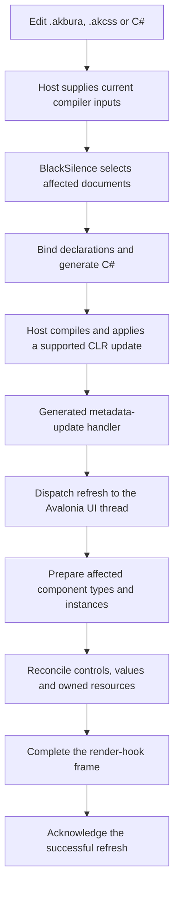
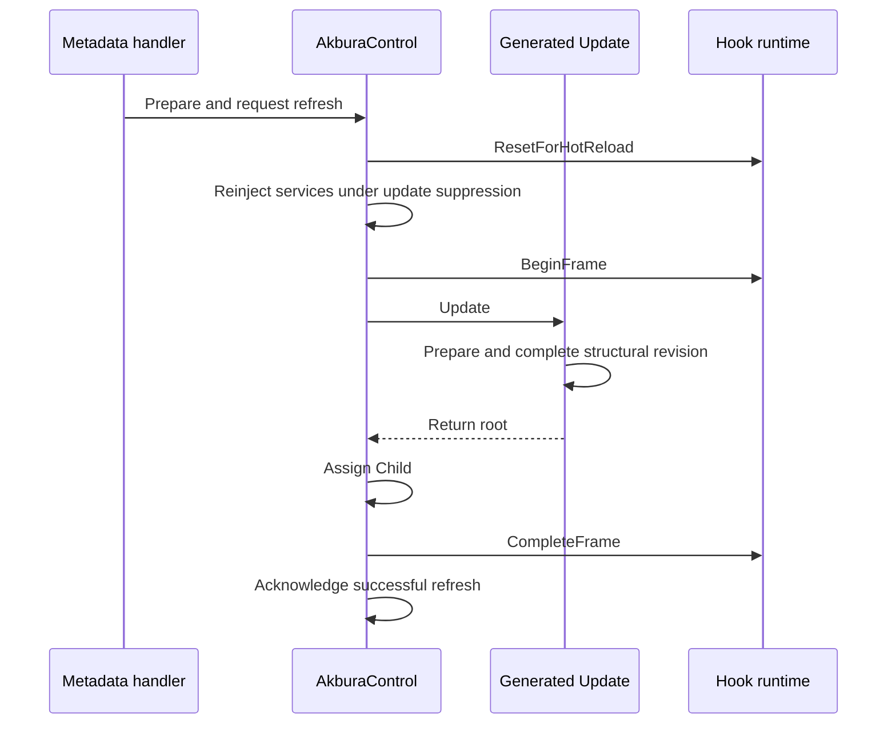

# How Hot Reload Works

Akbura Hot Reload changes the instructions used by an existing component. It does not normally replace the entire component or rebuild every control in its tree.

The process has two distinct layers:

- The development host and .NET compile an edit and apply supported changes to executable code and metadata.
- Akbura uses that updated code to reconcile existing component instances with the current declarations.

The runtime does not reread `.akbura` or `.akcss` files. Those files are compiler inputs; the running application receives generated C# through .NET Hot Reload.

The preservation rules follow identity and ownership: reuse compatible objects, leave unchanged declarations alone, and explicitly release resources whose declarations disappear. A successful update also has to complete its render-hook frame before it is acknowledged.

## Contents

- [The source-to-screen pipeline](#the-source-to-screen-pipeline)
- [Build-time inputs and module manifests](#build-time-inputs-and-module-manifests)
- [The generated component contract](#the-generated-component-contract)
- [Receiving and scheduling a metadata update](#receiving-and-scheduling-a-metadata-update)
- [Descriptors and component state](#descriptors-and-component-state)
- [Control identity and structural matching](#control-identity-and-structural-matching)
- [Names and lexical scopes](#names-and-lexical-scopes)
- [Values, collections, bindings and commands](#values-collections-bindings-and-commands)
- [AKCSS reconciliation and reactive updates](#akcss-reconciliation-and-reactive-updates)
- [Structural transactions and render hooks](#structural-transactions-and-render-hooks)
- [An example update](#an-example-update)
- [Supported boundaries](#supported-boundaries)
- [Diagnosing and testing an update](#diagnosing-and-testing-an-update)
- [Implementation map](#implementation-map)

## The source-to-screen pipeline



A failure near the start of this pipeline is not a runtime reconciliation failure. If compilation fails or the host rejects a metadata edit, the running component never receives the new instructions. Conversely, successful CLR application does not prove that the component's update, resource cleanup or effects completed.

## Build-time inputs and module manifests

### Selecting documents to regenerate

BlackSilence distinguishes a document's exported declaration surface from its implementation and source mappings.

An internal markup edit can require regenerating that document without changing the contract seen by its consumers. A changed parameter, state, command, injected service, namespace or other exported declaration can invalidate consumers as well.

The dependency graph includes component references, identifiers inside embedded C#, imports, aliases, binding paths and AKCSS dependencies. Loops, conditions and markup code blocks are traversed; treating their bodies as implementation does not mean ignoring the names used inside them.

AKCSS implementation dependencies include imported definitions and transitive `@apply` operations. Global-using documents have broad effects. Additions, removals and ambiguous names also change the declaration environment.

Incomplete markup, malformed embedded C# and unclassified syntax use conservative invalidation. The graph prefers additional work over incorrectly reusing a document whose dependencies are uncertain.

### Binding embedded C#

Akbura binds embedded C# using synthetic Roslyn syntax trees and semantic models. Those probes must preserve the document's imports, namespace, declarations, lexical scope, preceding statements, local functions, state substitutions and target conversions.

`BindingSession.ProbeContext` belongs to one document semantic model in one immutable `AkburaCompilation`. It shares compatible syntax preparation within that context, including component scaffolding, projected declarations and method syntax. It is not a process-wide cache and is not transferred to another document or compilation.

Type-binding results can be reused when the exact type syntax and ordered imports match within the owning context. General expression and statement results are not cached merely by source text. Hook probes also require the same invocation, hook symbols and state-argument substitutions.

Diagnostic reuse is scoped to the exact Roslyn semantic model. A covering-span result can answer a contained query, but diagnostics are filtered for that target's locations and suppression rules. Unrelated models and revisions do not share diagnostic results. Canceled work cannot publish reusable project state.

### Generating the module manifest

The MSBuild integration embeds two kinds of resources:

- `!Akbura`: the XML module manifest, containing component signatures, AKCSS declarations, source paths and source positions.
- The raw `.akbura` and `.akcss` source files under their logical resource names. Global-using files are embedded but are not exported as ordinary module declarations.

The manifest is compile-time module metadata, not an alternative runtime interpreter. Generating it requires a C# semantic environment, so its inputs include more than markup files.

The targets separate validation, generation and resource registration:

| Target | Responsibility |
| --- | --- |
| `_CheckAkburaModuleManifest` | Resolve references, prepare SDK-generated C# inputs and validate the complete input/output state. |
| `GenerateAkburaModuleManifest` | Run parsing, Roslyn binding and XML generation only when validation requires it. |
| `_RegisterAkburaModuleResources` | Register the manifest and current sources before `AssignTargetPaths`, including when generation is skipped. |

The input fingerprint includes normalized paths, complete ordered source/C#/reference sets, source logical names, file contents, compiler settings and task/generator implementation identities. It uses SHA-256 rather than relying on timestamps or file sizes. Replacing a file while preserving its size and timestamp therefore still invalidates the result.

Compiler settings include `AssemblyName`, `RootNamespace`, `ProjectDirectory`, `DefineConstants`, `LangVersion`, `Nullable` and `AllowUnsafeBlocks`. Project, configuration, TFM, RID, intermediate path and manifest output path distinguish build contexts. The cache schema and manifest format are versioned independently.

The default manifest path is `$(IntermediateOutputPath)Akbura.module.xml`; `AkburaModuleManifestPath` can override it. The small `Akbura.module.<context-hash>.cache.json` state stores the input fingerprint and successful XML checksum under the intermediate directory. It does not store Roslyn objects.

A valid hit performs no Akbura/C# parsing, Roslyn compilation or XML serialization. A missing or modified XML file, corrupt state, changed input set, changed option or changed tool deployment requires generation. Identical generated XML is not rewritten.

Successful state is published only after manifest generation and writing succeed. Output/state replacement is atomic, and inputs are checked again around generation. Failed generation cannot mark the result current. The builder can use recovery types while Csc/source generators report semantic errors; a later compiler failure is not the same as failed manifest construction.

The manifest retains `LogicalName=!Akbura`, `WithCulture=false` and `Visible=false`. Resource registration runs on every qualifying build so a recompiled DLL still embeds its resources on a manifest cache hit. Manifest, state and lock files participate in SDK file-write tracking; an explicitly external output can survive SDK clean, but missing intermediate state forces revalidation/generation.

An exclusive `<manifest>.lock` protects validation/generation and records the owning context. Sharing a custom output between different contexts fails clearly. This lock does not lease the entire SDK/Csc output directory: simultaneous builds with different inputs must use separate intermediate/output paths. Source and reference files should remain stable during a build.

Both tasks use `TaskHostFactory` isolation so their assemblies remain rebuildable. Generation/resource registration require `AkburaEmbedSourceFiles=true`, `BuildingProject=true` and `DesignTimeBuild!=true`. Editor `AdditionalFiles` integration remains independent of that gate.

Custom targets that generate `Compile` items used by module signatures must run before `_CheckAkburaModuleManifest`. The manifest task does not run Roslyn analyzers to obtain analyzer-generated sources.

## The generated component contract

When the consuming parse options contain `DEBUG`, the generator selects `DebugStructural`. Otherwise, its default representation is `ReleaseDirect`. Conditional and deferred scopes have their own generated lifetime paths; they must not be treated as eager component-scope elements.

In structural generation, eagerly created component-scope controls live in an `AkburaRenderState`. Generated methods describe the current tree, construct missing nodes and access retained objects through the runtime store.

| Generated member | Purpose |
| --- | --- |
| `__akburaRenderState` | Holds the applied live-node and ownership snapshot. |
| `__AkburaCurrentRenderRevision()` | Returns the current structural fingerprint. |
| `__AkburaDescribeRenderTree(...)` | Describes nodes, parents, destinations and identities. |
| `__AkburaCreateRenderNode(int)` | Constructs a node that cannot be reused. |
| `__AkburaEnsureRenderTree()` | Begins reconciliation when the plan changed or was invalidated. |

For example, generated code can retrieve a retained control with:

```csharp
var button = __akburaRenderState.GetRequired<Button>(2);
```

The number is a local identifier in the current plan, not a permanent identity across edits. Adding an eager unnamed element can change description/factory method bodies without introducing another per-element CLR field.

This representation reduces metadata-shape changes; it does not make every source edit a method-body-only edit. Named accessors, descriptors, types, signatures and compiler-generated closures can still change CLR metadata. The development host decides whether it can apply those changes.

Direct generation uses direct references and fields where appropriate. Structural preservation guarantees should not be assumed for every non-structural execution path.

## Receiving and scheduling a metadata update

### The generated handler

`HotReloadServiceWriter` emits an assembly-specific metadata-update handler under `#if DEBUG`. Its entry points are:

```csharp
internal static void ClearCache(Type[]? updatedTypes)
internal static void UpdateApplication(Type[]? updatedTypes)
```

`ClearCache` invalidates affected AKCSS observed-property metadata. `UpdateApplication` performs component refresh selection and dispatches to `Dispatcher.UIThread` when called off the Avalonia UI thread.

With an unknown type set, or an update to the generated handler itself, the handler refreshes all components it knows. With a concrete type set, it selects affected components and consumers of affected generated AKCSS modules. Selection considers containing types and relevant base types, then orders base component types before derived types.

The handler calls each selected type's `__AkburaHotReloadApply()` and collects failures so one type's failure does not prevent attempts for the others. This selection is not a general dependency graph for arbitrary service/helper methods.

### Type preparation and live instances

The generated apply method reconciles descriptor/state shapes and publishes a preparation callback for instances of that component type.

`AkburaComponentRegistry` tracks participating attached instances through weak references. `AkburaHotReloadRuntime` keeps per-instance scheduling/application state in a `ConditionalWeakTable`, and retains the latest preparation callback per type. A type callback must not capture a particular component instance.

For an attached instance, preparation invalidates the relevant generated snapshots and calls `AkburaControl.ApplyHotReload`. Component updates are suppressed while render hooks reset, services are reinjected and a new update request is recorded. Leaving suppression allows the requested update to run against a coherent prepared state.

A detached older instance can catch up on its next participating attach. Missed updates for the same type are coalesced into the latest callback, not replayed one by one. An instance created after publication starts from that creation revision and does not replay older updates.

### Scheduling is not acknowledgment

Several identities serve different purposes:

| Identity | What it describes |
| --- | --- |
| Descriptor/state shape | Generated declaration compatibility. |
| Render fingerprint | The structural plan. |
| Global refresh revision | Ordering of published type refreshes. |
| Component creation revision | Refreshes that predate an instance. |
| Request generation | Which scheduled instance update completed. |
| Plan `LocalId` | A position in the current plan's lookup space. |
| Runtime `NodeId` | A retained live node across plans. |

The runtime acknowledges a refresh only after generated `Update()` returns, the component's `Child` is assigned and the render-hook frame completes. A pending or failed request is not recorded as applied just because preparation ran.

Reentrant requests are drained without recursively applying the same refresh. If an update fails, its pending request can be retried by subsequent update processing or another refresh.

## Descriptors and component state

### Descriptor identity

Parameters, injected services and commands have stable descriptor keys based on semantic identity, including names, types, kinds or signatures. Their shape fingerprint includes additional behavior-affecting declaration details such as parameter flags and default-value syntax.

`AkburaHotReloadMetadata` stores applied shapes and the property manifest in a runtime weak table keyed by component type. Reading this metadata ensures the type's initial descriptor registration has run, including when descriptors are accessed before any instance is constructed.

When a shape changes, generated code removes obsolete registrations, finds compatible existing property objects and creates replacements where needed. Compatible Avalonia property identity is retained because live instances already associate values with those property objects.

`AvaloniaPropertyRegistryHotReload` encapsulates compatibility with Avalonia's internal property registry. It unregisters specific generated declarations and clears relevant registry caches. An incompatible private layout fails explicitly. This registry adapter is separate from AKCSS value ownership; it is not a license to manipulate private value-store internals.

### Ordinary states

Debug state access uses `StateCollection.GetOrCreate<T>` through the component's runtime state storage. Its factory runs only when that identity needs a state object. User-facing properties such as `count` continue to access the retained state's value.

A state's identity includes its name, value type and factory kind. Its initializer expression is not part of compatibility. For example:

```akbura
state int count = 0;
```

Changing the initializer to `100` does not replace an existing compatible state or overwrite the user's current count. New instances and newly required identities use the current initializer. Renaming the state or changing its type requires a different identity; there is no automatic value migration between incompatible identities.

`__AkburaHotReloadResetStates()` invalidates cached state snapshots rather than clearing all ordinary states. Removed states release their component ownership so later writes to an obsolete state do not keep scheduling that component.

Release generation can retain direct state fields and static state metadata; do not infer its CLR metadata contract from the Debug runtime-store representation.

### State-producing hooks and aliases

A hook used in a state declaration, for example:

```akbura
state double width = useAvaloniaProperty(Width);
```

belongs to state storage, not automatically to the positional render-hook frame.

Composed hook aliases are staged in a runtime state transaction. A successful frame publishes the aliases and reconciles removed state resources. Aborting restores the committed aliases and cached snapshot. Resetting render hooks therefore does not imply recreating all component state or rerunning every state initializer.

## Control identity and structural matching

### The render plan

`AkburaRenderNodeDefinition` describes each node with:

| Field | Meaning |
| --- | --- |
| `LocalId` | Dense lookup identifier within the current plan. |
| `ParentId` | Current parent; the root uses `-1`. |
| `Slot` | Semantic destination, such as a content property or children collection. |
| `Type` | Exact runtime type expected from the factory. |
| `ExplicitKey` | Optional source identity derived from `x.Name`. |
| `SyntaxIdentity` | Fingerprint of the node's own normalized declaration. |

The builder validates a single root, dense IDs, parent-before-child order and unique explicit keys within a parent/slot group.

A node's syntax identity includes its own start tag and non-element body content, excluding trivia and nested element declarations. Inserting a child does not by itself change its parent's own declaration identity. Meaningful text is still content, not disposable formatting.

### Matching an applied tree to a desired tree

Matching is scoped to a retained parent identity and a semantic slot. The runtime processes parents before children and applies these passes to each sibling group:

1. Match explicit keys with equal keys and exact runtime types.
2. Match unkeyed nodes with equal syntax identities and exact types. Prefer the closest old sibling position, with deterministic tie breaking.
3. Match remaining unkeyed nodes by exact type in old sibling order.
4. Construct missing nodes using the current generated factory.

Keyed nodes do not fall back to unkeyed matching. General assignability is not enough: a different derived control type is not the same compatible node.

Reused nodes retain their object reference and runtime `NodeId`, even when their `LocalId` changes. A factory must not return null, the wrong concrete type or an object already assigned to another node. Newly created `ISupportInitialize` objects follow their initialization lifecycle.

For example, removing `Hello` from this group:

```akbura
<StackPanel>
    <TextBlock Text="Hello" />
    <TextBlock Text="Hi" />
</StackPanel>
```

retains the existing `Hi` TextBlock through exact syntax matching. It does not reuse `Hello` just because `Hi` now has its former local ID. Changing a single unkeyed TextBlock's literal can instead retain it through exact-type fallback and reconcile the changed property.

Two identical unkeyed siblings do not reveal an author's business identity. Matching is deterministic, not an inference of invisible keys. Moving a node to another parent or slot also does not guarantee reuse.

## Names and lexical scopes

Avalonia does not allow assigning `StyledElement.Name` after styling, including assigning the same name again. Generated structural `x.Name` initialization therefore runs only for a newly created node, before initialization/styling completes.

`x.Name` also supplies the node's explicit matching key. Changing, adding or removing the name declaration creates an incompatible node rather than renaming a styled retained object. Compatible parents and siblings can remain; descendants follow the replacement parent's identity. Generated named accessors resolve objects through the current store.

NameScope registration is distinct from assigning the CLR `Name` property. A scope is compatible when its ordered `(name, instance)` registrations and parent scope match, using ordinal name comparison and object-reference identity. An unchanged map retains the completed native scope; a changed map gets a separate lookup.

Component roots expose their native scope through tracked ownership. Root replacement, scope replacement and scope attachment participate in structural recovery. Rollback restores lookups and attachments, not an illegal assignment to an old styled control's name.

Templates and local scopes keep independent lexical lookups. Foreach registrations are scoped to their source occurrences rather than merged into one component-global scope. These rules do not provide an API for dynamically renaming styled controls from arbitrary user code or bindings.

## Values, collections, bindings and commands

### Property declarations versus live values

Preserving a control reference is insufficient if every refresh overwrites its live values. Property reconciliation therefore compares the owned declaration, target and property separately from the element's overall syntax identity.

Consider a user typing into:

```akbura
<TextBox Text="Generated" Width="100" />
```

Changing only `Width` to `200` can retain the same TextBox, update Width and preserve the user-entered Text. An unchanged Text declaration does not need to be assigned again.

`ReconcileClrValue` and `ReconcileAvaloniaValue` capture an ownership baseline when a declaration takes control. Changing the declaration reapplies its desired value without making each intermediate value the original baseline. Omitting the declaration releases ownership and restores the recorded baseline.

That baseline is not necessarily the latest value written by application code. These rules also do not prevent ordinary dynamic expressions or user callbacks from assigning properties during normal updates.

### Collections and scalar children

`AkburaRenderCollectionReconciler` owns generated occurrences, not an entire collection. It moves/inserts desired generated items and removes obsolete owned occurrences while preserving unrelated items:

```text
Live collection:     [External, A, B]
Previously owned:    [A, B]
Desired generated:   [B, C]
Reconciled result:   [External, B, C]
```

Reference-type items are matched by reference; value-type collections use value equality. Avalonia collections use native move operations where available, otherwise removal/insertion. The insertion anchor preserves placement even when the generated segment temporarily becomes empty.

A read-only collection or a missing previously owned occurrence is an explicit error. Component-owned collections also synchronize logical children. Scalar child properties can release an omitted child without replacing its parent.

### Resource-owning operations

Bindings, subscriptions and event handlers need explicit cleanup when replaced or removed. Their operation slot identifies a semantic destination; declaration identity describes what currently occupies it.

| Resource | Structural API |
| --- | --- |
| Avalonia binding | `ApplyBindingOperation` |
| Observable binding | `ApplyObservableBindingOperation` |
| CLR event handler | `ApplyClrEventOperation` |
| Routed event handler | `ApplyRoutedEventOperation` |
| AKCSS cascade | `ApplyAkcssStylesOperation` / `ReconcileAkcssStylesOperation` |

An unchanged compatible operation can retain its resource. Replacements install current resources and release obsolete ones; omission releases the owned operation during completion preparation. The implicit root DataContext binding follows this ownership model too.

A value declaration and an owned operation cannot claim the same node slot in one pending revision. A literal-to-binding transition must release the preceding kind of ownership explicitly.

### Fresh command closures

A command that captures render-local values needs a current callback even if its binding expression has the same syntax. Generated command reconciliation can compare the desired callback value rather than relying only on that syntax.

Structural source initialization reconciles such a command once in the pending revision. The ordinary callback-refresh pass avoids registering the same command slot again during that revision, but still refreshes captured values on subsequent ordinary frames. Duplicate-slot validation remains an error; it is not a mechanism for choosing whichever callback was registered last.

## AKCSS reconciliation and reactive updates

### Cascade revisions and current factories

A Debug AKCSS cascade has a semantic revision independent of the element's markup fingerprint. It includes emitted activator behavior and revisions of referenced definitions, including transitive `@apply` content. Runtime observable values are not declaration revisions.

Generated revision methods and `__AkburaGetStyle(index)` return current code/data after CLR updates. Correctness does not rely on rerunning static initializers or using an old static styles array.

An unchanged cascade retains its owned resource. A changed, supported utility-only cascade can reconcile individual declarations rather than recreate the whole cascade.

### Matching utility declarations

`AkcssUtilityHotReloadDescriptor` separates declaration identity, utility family, syntax anchor and semantic revision. Unique `(Family, SyntaxIdentity)` anchors match first. A single remaining old/new declaration in a family can represent a modified declaration. Ambiguous repeated anchors are replaced rather than guessed by position; unique neighbors remain eligible for retention.

Compatible candidates with equal revisions are retained by reference. Added, modified and ambiguous declarations invoke current lazy factories. Module index changes or uncertain value-source contexts can conservatively require more replacement.

The desired snapshot's array index supplies effective source precedence without mutating retained candidates' immutable source-order metadata. Reordering declarations therefore changes conflict resolution without requiring every retained object to be reconstructed.

### Subscriptions and affected properties

Retained candidates keep compatible arguments, observable variants, watchers and property contributions. Replacements attach provisionally; obsolete subscriptions retire at commit. Retired observers are deactivated before disposal, ignore late notifications and drop references to old sources.

The runtime resolves the union of old/new conflict keys affected by addition, removal, revision changes or conflicting reorders. Multi-property utilities contribute every affected key. Removing a winner can expose a retained shadowed candidate. Unrelated keys are not reset or executed just because another utility changed.

Snapshot-local indexes map keys to their candidate operations and static conflict metadata. Dynamic readiness, activation, variants and priorities are evaluated when resolving a key; the runtime does not cache a permanently winning candidate.

The reconciled array is published to `AkburaControl.AkcssStylesProperty`. Only the matching self-notification is suppressed for that target/publication. A conflicting reentrant external replacement is rejected instead of silently diverging from the runtime snapshot.

### Property-contribution ownership

Not every property write is independently reversible:

| Operation | Guarantee |
| --- | --- |
| Styled/attached property at supported explicit Animation, StyleTrigger, Template or Style priority | An owned contribution can be suspended, resumed and disposed through its Avalonia handle. |
| Ordinary LocalValue utility assignment/binding | Compatibility path; no independent reversible local-source guarantee. |
| Direct property, arbitrary CLR setter, class or interceptor effect | No general transactional reversal of arbitrary side effects. |

An owned `AkcssPropertyContribution` captures its target, property, priority and binding source. Suspension publishes UnsetValue through that source instead of calling ClearValue on the target. Resuming republishes the captured value; disposing releases its own source/handle. Removal can therefore reveal an underlying live value or binding naturally.

LocalValue has a different contract: SetValue does not provide an independent reversible layer, and a local Bind replaces an existing local binding. AKCSS preserves ordinary LocalValue precedence rather than globally changing priorities to simulate ownership. It does not recreate external bindings from `GetValue()` snapshots or access private Avalonia value-store internals.

### Staging and rollback

Supported reconciliation prepares descriptors and replacements without executing operations merely to validate them. Application suspends affected owned contributions, attaches replacements and stages the new ordered snapshot.

Commit retires obsolete sources before releasing old suspended contributions. Rollback restores arrays, descriptors, precedence and original owned handles. Unaffected handles and subscriptions are not recreated. Compatibility operations use their reset/reapply compensation path, with its narrower guarantees.

Invalidations and resource publications queue against the pending transition. Commit drains against the installed snapshot; abort restores the applied snapshot before draining. Detached targets do not attach new sources or execute styles; reattachment activates the applicable snapshot.

### Synchronous batching

`AkburaControl.BeginAkcssUpdate(target)` opens a target-local, nestable synchronous batch:

```csharp
using (AkburaControl.BeginAkcssUpdate(target))
{
    backgroundSource.Publish(first);
    backgroundSource.Publish(latest);
    paddingSource.Publish(padding);
}
```

Disposing the outer scope resolves pending keys with their latest inputs. A key is deduplicated while pending; distinct properties still represent distinct work. Unbatched notifications take effect synchronously. Scopes stay on the target's Avalonia thread and must not span asynchronous work.

Structural revisions also hold styled targets through commit/abort so callbacks do not resolve against half-applied ownership. One iterative drain handles key invalidations and resource publications. A reentrant invalidation can enqueue a key again after execution begins, without recursion or lost work. Non-converging application feedback is not silently discarded.

Eligible Debug scalar operations can republish through an existing active contribution when target, property and priority match. A different winner/priority, unsupported operation or suspended handle uses replacement. Resource-backed sources retain their subscription semantics.

`AkcssUtilityValueSource.WithEqualityPolicy(...)` is explicit opt-in. `AlwaysNotify` is the default; `ImmutableScalar` suppresses equal supported immutable scalars without invoking arbitrary user Equals; `ReferenceEquality` is a caller-owned identity contract. Mutable values and notification-dependent utility code must not silently lose emissions.

### Conservative replacement

Changed class/mixed cascades, interceptors, custom/legacy operations, unknown revisions, unsupported converters and uncertain scope ownership can require complete replacement. Unchanged complete cascades can still be retained by their revision guard. Incremental matching does not imply independent property ownership, and either mechanism does not make arbitrary user effects reversible.

## Structural transactions and render hooks

### Applied and pending structural snapshots

`Invalidate()` clears the applied render fingerprint while retaining live objects. `BeginRevision()` matches the current plan against that applied snapshot and opens a pending revision when required.

The generated update follows this order:

1. Ensure the render tree and register current declarations.
2. Apply tracked values, collection changes and owned operations.
3. Run ordinary dynamic update work.
4. Prepare completion, including omission cleanup and initialization completion.
5. Refresh component content presenters.
6. Complete the structural revision and return its root.

`PrepareRevisionCompletion()` is not publication. It keeps content-presenter refresh inside the structural recovery boundary. `CompleteRevision()` publishes the pending nodes and ownership snapshot. Failure while a revision is pending aborts it and attempts tracked restoration; rollback failures are preserved with the original error.

These transactions cannot undo applied CLR IL, arbitrary constructor/callback effects or every ordinary dynamic assignment. A custom source that fails to unsubscribe or throws before returning a handle also cannot acquire guarantees the runtime does not have.

### Render-hook frames

Render hooks use a positional frame. Ordinary rendering checks registration count, contract keys and runtime state types against the preceding frame.

Hot Reload calls `UseHookRuntime.ResetForHotReload()` before service reinjection and the requested update. Old slots are removed from the active frame and stopped; the next completed frame creates current slots/callbacks. A reset requested during collection/completion is deferred to a safe boundary.

An effect with empty dependencies runs in the fresh frame. Adding/removing hooks across Hot Reload does not require migrating the preceding positional frame, but conditional hook calls during ordinary rendering still have to satisfy its positional contract.

Detach is different: it suspends hook application and stops active resources while allowing slot state to remain available for reattachment. Cleanup attempts independent slots even when one throws.

### The completion boundaries



Structural publication happens inside generated `Update()`. Hook completion and refresh acknowledgment happen afterward. A hook failure can therefore leave a committed structural tree and an unacknowledged request. These boundaries are not one application-wide atomic commit.

## An example update

Suppose an existing component contains:

```akbura
using Avalonia.Controls;

state int count = 0;

<StackPanel>
    <TextBox x.Name="query" Text="Search" Width="100" />
    <TextBlock Text={count.ToString()} />
</StackPanel>
```

The user edits the TextBox and increments `count` through application behavior. The source then changes only Width to `200` and adds another child.

The component's source must be regenerated, but an unchanged exported contract does not by itself require regenerating every consumer. The host compiles/applies the supported update and the generated handler schedules the existing instance.

The runtime can retain the StackPanel, the keyed `query` TextBox and compatible unkeyed children. It constructs the additional child and reconciles the owned collection segment. The unchanged Text declaration leaves user input alone; the changed Width declaration applies `200`. The retained TextBox is not assigned its Name again, and an unchanged scope map keeps its lookup.

The compatible `count` state retains its current value rather than rereading `0`. Render hooks reset and use current callbacks. Owned bindings/styles/events retain or replace resources according to their declaration and revision contracts. Only after the update and hook frame complete is the refresh acknowledged.

Changing `x.Name`, a control's concrete type or the state's type is a different edit: it changes compatibility. The runtime creates replacements where needed, and the CLR host must also accept the resulting metadata changes.

## Supported boundaries

- CLR edit support belongs to the development host/runtime. Akbura reconciliation cannot make a rejected metadata change apply.
- Runtime node identity is not a local plan ID, sibling index or overridden Equals result.
- Matching stays within a compatible retained parent and semantic slot; arbitrary reparenting is not guaranteed to preserve instances.
- Ordinary state preservation requires compatible declaration identity, not automatic migration between types or names.
- Preservation applies to tracked ownership. Arbitrary user code can still overwrite values or mutate collections outside that contract.
- LocalValue writes and arbitrary effects do not have the reversible contribution guarantees of supported explicit property layers.
- Static initialization is not a refresh mechanism. Current factories and revision methods must supply updated behavior.
- Structural completion, hook completion and successful refresh acknowledgment are separate boundaries.
- Cancellation/failure must not publish partially constructed generator state or successful manifest cache state.
- Debug structural generation, conditional scopes and Release direct generation have different metadata/lifetime contracts and need separate coverage.

## Diagnosing and testing an update

First identify which layer has not completed:

| Observation | Inspect |
| --- | --- |
| No new generated code or compiler error | AdditionalFiles, dependency classification, C# probes and compiler diagnostics. |
| Host requests restart/rejects an edit | The generated CLR metadata change and the host's edit capabilities. |
| No affected instance refresh | Handler filtering, UI dispatch, registry participation and detached catch-up. |
| Controls unexpectedly replaced | Parent/slot grouping, explicit keys, exact type and syntax identities. |
| Live input/state overwritten | Declaration identity, property baseline, state identity and ordinary dynamic assignments. |
| Duplicate callbacks or stale style effects | Owned operation slots, command closure refresh, disposal and AKCSS candidate revisions. |
| Update applied but request remains pending | Structural error, Child assignment, hook completion and acknowledgment. |
| Unchanged builds still do semantic work | Manifest validation reason, input changes, actual task execution and Csc execution in a binary log. |

Use a build binary log to separate MSBuild/task cost from compiler generation and runtime refresh:

```powershell
dotnet build path/to/App.csproj --no-restore -bl:hot-reload.binlog
dotnet watch --project path/to/App.csproj
```

Do not infer that Csc ran merely because its containing target was visited, or that a manifest task ran because its output exists. Likewise, successful compilation or a generator timing does not measure when the live control updated.

`DebugStats` and `ReleaseStats` enable optional generator instrumentation. Conservative dependency rows report source path, syntax kind/span and cause. Probe counters distinguish requests, created trees/compilations/models and actual diagnostic queries. Stage durations are inclusive worker measurements, not additive end-to-end wall time. Normal builds do not need this instrumentation.

Regression coverage should check observable contracts rather than hard-coded timing thresholds:

- Apply actual CLR deltas to the same instances; a fresh assembly/component does not establish preservation.
- Test insertion/removal, ambiguous siblings, explicit names, conditional/template/foreach scopes and mixed collection ownership.
- Distinguish an initializer edit from a changed state identity; distinguish state hooks from render-hook slots.
- Check user-entered values, live external bindings, command captures, obsolete subscriptions and late callbacks.
- Inject failures before publication, during completion, in disposal and in hook frames; verify retry and the correct recovery boundary.
- Test detached catch-up separately from ordinary updates.
- Compare fresh and reused generated artifacts, and inspect emitted metadata rather than only source text.
- For manifests, use actual SDK builds and a packed consumer, and force Csc while generation is skipped to verify embedded resources.

## Implementation map

| Area | Sources |
| --- | --- |
| Generator inputs and dispatch | [AkburaBlackSilenceGenerator](../src/Akbura.BlackSilence/AkburaBlackSilenceGenerator.cs), [DocumentSyntaxVersion](../src/Akbura.Generator/Language/CodeGeneration/DocumentSyntaxVersion.cs), [AkburaDependencyGraph](../src/Akbura.Generator/Language/CodeGeneration/AkburaDependencyGraph.cs) |
| Embedded C# binding | [CSharpProbeBinder](../src/Akbura.Generator/Language/Binder/CSharpProbeBinder.cs), [CSharpProbeContext](../src/Akbura.Generator/Language/Binder/CSharpProbeContext.cs), [CSharpProbeDiagnostics](../src/Akbura.Generator/Language/Binder/CSharpProbeDiagnostics.cs) |
| Module build integration | [Akbura.targets](../src/Akbura/buildTransitive/Akbura.targets), [CheckAkburaModuleManifest](../src/Akbura.Build.Tasks/CheckAkburaModuleManifest.cs), [AkburaManifestCache](../src/Akbura.Build.Tasks/AkburaManifestCache.cs), [GenerateAkburaModuleManifest](../src/Akbura.Build.Tasks/GenerateAkburaModuleManifest.cs) |
| Update handler and declaration identity | [HotReloadServiceWriter](../src/Akbura.BlackSilence/HotReloadServiceWriter.cs), [ComponentHotReloadWriter](../src/Akbura.Generator/Language/CodeGeneration/ComponentHotReloadWriter.cs), [ComponentHotReloadIdentity](../src/Akbura.Generator/Language/CodeGeneration/ComponentHotReloadIdentity.cs) |
| Structural generation | [ComponentPlanner](../src/Akbura.Generator/Language/CodeGeneration/ComponentPlanner.cs), [ComponentStructuralHotReloadWriter](../src/Akbura.Generator/Language/CodeGeneration/ComponentStructuralHotReloadWriter.cs), [ComponentLifecycleWriter](../src/Akbura.Generator/Language/CodeGeneration/ComponentLifecycleWriter.cs) |
| State and descriptor storage | [StateWriter](../src/Akbura.Generator/Language/CodeGeneration/StateWriter.cs), [StateCollection](../src/Akbura/ComponentTree/StateCollection.cs), [AkburaHotReloadMetadata](../src/Akbura/HotReload/AkburaHotReloadMetadata.cs), [AvaloniaPropertyRegistryHotReload](../src/Akbura/HotReload/AvaloniaPropertyRegistryHotReload.cs) |
| Instance lifecycle | [AkburaHotReloadRuntime](../src/Akbura/HotReload/AkburaHotReloadRuntime.cs), [AkburaComponentRegistry](../src/Akbura/ComponentTree/AkburaComponentRegistry.cs), [AkburaControl](../src/Akbura/AkburaControl.cs), [UseHookRuntime](../src/Akbura/Hooks/UseHookRuntime.cs) |
| Structural reconciliation | [AkburaRenderPlanBuilder](../src/Akbura/HotReload/AkburaRenderPlanBuilder.cs), [AkburaRenderState](../src/Akbura/HotReload/AkburaRenderState.cs), [AkburaRenderCollectionReconciler](../src/Akbura/HotReload/AkburaRenderCollectionReconciler.cs) |
| AKCSS ownership and scheduling | [AkcssRuntime.Reconciliation](../src/Akbura/Akcss/AkcssRuntime.Reconciliation.cs), [AkcssRuntime.Updates](../src/Akbura/Akcss/AkcssRuntime.Updates.cs), [AkcssRuntime.ConflictIndex](../src/Akbura/Akcss/AkcssRuntime.ConflictIndex.cs), [AkcssPropertyContribution](../src/Akbura/Akcss/AkcssPropertyContribution.cs) |
| Tests | [Unit tests](../src/Akbura.UnitTests), [CLR Hot Reload integration tests](../src/Akbura.HotReloadIntegrationTests) |
