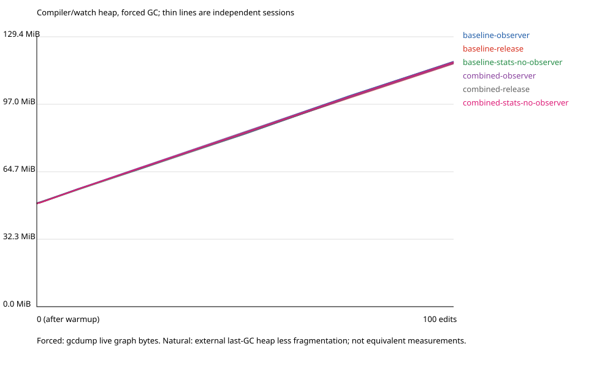
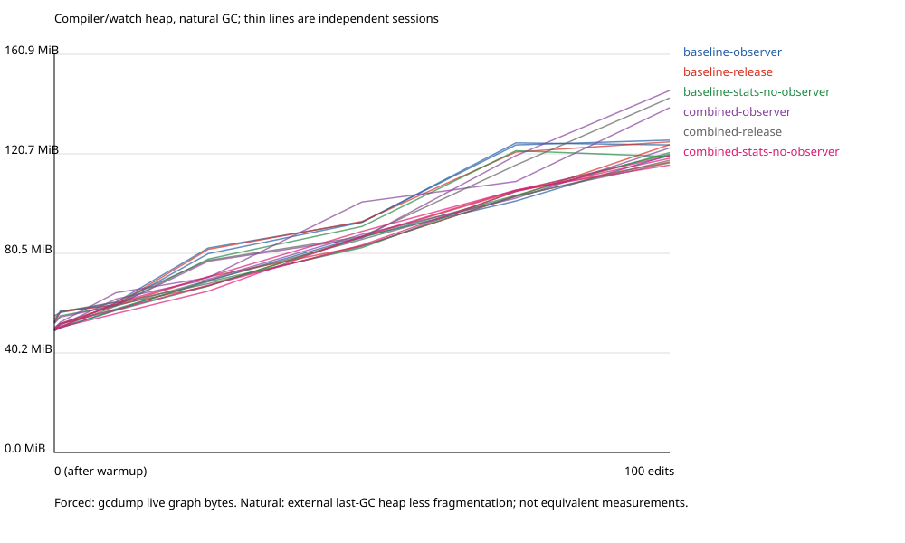

# Watch memory: completed 100-edit matrix and preliminary retention review

The matched memory matrix is complete: **36 independent sessions, 3,600 measured live updates, 72 warmup updates and 864 process/checkpoint rows**. All archived runtime gates passed, with no application restarts or subscription failures. This report is a new analysis of those existing measurements, not another benchmark run.

**The observed post-GC growth is not specific to semantic reuse or the recorder.** All six configurations retain approximately 67-68 MiB more compiler/watch memory after 100 edits. The object graphs show revision-proportional Roslyn compilation and Edit-and-Continue baseline retention in both Baseline and Combined. They do not demonstrate an Akbura semantic-cache leak. They also do not establish that every additional byte belongs exclusively to Roslyn or that this lifetime is an SDK defect.

Experimental defaults and production implementation are unchanged. The full heavy-component critical-path study and any selective longer session remain outside this completed 100-edit memory matrix.

## Repeated memory results

Three independent sessions per configuration and GC mode were collected. MiB means 1,048,576 bytes. Growth below is the median of each session's warmup-to-revision-100 difference; ranges are observed minima/maxima, not confidence intervals.

| Compiler/watch configuration | Forced-GC growth, median MiB | Observed range, MiB |
| --- | ---: | ---: |
| Baseline, non-STATS Release | 67.17 | 67.02-67.53 |
| Combined, non-STATS Release | 67.57 | 67.54-67.67 |
| Baseline, STATS with observer | 68.00 | 67.28-68.19 |
| Combined, STATS with observer | 67.43 | 67.04-67.81 |
| Baseline, same STATS binary, observer off | 67.60 | 67.38-67.76 |
| Combined, same STATS binary, observer off | 67.64 | 67.55-67.72 |

The compiler/watch live graph starts near 49.4 MiB after warmup and ends near 117 MiB. Late-window slopes remain approximately 0.67-0.68 MiB per edit: there is **no observed plateau by revision 100**. A plateau beyond that point is untested.

The application is measured separately. Its forced-GC median growth is approximately 1.9 MiB across configurations, not the roughly 67-68 MiB compiler/watch increase. Application retaining owners were not profiled with full dumps, so that smaller growth is not attributed here.

Natural-GC measurements are noisier: compiler/watch median growth ranges from 68.50 to 89.28 MiB across configurations. Combined with the observer has higher natural-GC readings, but its forced-GC result is not higher than the Baseline recorder control. Natural last-collection observations and forced object-graph bytes are different estimators from different sessions; subtracting them is not an exact recorder retained-size measurement. Allocation effects and collection scheduling remain possible explanations, not established causes.

See the [generated statistics](statistics.md), [independent session summaries](memory-summary.csv), [configuration distributions](configuration-summary.csv), [round-paired differences](paired-compiler-differences.csv) and [complete checkpoint series](memory-series.csv). Memory profiling and checkpoint pauses disqualify these sessions as primary production latency evidence.





## Actual retained objects and owners

Full compiler/watch heap profiles were captured in the first forced-GC round for every configuration: six configurations at warmup, revision 50 and revision 100, for **18 profiles**. The repeated live-graph byte curves cover three rounds, but full type/root analysis was not repeated in rounds two and three.

All six first-round configurations have the same measured progression:

| Strong-root-reachable type | After warmup | Revision 50 | Revision 100 |
| --- | ---: | ---: | ---: |
| `Microsoft.CodeAnalysis.CSharp.CSharpCompilation` | 19 | 69 | 119 |
| `Microsoft.CodeAnalysis.Emit.EmitBaseline` | 3 | 53 | 103 |
| `Microsoft.CodeAnalysis.CSharp.SyntaxTreeSemanticModel` | 13 | 13 | 13 |
| `Microsoft.CodeAnalysis.CSharp.MethodBodySemanticModel` | 13 | 13 | 13 |

The [retaining-path excerpts](retaining-path-excerpts.json) include actual strong-root paths in both Baseline Release and Combined Release. Alongside the current workspace compilation paths, an older compilation is reachable through:

```text
dotnet watch main/watch async state
  -> HotReloadDotNetWatcher
  -> ManagedCodeWorkspace
  -> HotReloadService
  -> EditAndContinueService
  -> DebuggingSession
  -> project baseline dictionary / immutable baseline list
  -> ProjectBaseline
  -> EmitBaseline
  -> earlier EmitBaseline
  -> CSharpCompilation
```

This is a measured SDK/Roslyn live-session retaining path, not a hypothetical static-cache explanation. The additional type populations include Roslyn syntax nodes, symbol arrays/dictionaries, strings and character/byte arrays. For example, in Combined Release, `IdentifierNameSyntax` grows by 55,700 objects and `ISymbolInternal[]` by 77,600 objects. The largest positive shallow type deltas are saved in [top-type-growth.csv](top-type-growth.csv).

The paths are representative shortest strong-root paths; field names and exclusive transitive retained sizes remain unresolved. Counts and shallow bytes cannot prove that every growing object is obsolete, or assign the entire roughly 67-68 MiB increase to one owner. Retention during an active Edit-and-Continue session is demonstrated; a defect in that lifetime is not established.

## Semantic cache and instrumentation counterfactuals

In all three profiled Combined configurations, the compilation-bound probe store retains one store, one document generation, five projection entries and two reusable binding results at all three checkpoints. The observer's six Combined sessions independently report maxima of five projection entries and two semantic entries, ending with two operation roots, probe models, probe compilations and probe syntax trees. These are current-snapshot scalar observations, not the only retention oracle; they agree with the whole-heap type counts.

Across the six first-round configurations, the total shallow size of types whose name contains `Akbura.` (including generic containers) changes by only -864 to +1,560 bytes, while the whole root-reachable graph grows by approximately 69.7-69.9 million bytes. This type-name grouping **does not** include the transitive Roslyn graphs held by an Akbura object and is not an exclusive ownership calculation. It is supporting evidence, not proof on its own that no Akbura reference can retain another object.

No `GenerationStatisticsSession` instance is strong-root reachable in any of the 18 checkpoint profiles. The STATS profiles retain the expected single `AsyncLocal<GenerationStatisticsSession>` cell and a single pipeline recorder, rather than one session or recorder per revision. Source inspection agrees: observation identities are weak references, records are emitted scalars, and `GenerationStatisticsSession.Dispose()` restores the previous ambient scope. No observer-requested GC was recorded in any of the 12 observer-on sessions; forced collections came from the external checkpoint protocol only.

The non-STATS and same-binary observer-off controls still exhibit comparable post-GC growth. Therefore, neither semantic-result reuse nor observation instrumentation is supported as the primary cause of this particular retained-growth pattern. This does not establish zero observer allocation cost, zero cache overhead, or universal collectibility for other edit kinds.

Evidence: [focused type counts](focused-type-counts.csv), [whole-profile totals](profile-totals.csv), [observer bounds](observer-bounds.csv), original per-profile histograms and paths under [memory/runs](../memory/runs).

## Report repair and evidence integrity

The old controller completed all 36 sessions and failed only while selecting a counter sample for its report. At the first failing checkpoint, the nearest timestamp group contained only a CPU metric; complete GC data existed one second earlier. Counter callbacks can straddle timestamp boundaries or leave a partial final group.

The repaired report chooses the nearest group containing exactly one heap-size and one fragmentation metric for **each** of gen0, gen1, gen2, LOH and POH. The five-second skew limit is unchanged. It rejects missing, partial or duplicated generation sets instead of summing an incomplete heap or substituting zeros. Forced compiler/application checkpoints must also have their archived gcdump graph statistics. Optional unavailable metrics remain empty.

This selection rejected a nearer incomplete group in **24 of 864 process/checkpoint rows**. The selected timestamps and skew are recorded per row. Synthetic tests cover CPU-only tails, partial and duplicated generation sets, excessive skew, entirely missing GC data, missing forced-GC graph statistics, UTC/local conversion, optional nulls, slope calculation, incomplete sessions and immutable input files.

The [new postprocessing journal](journal.log), [completion status](status.json) and [provenance manifest](provenance.json) record the repaired report sources and hashes of every archived input. Before/after hashes match. The original measurement manifests, runtime results, raw counters, controller failure and partial failed attempts were not rewritten or relabeled. Derived statistics have their own [analysis provenance](analysis-provenance.json). No compiler/unit-test suite was rerun or counted again; the earlier 862 filtered executions remain historical evidence.

## Decisions and remaining work

| Question | Preliminary answer |
| --- | --- |
| Is revision-proportional live-session retention demonstrated? | Yes, through revision 100 in repeated live-graph byte curves and first-round object counts. |
| Is an Akbura semantic-cache leak demonstrated? | No. Bounded cache counts and matched controls do not support that attribution. |
| Are actual retaining owners identified? | SDK/Roslyn Edit-and-Continue baseline paths retain representative older compilations. Exclusive byte attribution and obsolete-lifetime classification remain open. |
| Is the recorder the main retained-growth cause? | Not supported by forced-GC, non-STATS and same-binary observer-off controls. Natural-GC/allocations still require separate interpretation. |
| Does the heap plateau? | Not by 100 edits; no 500-edit session was run. |
| Does this explain a one-minute property edit? | No. Memory retention is not a measured latency bottleneck, and these are not accepted production timing sessions. |
| Should cache ownership or defaults change? | No production fix is justified by this evidence; defaults remain disabled. |

The next ownership target is the SDK/Roslyn baseline lifetime, with field-resolved paths and (if a longer curve is necessary) selected matched Baseline/Combined extensions, not broad cache clearing. Separately, the already demonstrated real Purity Sidebar workload still needs non-STATS repeated timing and direct stage attribution before selecting a performance optimization. The 100-edit memory findings do not rank generator, EnC or runtime stages by elapsed-time impact. No additional long run, cache redesign, experimental activation, commit or push was launched by this report repair.

## Reproduce the report without rerunning measurements

Run from the repository root and choose a fresh output directory:

```powershell
$memoryEvidence = 'benchmarks/HotReload/results/2026-10-22-watch-memory-attribution/channel-recovery/validated'
$memoryReport = 'bin/WatchMemory/report-review-new'
pwsh -NoProfile -File benchmarks/HotReload/Complete-WatchMemoryReport.ps1 `
    -ResultDirectory $memoryEvidence -OutputDirectory $memoryReport
pwsh -NoProfile -File benchmarks/HotReload/Analyze-WatchMemory.ps1 `
    -ResultDirectory $memoryEvidence -SummaryDirectory $memoryReport
```

The first script reruns only the report guard and read-only postprocessing. It does not build projects, start an application/watch process, request GC or repeat any measurement. The original controller journal intentionally still ends with its historical report-generation failure; use this report's completion status for the repaired postprocessing outcome.
